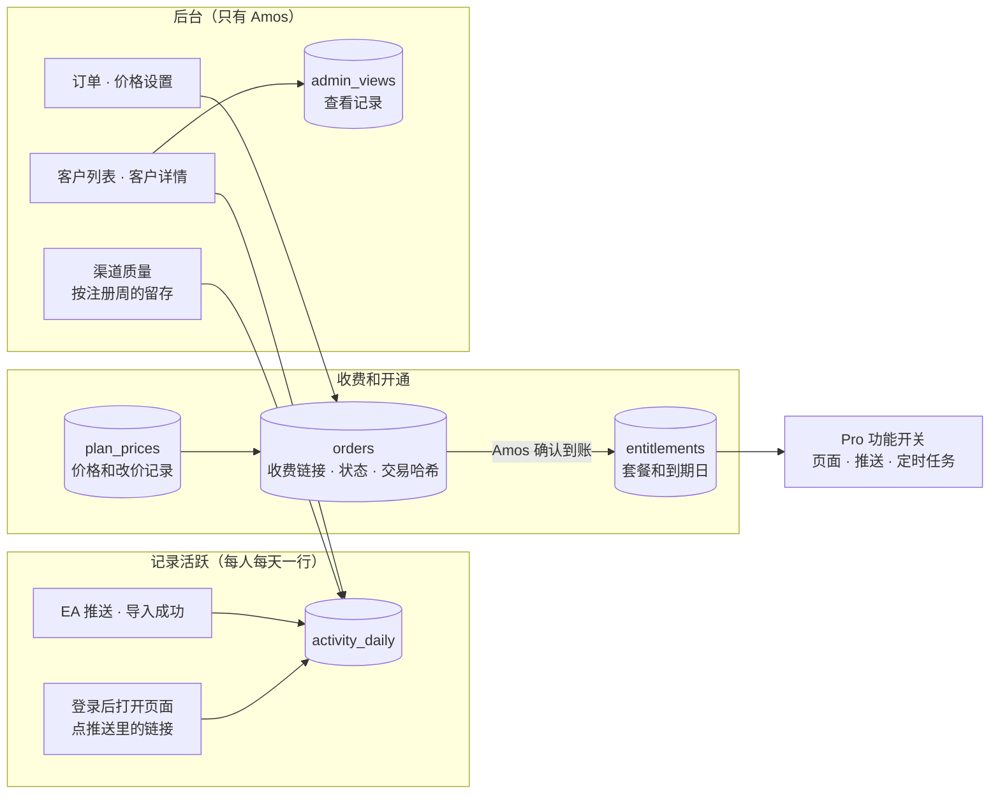
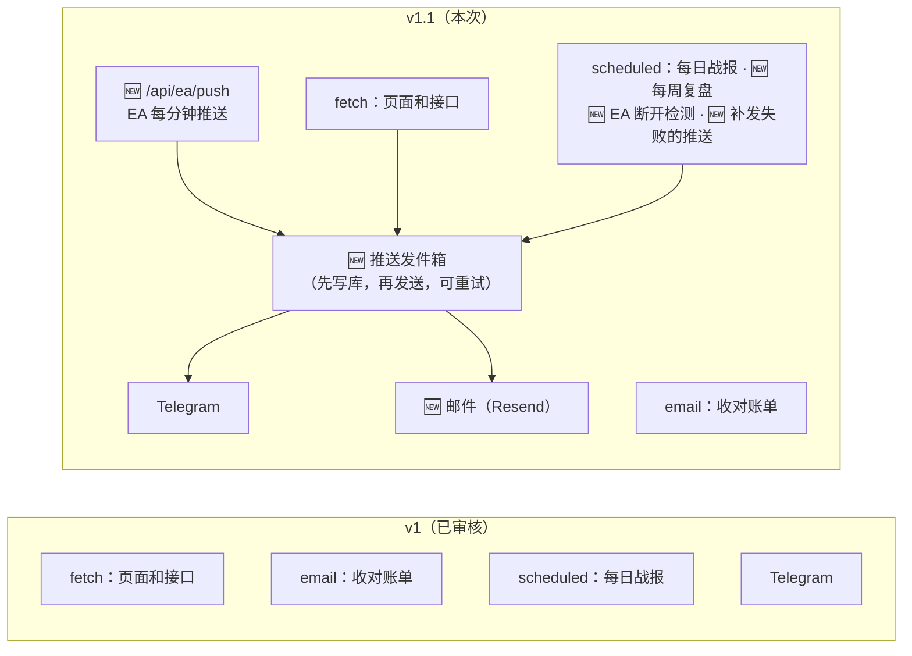
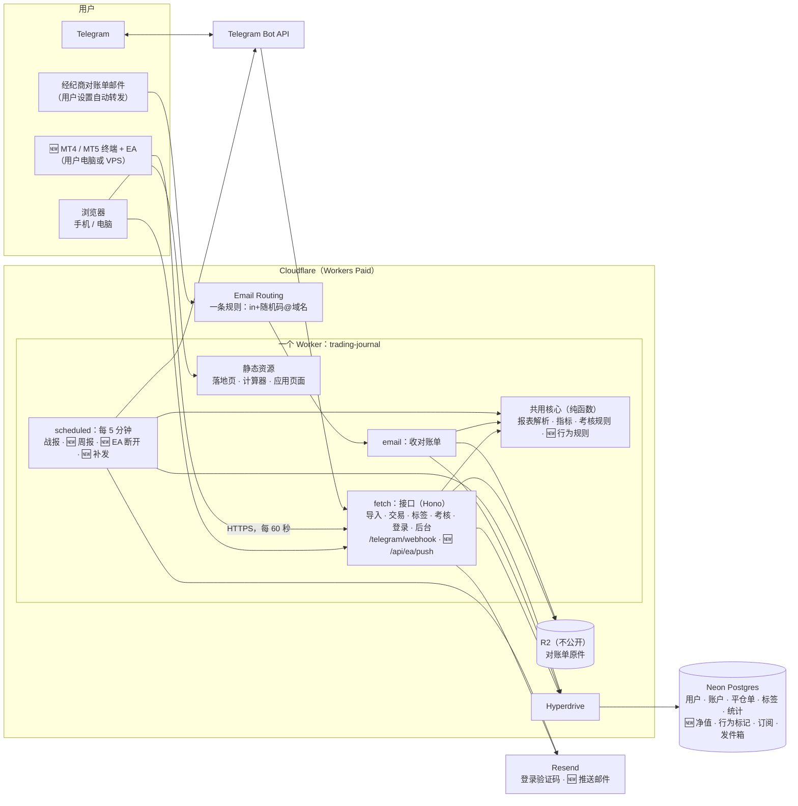
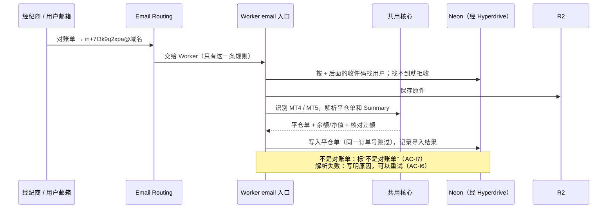
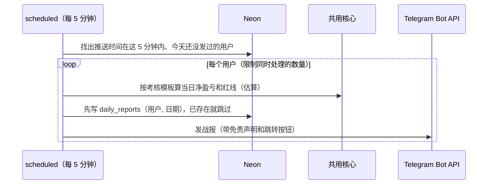
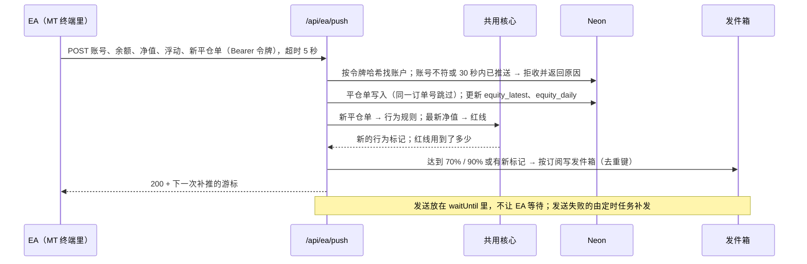
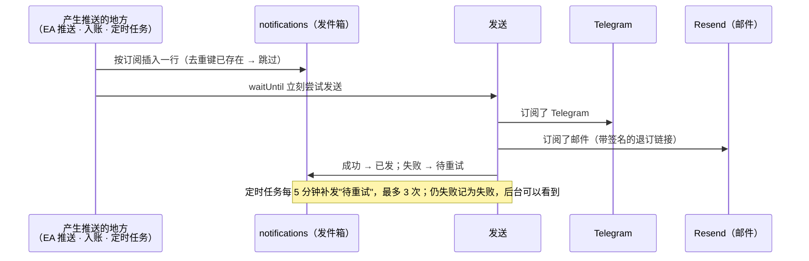
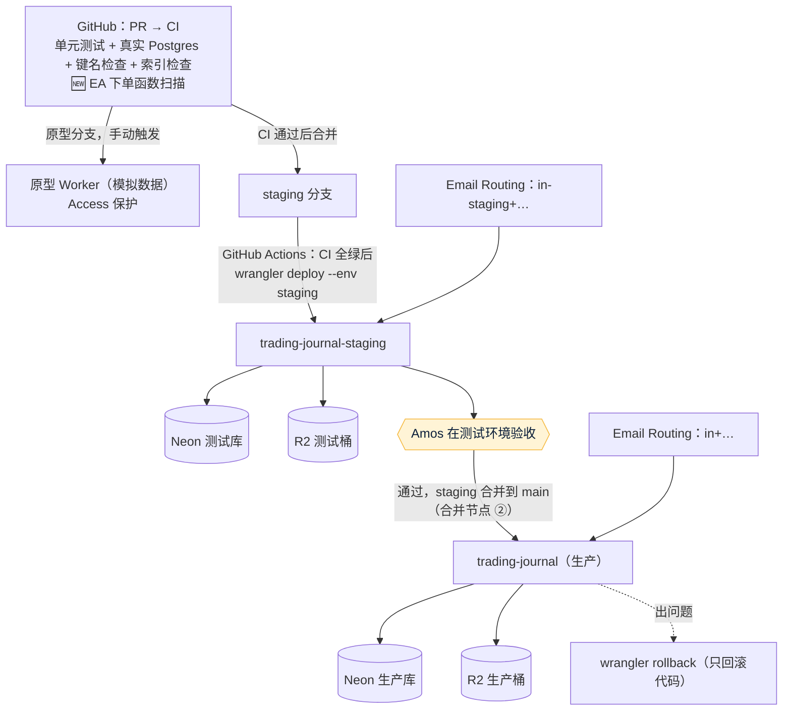
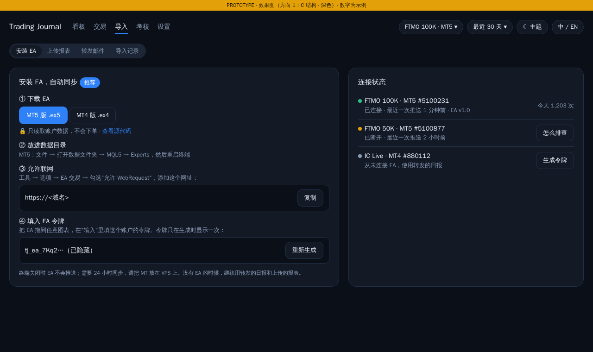
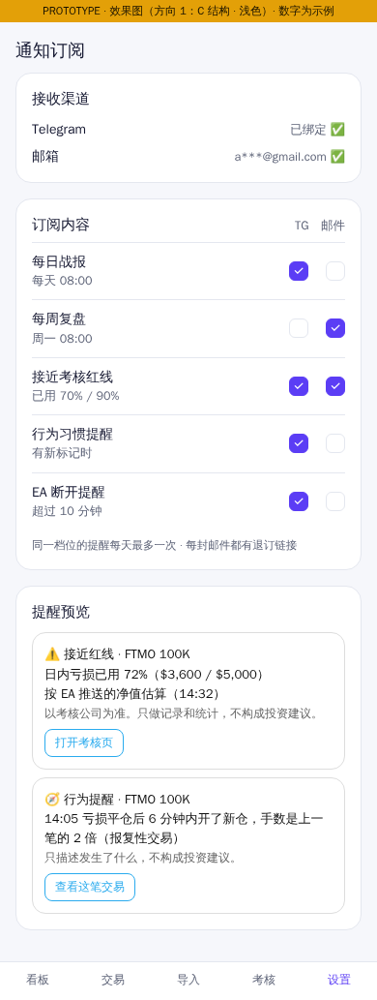

# 00 架构方案：trading journal v1
- 版本：v1.2 草稿（2026-10-22，按需求说明书 v1.3 草稿修订：后台客户活跃、收费和开通；测试环境改用免费版；**待 Amos 审核**）
- 变更历史：
  - v0.1 草稿（2026-10-20）：首次提交，按 Vercel 设计
  - v0.2 草稿（2026-10-20）：Amos 选定风格方向 1，决定"服务器和域名使用 Cloudflare"，其他问题按默认。平台改为 Cloudflare Workers；技术选型从 Next.js 改为 Vite + React + Hono（理由见 2.1）；收件地址改为子地址；补第 5 节效果图 13 张
  - v1（2026-10-20）：Amos 确认平台规范 K0–K8，第 7 节其他问题按默认；查到仓库是公开的（Q5）。同一个 PR 里建立了项目地图、项目索引、入口文件和 CI（第 8 节）；Amos 审核通过（合并节点 ①）
  - **v1.1（2026-10-21）**：需求说明书 v1.2（Amos 已确认）加入 EA、行为习惯、邮件推送、通知订阅，这几项改变了已审核的架构（协作总则第二节"偏离已审核决定要重新审核"）。改动见第 0 节；原型阶段改用独立的原型 Worker（平台规范 v0.1.1 K5）。Amos 2026-10-21 审核通过（PR #3）
  - **v1.2 草稿（2026-10-22）**：需求说明书 v1.3 草稿加入 CH6（客户活跃和渠道质量）、CH7（收费和 USDT 开通），新增 5 张表、付费页和后台接口；Amos 2026-10-21 说"在测试阶段我不想用付费产品"，测试环境改用 Workers 免费版（第 3.1 节）。改动见第 0.1 节
- 负责：PM 写业务视角并整合全文；研发写技术视角；运维写基础设施（agents 协作总则第一节第 2、3 步）
- 依据：
  - agents main `381c85f`（v0.11.1）
  - 《[v1 需求说明书](需求文档/v1-需求说明书.md)》v1.2（Amos 2026-10-21 确认）；🆕 v1.3 草稿（2026-10-22，和本版一起审核）
  - `平台规范/Cloudflare.md` v0.1.1
- 状态：**v1.2 草稿，和需求说明书 v1.3 草稿一起交 Amos 审核**；同时原型补后台和付费页面，部署到原型环境请 Amos 确认（第 4.5 步）。
- v1.1 的状态记录：v1.1 提交 Amos 重新审核，2026-10-21 通过（PR #3）
- 当前状态以项目地图、项目索引和代码为准（C53）。本文件是当时的记录。

## 0.1 🆕 v1.2 改了什么（草稿）

这张图想说明：
- 活跃只记"这个人这一天有没有来过、有没有数据进来"，EA 每分钟推送也只更新同一行；
- 收费全程不接支付公司、不查链上，状态变化都由 Amos 在后台操作；
- 开通后的权限只看 `entitlements` 一张表。

| 改动 | 内容 | 为什么 |
|---|---|---|
| 新表 | `activity_daily`、`plan_prices`、`orders`、`entitlements`、`admin_views`，以及 `app_settings`（收款地址、试用天数） | 需求说明书 CH6、CH7 |
| 删掉 | v1 的 `events` 表里的"活跃"事件改由 `activity_daily` 记录；访问、申请、注册、首次导入这几种事件不变 | 每次请求都写事件会让写入量随 EA 推送暴增（需求说明书 T16） |
| 新接口 | 后台：客户列表、客户详情、渠道质量、订单、价格；客户：申请开通、付费页、提交交易哈希 | 同上 |
| 定时任务 | 每天一次：链接过期、到期提醒（7 天、1 天）、到期降级 | 并进现有的定时任务，不新增 Cron（免费版每个账户只有 5 个） |
| 测试环境 | Workers 免费版、Neon 免费版、Resend 免费版 | Amos："在测试阶段我不想用付费产品"（3.1） |
| 没有新增密钥 | 收款地址存在数据库的 `app_settings` 里，由 Amos 在后台填，不是密钥 | 系统只存地址，不存、不经手私钥（AC-P10） |

## 0. v1.1 改了什么

这张图想说明：仍然是一个 Worker，没有新增常驻进程。新增一个 EA 接收接口；所有推送先写进"发件箱"表再发送，失败的由定时任务补发，保证不丢、不重复。

| 编号 | 改动 | 对应需求 | 位置 |
|---|---|---|---|
| A1 | 新增 EA 接收接口 `/api/ea/push`：令牌鉴权、30 秒限流、平仓单去重、余额净值写"最新值 + 每日汇总"，不存每分钟的明细 | CH1、AC-E1–E8 | 2.4、2.8 |
| A2 | 新增 EA 代码目录 `ea/`（MQL4、MQL5 源代码）和编译产物的发布方式 | CH1、AC-E1 | 2.2、2.8、R8 |
| A3 | 行为习惯规则写在 `src/core/behavior.ts`，入账时计算，结果存 `behavior_flags` | CH2、AC-B1–B5 | 2.3、2.5 |
| A4 | 推送统一走"发件箱"（`notifications` 表）：订阅、去重键、发送、重试；渠道是 Telegram 和邮件（Resend） | CH3、CH4、AC-N1–N7 | 2.3、2.4 |
| A5 | 定时任务（每 5 分钟）增加：每周复盘、EA 断开检测、补发失败的推送 | AC-N2、N5、N7 | 2.4 |
| A6 | 退订：邮件里的链接带签名，不用登录就能退订 | AC-N6 | 2.6 |
| A7 | 原型环境改为独立的原型 Worker（平台规范 v0.1.1） | — | 3.2、3.3 |
| A8 | 工作量从 8 步增加到 11 步 | — | 4 |

## 一图看懂：系统架构（Cloudflare）

这张图想说明：
- 网页、接口、🆕 EA 推送、收邮件、定时任务**都在同一个 Worker 里**，共用一份解析、指标和规则代码，保证各处口径一致（需求说明书第 7 节）。
- 🆕 EA 跑在用户自己的 MT 终端里，用 HTTPS 主动推送给 Worker；服务器不连接任何经纪商，也不需要账户密码。
- 邮件由 Email Routing 直接交给 Worker 的 `email` 入口，不经过外部接口。
- 数据库在 Neon，Worker 通过 Hyperdrive 连接；对账单原件放在 R2。

## 1. 业务视角（PM）
| 业务 | 使用者 | 页面 | 数据 |
|---|---|---|---|
| 导入 | 交易者 | 导入页（🆕 EA、上传、专属邮箱、导入记录） | 导入记录、对账单原件、平仓单、🆕 EA 连接和净值 |
| 🆕 行为习惯 | 交易者 | 看板、交易列表 | 行为标记 |
| 🆕 推送 | 交易者 | 设置 → 通知订阅；退订页 | 订阅、发件箱 |
| 复盘 | 交易者 | 看板、交易列表 + 详情 | 平仓单、标签、笔记 |
| 考核红线 | 考核中的交易者 | 考核页、Telegram 战报 | 交易账户的考核设置、每次导入时的余额和净值 |
| 引流 | 访客 | 落地页、计算器（不用登录） | 内测申请、渠道统计 |
| 运营 | Amos | 后台：申请、邀请码、按渠道统计 | 邀请码、统计事件 |

核心流程是"一份对账单怎么变成战报"，分四步：
1. 🆕 EA 每分钟推送，或者用户上传对账单、转发到专属邮箱；
2. 解析出平仓单，按"账户 + 订单号"去重后入库；
3. 用共用的指标和规则计算看板和红线；
4. 🆕 入账时计算行为标记；有 EA 时按最新净值判断是否接近红线；到了用户设定的时间生成战报和周报。所有推送按订阅写进发件箱，发到 Telegram 或邮件。

## 2. 技术方案（研发）
### 2.1 技术选型
| 部分 | 选型 | 为什么 |
|---|---|---|
| 语言 | TypeScript，前后端用同一种语言 | 解析、指标、规则只写一份；计算器在浏览器里也能直接用 |
| 运行环境 | Cloudflare Workers：静态资源加一个 Worker，`fetch`、`email`、`scheduled` 三个入口 | Amos 确定用 Cloudflare。第一版没有常驻进程，适合 Workers |
| 前端 | Vite + React（单页应用）；落地页和计算器在构建时生成静态 HTML（便于被搜索引擎收录） | **不用 Next.js**。Cloudflare 官方默认推荐的 vinext 还是实验性的，OpenNext 也有限制（平台规范第二节）。我们不需要服务端渲染，用 Vite 更简单、可控 |
| 接口 | Hono（Workers 上的轻量路由） | 体积小，测试方便 |
| 数据库 | Neon Postgres，通过 Hyperdrive 连接，驱动用 Postgres.js；每个请求新建客户端；迁移脚本放 `db/migrations/` | Neon 官方推荐 Hyperdrive（平台规范 K6）。平仓单要做去重（唯一约束）和统计查询 |
| 原件存储 | R2，存储桶不公开 | 保存原件，修复解析问题后可以重新解析（澄清问题 C1） |
| HTML 解析 | 优先用轻量的流式解析器（例如 htmlparser2），不构建完整 DOM | Paid 套餐每次请求 CPU 30 秒，完全够用；轻量解析内存占用小（128 MB 上限） |
| 邮件解析 | postal-mime（Cloudflare 文档推荐） | 拆出邮件正文和附件 |
| 图表 | uPlot | 体积小 |
| 多语言 | `messages/en.json`、`messages/zh.json`；构建时检查两份的键名一致 | PM 可以直接改文案（C6） |
| 主题 | 深色、浅色两套颜色变量，默认跟随系统，用户可以手动切换；用户的选择存在浏览器本地 | 风格方向 1（C 的结构 + A 和 B 的配色） |
| 测试 | Vitest（单元测试，连真实 Postgres）、Playwright（端到端测试和页面走查）；Workers 本地运行用 wrangler 的本地模式 | C37、C42–C51 |
| 🆕 EA | MQL4（MT4）、MQL5（MT5）；用 `OnTimer` 每 60 秒调用一次 `WebRequest`，超时 5 秒 | `WebRequest` 只能在 EA 和脚本里调用，要先把网址加进允许列表，并且是同步调用【证实，[MQL5 文档](https://www.mql5.com/en/docs/network/webrequest)、[MQL4 文档](https://docs.mql4.com/common/webrequest)】，所以要设短超时（AC-E7） |
| 🆕 推送邮件 | Resend（和登录验证码同一个服务） | Amos 已确认（Q6）；Worker 里直接调用接口 |

### 2.2 代码目录和归属角色
| 目录 | 内容 | 归属 |
|---|---|---|
| `src/core/` | 报表解析（`parsers/mt4.ts`、`parsers/mt5.ts`）、指标、考核规则模板。纯函数，不连数据库，前后端共用 | 研发 |
| `src/worker/` | Worker 的三个入口、接口、数据库访问、导入流程、登录、Telegram | 研发 |
| `src/web/` | 前端页面；手机版和电脑版的关键页面分开写组件（C64） | 研发 |
| 🆕 `ea/mt4/`、`ea/mt5/` | EA 源代码（公开）；编译好的 .ex4、.ex5 作为发布文件，不放源码目录 | 研发 |
| `messages/` | 中英文文案 | PM 改文案；研发定结构 |
| `db/migrations/` | 数据库迁移脚本 | 研发 |
| `test/` | 单元测试；`test/fixtures/statements/` 放脱敏后的报表样本和标准答案 | 研发写单元测试；测试准备标准答案 |
| `e2e/` | 端到端测试和页面走查脚本 | 测试 |
| `wrangler.jsonc`、`deploy/` | Worker 配置（环境、绑定、Cron）、部署说明和脚本 | 运维（`wrangler.jsonc` 由研发和运维共同维护） |
| 文档目录 | `需求文档/`、`市场/`、`技术方案/`、`测试报告/`、`部署方案/`、`交付记录/`、`assets/` | 各角色按 agents 第三节 |

### 2.3 数据结构（要点）
| 表 | 主要字段 | 约束 |
|---|---|---|
| `users` | 邮箱、语言、注册渠道、是否管理员、**收件码**（10 位随机小写字母和数字） | 邮箱唯一；收件码唯一 |
| `invite_codes` / `applications` | 邀请码：码、渠道、上限、已用；内测申请：邮箱、来源 | |
| `trading_accounts` | 用户、平台（MT4/MT5）、账号、币种、服务器时区、考核模板及版本、参数 | |
| `imports` | 账户、来源（上传/邮件）、原件在 R2 的位置、状态、失败原因、Summary 的余额/净值/浮动、核对差额 | |
| `trades` | 账户、订单号、方向、品种、手数、开平仓时间（UTC）、价格、毛利/佣金/隔夜利息/税/净盈亏（**整数，按最小货币单位存**） | **唯一（账户, 订单号）**，用于去重（AC-I4） |
| `tags` / `trade_tags` / `notes` | 预设和自定义标签、笔记 | |
| `telegram_links` | 绑定码（10 分钟有效、只能用一次）、chat id | v1 的 `daily_reports` 并入发件箱 `notifications` |
| `events` | 渠道统计事件（访问、申请、注册、首次导入、活跃） | 只记自己的数据，不接第三方追踪（M5） |
| `rate_limits` | 验证码发送次数等计数 | 放数据库，不放内存（Workers 的实例之间不共享内存，同 C58 的道理） |
| 🆕 `ea_connections` | 交易账户、令牌的哈希（不存明文）、平台、EA 版本、最近一次推送时间、补推游标 | 一个交易账户一条；令牌重新生成后旧哈希立即作废（AC-E2） |
| 🆕 `equity_latest` / `equity_daily` | 最新的余额、净值、浮动和时间；每天（按考核模板的重置时区）的开始余额、最低净值、收盘净值 | **不存每分钟的明细**：每次推送只更新这两张表，控制写入量（2.8） |
| 🆕 `behavior_flags` | 交易或日期、规则、触发的事实（时间差、倍数）、参数版本 | 唯一（账户, 规则, 交易或日期），重复计算不重复标记 |
| 🆕 `subscriptions` | 用户、账户、内容类型、渠道、时间、阈值 | 唯一（用户, 账户, 内容类型, 渠道） |
| 🆕 `activity_daily`（v1.2） | 用户、日期（按用户时区）、是否打开页面、是否点推送链接、是否有 EA 推送、是否导入成功 | **唯一（用户, 日期）**，用 `INSERT … ON CONFLICT DO UPDATE` 只改标志位；EA 推送时先看内存里的"今天已记"标志，同一实例同一天只写一次（AC-G11） |
| 🆕 `plan_prices`（v1.2） | 套餐、周期（月 / 年）、价格（**USDT 按 0.01 的整数存**）、生效时间、修改人 | 只追加不修改：最新一条就是当前价格，旧的就是改价记录（AC-P1） |
| 🆕 `orders`（v1.2） | 订单号、用户、套餐、周期、金额（锁定）、链接码（随机 24 位）、过期时间、状态、交易哈希、Amos 的处理原因、确认人和时间 | **唯一（交易哈希）**（AC-P5）；确认用条件更新 `WHERE status = '已提交'`，只有一个请求能成功（AC-P7） |
| 🆕 `entitlements`（v1.2） | 用户、套餐、到期日、来源（试用 / 订单 / Amos 赠送）、关联订单 | 每次变化追加一行；当前套餐取最新一行 |
| 🆕 `admin_views`（v1.2） | 管理员、被查看的用户、时间、看了哪一页 | 只追加（AC-G9） |
| 🆕 `app_settings`（v1.2） | 收款地址、网络（TRC20）、试用天数、链接有效小时数 | 只有后台能改，改动写进 `admin_views` 同样的记录 |
| 🆕 `notifications`（发件箱） | 去重键、渠道、内容、状态（待发 / 已发 / 失败）、重试次数 | **唯一（去重键）**：例如"用户, 账户, 接近红线-日内-70%, 2026-10-21"，保证同一条只发一次（AC-N7） |

### 2.4 关键流程

这张图想说明：邮件导入和上传走同一条解析路径，区别只在原件从哪里来。每人一个地址用子地址实现（`in+收件码@域名`），只要一条收件规则；Cloudflare 的 catch-all 只支持根域名，每个域名最多 200 条规则，没法一人一条（平台规范第二节）。

这张图想说明：先写"今天已发"的记录再发送，定时任务重跑或并发时也不会重复发。v1.1 起，"今天已发"的记录就是发件箱 `notifications` 里那一行（去重键唯一）。

🆕 **EA 推送（A1）**

这张图想说明：EA 只做"读数据、发出去"；去重、规则、提醒都在服务器上算。响应里带补推游标，网络断开过的 EA 下次会从游标开始补推（AC-E7）。

🆕 **推送发件箱（A4、A5）**

这张图想说明：所有推送都先落库再发送，所以 Telegram 或邮件服务暂时出错时不会丢；去重键唯一，所以重跑也不会重复。

### 2.5 计算和解析的做法
- 指标和规则的口径只在 `src/core/` 里写一份，用测试准备的标准答案数据集做单元测试（AC-D1、AC-R2）。
- 金额在解析时直接从报表文本转成整数（例如 `-1.50` → `-150`），全程不用浮点数。
- MT5 用 Positions 表合成平仓单；分几次平仓的，按持仓号合并（AC-I2）。
- 每份报表都和 Summary 自动核对，有差额就标在导入记录里（AC-I3）。
- 考核模板写成带版本号的配置，每个模板记录官网链接和核对日期（AC-R1）。规则改了就新增一个版本；旧账户继续用原来的版本，除非用户主动切换（C55 的思路）。"当日 00:00"按模板的重置时区计算（原型说明 X3）。
- 🆕 行为规则写在 `src/core/behavior.ts`，参数和需求说明书第 7.3 节一致，每条规则 6 组以上的测试用例（AC-B1）。入账（EA、上传、邮件）后，只对新入账的交易和它们所在的日期重新计算。
- 🆕 红线的净值：有 `equity_latest` 且在 10 分钟内的，用它；否则用最近一次报表（需求说明书 7.2）。
- 🆕 服务器时区：EA 同时推送服务器时间和 UTC 时间，服务器据此自动算出时区偏移，用户不用手动设置（推断，研发在第 9 步用模拟账户确认 MQL 的时间函数）。

### 2.6 安全
- **专属邮箱**：收件码 10 位随机，不含用户信息；未知收件码直接拒收；用户可以在设置里重新生成收件码，旧地址立即失效。
- **数据隔离**：每个查询都带用户条件；端到端测试用两个账号互相改编号访问（AC-A4）。
- **原件**：R2 不公开，只能通过鉴权接口读取；删除数据时一起删除（AC-A3）。
- **登录**：邮箱验证码 10 分钟有效、只能用一次；发送次数计数放在数据库（AC-A1）。
- **Telegram**：webhook 带 secret token 校验。
- **原型**：Preview 地址用 Cloudflare Access 保护，只有 Amos 能登录访问（平台规范 K5）。
- **不保存任何账户密码**；对账单里的姓名不进数据库（需求说明书第 8 节）。
- 🆕 **EA 令牌**：32 位随机字符，数据库只存哈希（HMAC，密钥用 `APP_SECRET`）；令牌只在生成时显示一次，丢了就重新生成；每个令牌只能推送它绑定的那个 MT 账号。
- 🆕 **EA 代码**：源代码公开；CI 扫描 `ea/` 目录，出现下单、改单、平仓、撤单的函数就失败（AC-E1）。
- 🆕 **退订链接**：带签名（HMAC），只能退订链接里写的那一类内容，过期时间 90 天；不用登录（AC-N6）。
- 🆕 **后台**（v1.2）：所有 `/api/admin/*` 接口都检查管理员身份（`ADMIN_EMAILS`），不只是页面隐藏入口（AC-G6）；打开客户详情时写一条 `admin_views`（AC-G9）。
- 🆕 **付费页**（v1.2）：要登录，链接码只是定位订单，还要核对订单属于当前用户（AC-P4）；交易哈希只接受 64 位十六进制（AC-P5）。
- 🆕 **钱包**（v1.2）：系统不生成钱包、不存私钥或助记词，只显示 Amos 在后台填的收款地址；收款地址的修改留记录，防止被人改成别的地址后没人发现（AC-P1、AC-P10）。

### 2.7 风险和技术债
| 编号 | 风险 | 应对 |
|---|---|---|
| R1 | 没有真实样本，解析的准确性无法确认 | Amos 提供样本（需求说明书第 13 节）；先按 MT 官方格式做，测试报告如实标注 |
| R2 | 有的经纪商报表模板被改过，或者是非英文报表 | 识别失败时给出具体原因，引导用户反馈样本 |
| R3 | 考核公司改规则 | 模板带版本号和核对日期；PM 每月核对一次官网 |
| R4 | 同一个 Worker 同时导出 `fetch`、`email`、`scheduled`，官方文档没有明说 | 测试环境第一步就实测；不行的话把 `email` 拆成第二个 Worker，通过 Service Binding 调用（工作量小） |
| R5 | Cron 的准点程度官方没有写；AC-N2（v1.1 之前是 AC-R5）要求 5 分钟内送达 | 测试环境连续测 3 天，记录实际延迟；不满足的话，把这条验收标准的口径交 PM 和 Amos 重新确认 |
| R6 | 有的邮箱或经纪商不接受带 `+` 的转发地址（推断） | 测试环境用 Gmail、Outlook、QQ 邮箱各测一次；不行的话，改用单独的根域名做 catch-all |
| R7 | 中国大陆的访问质量没有保证（平台规范 K8） | 测试环境验收时，由 Amos 在大陆实测 |
| 🆕 R8 | .ex4 / .ex5 要用 MetaQuotes 的 MetaEditor 编译，它是 Windows 程序，CI（Linux）上能不能编译未查到 | 第 9 步先试 CI 里用 Wine 运行 MetaEditor；不行的话，由研发在 Windows 上编译，发布文件附源代码的提交号和文件哈希，用户可以自己编译核对 |
| 🆕 R9 | 用户要手动加 WebRequest 允许网址、填令牌，步骤多，激活率可能低（推断） | 导入页每一步配截图（AC-E8）；内测时统计"下载了 EA 但从未连接"的比例 |
| 🆕 R10 | EA 每分钟一次，推送量随用户数线性增长 | 不存每分钟明细（2.3）；推送量和费用估算见 2.8，内测阶段很小 |
| 🆕 R11 | 考核公司对第三方 EA 读取账户的态度没有明文（需求说明书第 12 节） | 上线前市场写信问 FTMO；拿到书面答复前不宣传"考核公司允许" |
| 🆕 R12（v1.2） | 免费版每次请求只有 10 ms CPU，解析大报表可能超（推断） | 第 2 步部署后实测 CPU；第 4 步用真实样本测解析耗时。超了的办法：上传的报表在浏览器里先解析、服务器核对；邮件导入分几次处理；都不行再问 Amos（3.1） |
| 🆕 R13（v1.2） | 人工核对到账，客户可能等很久才开通；Amos 不在时没人处理 | 付费页写明"人工核对，一般 24 小时内开通"（文案待 Amos 确认）；有新的"已提交哈希"订单时给 Amos 发提醒（复用推送发件箱） |
| 🆕 R14（v1.2） | 收款地址被改掉（后台账号被盗）客户的钱就转到别人那里 | 后台登录同样用邮箱验证码；改收款地址给 Amos 发提醒邮件；改动留记录 |

### 2.8 🆕 EA 接收的细节
- **推送内容**：账号、服务器名、币种、余额、净值、浮动、服务器时间和 UTC 时间、EA 版本，以及"游标之后"新平仓的单子（MT5 按持仓合并，字段见需求说明书 8.2）。首次连接时游标是 90 天前（AC-E5）。
- **鉴权和限流**：`Authorization: Bearer <令牌>`；同一个令牌 30 秒内只接受一次，用 `ea_connections` 的"最近一次推送时间"判断（放数据库，不放内存）。
- **响应**：成功返回下一次的游标；拒收返回原因代码和一句话说明，EA 写进 MT 的"专家"日志（AC-E3）。
- **推送量和费用（推断，按公开价格估算）**：每个账户每天最多 1,440 次。100 个装了 EA 的账户每月约 430 万次请求，在 Workers Paid 每月包含的 1,000 万次以内【证实套餐数字，[Workers 价格](https://developers.cloudflare.com/workers/platform/pricing/)】；1,000 个账户约 4,300 万次，超出部分每百万次 $0.30，约 $10 每月。数据库每次推送只更新 2 行，加上偶尔新增的平仓单。
- **以后要更实时（v2）**：可以把每个账户的最新状态放到 Durable Object 里，减少数据库写入；第一版不需要。

## 3. 基础设施（运维）
### 3.1 平台
Amos 确定使用 **Cloudflare**。按 `平台规范/Cloudflare.md` v0.1 执行（Amos 已确认 K0–K8，[agents PR #19](https://github.com/dollar3651314/agents/pull/19)）。商业项目用 **Workers Paid**：Free 每次请求只有 10 ms CPU，解析报表很可能超时（平台规范 K0）。

🆕 **v1.2：测试环境用免费版**。Amos 2026-10-21："在测试阶段我不想用付费产品"。各项免费额度（2026-10-21 查官网，证实）：
| 服务 | 免费额度 | 测试阶段 |
|---|---|---|
| Workers | 每天 10 万次请求；每次请求 CPU 10 ms（偶尔超出有缓冲，经常超会被中断，报错 1102）；每个账户 5 个定时任务 | 请求数够；CPU 是风险 R12 |
| Hyperdrive | 免费版可用，每天 10 万次查询 | 够 |
| R2 | 每月 10 GB、写 100 万次、读 1000 万次 | 够 |
| Email Routing | 每个域名 200 条规则，单封最大 25 MB；处理邮件的 Worker 的 CPU 限制官网没写数字 | 够；CPU 同 R12 |
| Neon | 永久免费，不用绑卡；每个项目 1 GB、每月 100 计算小时 | 够 |
| Resend | 每天 100 封、每月 3000 封 | 够 |

出处：developers.cloudflare.com 的 workers/platform/limits、hyperdrive/platform/pricing、r2/pricing、email-routing/limits，neon.com/pricing，resend.com/pricing。生产环境用不用付费版，按测试环境的实测数据（R12）到上生产前再请 Amos 决定。

### 3.2 环境（C34、C61）
| 环境 | 分支 | 地址 | 数据 | 外部服务 |
|---|---|---|---|---|
| 原型 | 原型分支 → 独立的原型 Worker `trading-journal-prototype`（平台规范 v0.1.1 K5） | workers.dev 地址，用 Cloudflare Access 保护 | 只用模拟数据，页面顶部显示 PROTOTYPE | 不连接 |
| 测试环境 | `staging` → `--env staging`（Worker 名为 `trading-journal-staging`） | `staging.域名`（运维建议，Amos 确认） | 单独的 Neon 数据库、单独的 R2 存储桶 | 测试机器人；收件地址 `in-staging+收件码@域名`；邮件标题带"[测试环境]"；🆕 EA 填测试环境的网址和令牌，用 MT5 模拟账户（需求说明书第 13 节） |
| 生产 | `main` → 生产 Worker | 正式域名 | 生产 Neon、R2 | 正式机器人；`in+收件码@域名` |

### 3.3 部署拓扑

这张图想说明：测试环境和生产的数据库、存储、机器人、收件地址全部分开；只有 CI 全绿才部署；合并到 `main` 才上生产，而且必须在 Amos 于测试环境验收之后。

### 3.4 变量和密钥（只列名字，值由 Amos 填，C21）
| 放在哪里 | 名字 |
|---|---|
| Worker 密钥（Amos 在控制台填） | `APP_SECRET`、`TELEGRAM_BOT_TOKEN`、`TELEGRAM_WEBHOOK_SECRET`、`MAIL_API_KEY` |
| Worker 普通变量（写在 `wrangler.jsonc`） | `APP_ENV`、`MAIL_FROM`、`ADMIN_EMAILS`、`INBOUND_PREFIX`（`in` 或 `in-staging`） |
| 绑定（写在 `wrangler.jsonc`） | `HYPERDRIVE`（数据库连接串由 Amos 填在 Hyperdrive 的配置里）、`STATEMENTS`（R2 存储桶） |
| GitHub Secrets（Amos 填） | `CLOUDFLARE_API_TOKEN`（"Edit Cloudflare Workers" 模板，只授权到这个账户）、`CLOUDFLARE_ACCOUNT_ID` |

v1.1 没有新增密钥：EA 令牌的哈希和退订链接的签名都用 `APP_SECRET`；推送邮件和验证码共用 `MAIL_API_KEY`。

### 3.5 CI 和分支保护（C54）
- 每个 PR 跑这几项：单元测试（包括 CI 提供的 Postgres 容器，C37）、中英文键名检查、`scripts/check-project-index.mjs`、构建（包括 Worker 体积检查）、🆕 EA 源代码的下单函数扫描（AC-E1）、🆕 文案里的指令性词语扫描（AC-B4、R6）。CI 不需要任何密钥，外部服务都用替身。
- 部署 job：推送到 `staging` 或 `main`，并且前面的检查全部通过后，才用 `wrangler deploy` 部署（平台规范 K3）。
- 分支保护：`staging`、`main` 设为"CI 必须通过"，并勾选"不允许绕过"。前提是仓库公开，或者私有仓库在付费套餐上（第 7 节 Q5）。

## 4. 估算的工作量（分步执行，C63）
原型确认后，由 PM 拆成任务清单。下面是估计，不是实测。v1.1 从 8 步增加到 11 步（带 🆕 的是新增或扩大的）。

| 步骤 | 内容 | 工作量 |
|---|---|---|
| 1 | 项目骨架、CI、项目地图和索引、测试环境；**实测三个入口、收件、Cron**（R4–R6） | 中 |
| 2 | MT4/MT5 解析器和标准答案测试 | 大 |
| 3 | 登录、邀请码、账户、上传导入 | 中 |
| 4 | 看板、交易列表、标签笔记、深浅主题 | 大 |
| 5 | 考核模板和红线（按重置时区）、计算器 | 中 |
| 6 | 邮件导入 | 中 |
| 7 | 🆕 推送发件箱、Telegram 绑定、邮件推送、通知订阅和退订、每日战报和每周复盘 | 中 |
| 8 | 🆕 行为习惯规则（`src/core/behavior.ts` + 用例）、看板和交易列表的标记 | 中 |
| 9 | 🆕 EA 接收接口、令牌、连接状态、断开检测；MQL4/MQL5 EA；编译和发布（R8）；用模拟账户实测（AC-E4、E5、E7） | 大 |
| 10 | 🆕 接近红线提醒（EA 净值） | 小 |
| 11 | 落地页、后台统计、页面走查、测试环境验收 | 中 |

## 5. 视觉效果图（研发，风格方向 1）
Amos 选定方向 1：C 的结构，配深色（A 的配色）和浅色（B 的配色，绿色加深到 #047857，满足 WCAG AA）两套主题。效果图用真实的 HTML/CSS 渲染，数字都是示例，但前后能对上。核对过的几处：
- 品种、时段、星期三种拆分的合计都等于净盈亏 $1,234.56；
- 胜率 55.0% = 33 / 60；
- 红线：当日 00:00 余额 $101,290.26 − 5% × 100,000 = $96,290.26，当前净值 $100,134.56 − $96,290.26 = 还可亏 $3,844.30。

13 张截图都检查过：没有横向溢出、没有页面报错，并逐张人工看过（C50）。v1.1 新增 2 张（EA 安装、通知订阅），同样检查过、人工看过；提醒预览里的数字：$3,600 ÷ $5,000 = 72%。

| 页面 | 电脑（1280） | 手机（390） |
|---|---|---|
| 看板 · 深色 |  |  |
| 看板 · 浅色 |  |  |
| 看板 · 空状态 | — |  |
| 交易列表和复盘（手机是列表 + 底部弹出的详情） |  |  |
| 导入 |  |  |
| 考核和 Telegram 战报 |  |  |
| 免费计算器 |  |  |
| 🆕 导入 → 安装 EA（v1.1） |  | 手机版在原型里做（步骤列表 + 连接状态分成两屏） |
| 🆕 设置 → 通知订阅（v1.1） | 电脑版在原型里做（订阅表格 + 右侧预览） |  |

手机和电脑的结构差别（C64）：
- 手机首页只放"今天还可亏多少"、净盈亏、胜率和权益曲线，其他统计点进下一层；
- 交易详情在手机上是底部弹出的面板，在电脑上是右侧的详情栏。

## 6. 未验证事项
- R4、R5、R6：同一个 Worker 的三个入口、Cron 的准点程度、带 `+` 的转发地址，都要在测试环境实测。
- Worker 体积限制：两份官方文档说法不一样，以部署时实测为准（平台规范第二节）。
- Workers Paid、Neon、Resend 的实际费用：请 Amos 在后台确认（C24）。
- MT5 服务器端会不会发每日对账单（市场 §4，未查到）。
- 🆕 R8：MetaEditor 能不能在 CI 里编译。
- 🆕 MQL 的时间函数能不能算出服务器时区（2.5）；EA 能读到哪些历史字段（需求说明书 8.2）。第 9 步用模拟账户确认。
- 🆕 考核公司对只读 EA 的态度（R11）。

## 7. 账号和资源（C27）
| 编号 | 问题 | 结论 |
|---|---|---|
| Q1 | 平台规范 K0–K8 | **Amos 确认按草稿**（2026-10-20） |
| Q2 | 用哪个 Cloudflare 账号；Workers 套餐 | 🆕 v1.2：**测试环境用免费版**（Amos 2026-10-21），生产到时候再定（3.1）。原来：**Workers Paid**（Amos 按默认确认）。部署原型之前，请 Amos 截图 Workers & Pages → Plans，确认账号和套餐（K0：先问，不推断） |
| Q3 | 域名 | **待 Amos 告知**：域名本身没有默认值。原型阶段可以先用 `workers.dev` 的 Preview 地址；**测试环境之前必须有** |
| Q4 | Cloudflare Access 只允许哪个邮箱访问原型 | **待 Amos 告知**，部署原型之前提供（不按上下文推断） |
| Q5 | 仓库公开还是私有 | **公开**（2026-10-20 用 GitHub 接口查到）。免费版就能开分支保护（C54） |
| Q6 | 数据库、发信服务 | **Neon、Resend**（Amos 按默认确认） |
| Q7 | 中文用户是否主要在中国大陆 | **第一版不专门做大陆优化**（Amos 按默认确认），测试环境验收时由 Amos 实测（R7） |
| 🆕 Q9 | USDT-TRC20 收款地址（只要地址） | **待 Amos 提供**，收费那一步之前；Amos 在后台自己填 |
| 🆕 Q8 | EA 实测用的 MT5 模拟账户和一直开着的 MT5（电脑或 VPS） | **待 Amos 提供**，第 9 步之前（需求说明书第 13 节） |

## 8. 本 PR 建立的项目框架（C53、C54）
| 文件 | 内容 |
|---|---|
| `CLAUDE.md`、`AGENTS.md` | 入口：先读项目地图，底线摘要 |
| `项目地图.md` | 当前状态（还没有代码）、计划的分层和环境、不能破坏的约定 9 条 |
| `项目索引.md`、`项目索引.config.json` | 逐个列出范围内的文件和文档；名单检查（环境变量、数据库表）已配置，代码建立后自动生效 |
| `scripts/check-project-index.mjs` | 从 agents 原样复制 |
| `.github/workflows/ci.yml` | 现在只跑索引检查（还没有代码）；第 1 步加上安装、单元测试（真实 Postgres）、键名检查、构建、部署 job |

本地已实际执行：索引检查通过；故意加一个没写进索引的文件，检查报错退出（exit 1）。分支保护在本 PR 的 CI 第一次变绿后，由运维分步指导 Amos 开启（运维 3.8）。`staging` 分支在合并节点 ① 之后从 `main` 建立，建立前用远程查询核对提交号（C68）。

## 跨角色反馈 / 分歧记录
| 编号 | 提出方 → 接收方 | 内容 | 状态 |
|---|---|---|---|
| F1 | 运维 → PM | Cloudflare 还没有平台规范，按第五节先起草，Amos 确认后才能执行 | 已采纳：agents PR #19，Amos 已确认 K0–K8 |
| F2 | 研发 → PM | 平台换成 Cloudflare 后不用 Next.js，改用 Vite + React + Hono | 已采纳：2.1 写明理由；技术选型的变化随本方案一起交 Amos 审核 |
| F3 | 运维 → 研发 | catch-all 只支持根域名，收件地址改为子地址 `in+收件码@域名` | 已采纳：效果图和线框图已同步修改；需求说明书 AC-I5 的含义不变 |
| F4 | 研发 → 测试 | 标准答案数据集（AC-D1、AC-R2）由测试准备，放在 `test/fixtures/` | 已采纳 |
| F5 | 研发 → PM | Cron 的准点程度没有文档保证，AC-R5 有风险 | 已采纳：R5，测试环境实测后再定（v1.2 起对应 AC-N2） |
| F6 | 研发 → PM | 线框图 ⑨ 里 EA 令牌有"复制"按钮；为了安全，数据库只存哈希，令牌只在生成时显示一次 | 已采纳：效果图已改为"只在生成时显示一次 + 重新生成"；需求说明书 AC-E2 的含义不变 |
| F7 | 研发 → 运维 | EA 每分钟推送，不存每分钟明细，只存最新值和每日汇总，控制数据库写入和费用 | 已采纳：2.3、2.8 |
| F8（v1.2） | PM → 研发、运维 | 需求说明书 v1.3 草稿的 CH6、CH7：活跃记录、套餐价格、订单、权限、后台查看记录 | 写进 v1.2 草稿：0.1 节、2.3、2.6、2.7（R12–R14） |
| F9（v1.2） | Amos → 运维 | 测试阶段不用付费产品 | 3.1：测试环境用免费版，CPU 风险 R12 实测后再定 |
| F10（v1.2） | Amos → 研发、运维 | 客户端和后台都要有登录；原型去掉 Cloudflare Access | 原型做模拟登录（后台只认管理员邮箱）；Access 由 Amos 在 Cloudflare 关掉。真实登录按 2.6（邮箱验证码，后台只认 `ADMIN_EMAILS`），在第 3 步开发 |
