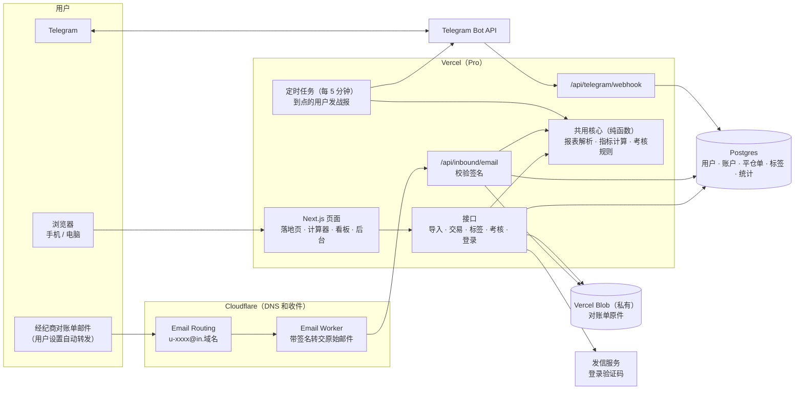
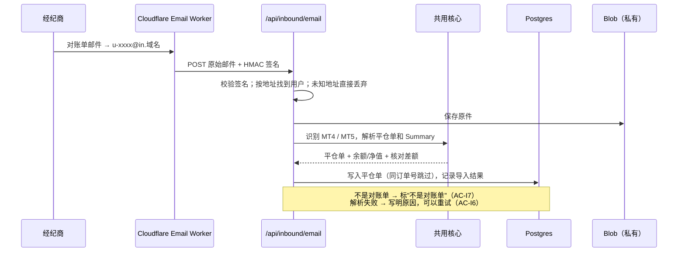
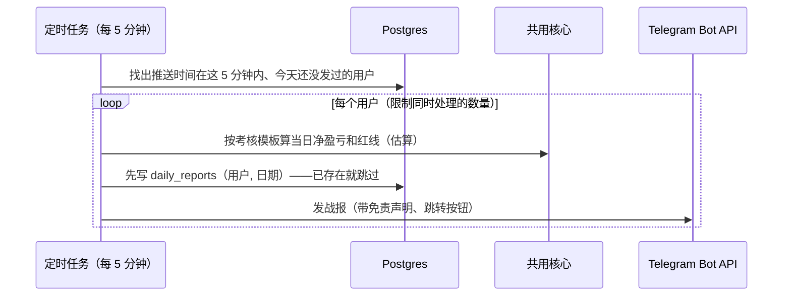
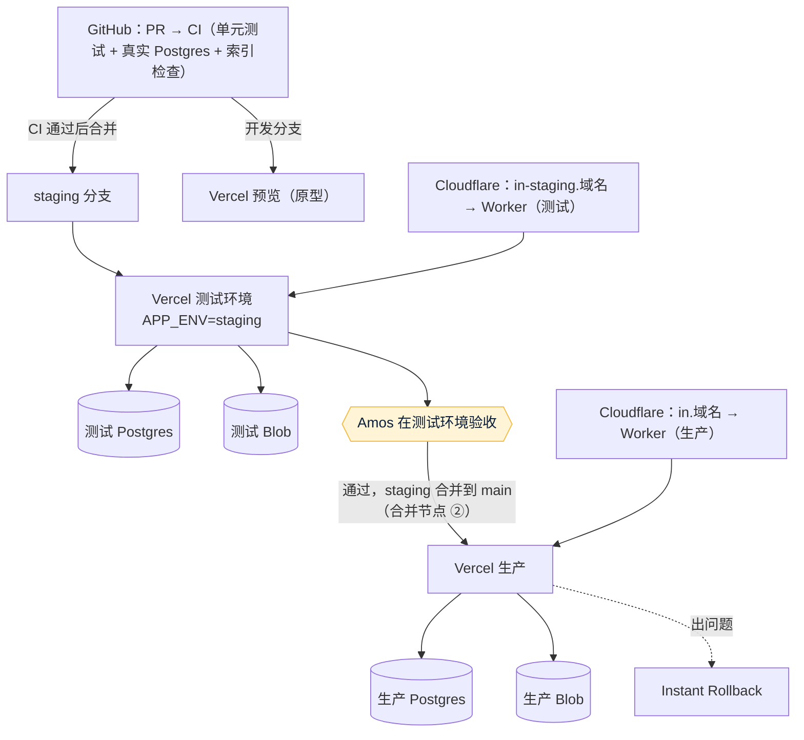

# 00 架构方案：trading journal v1
- 版本：v0.1 草稿（2026-10-20）
- 变更历史：v0.1 草稿（2026-10-20）首次提交。效果图和平台结论待补
- 负责：PM 写业务视角并整合全文；研发写技术视角；运维写基础设施（agents 协作总则第一节第 2、3 步）
- 依据：
  - agents main `f2a760c`（v0.11）
  - 《[v1 需求说明书](需求文档/v1-需求说明书.md)》v1.1（Amos 2026-10-20 审阅通过）
- 状态：**草稿，还不能提交审核**。还差两件事：
  1. Amos 回答第 7 节的平台和账号问题（第五节规定：平台确认之前，架构方案不能提交审核）；
  2. Amos 从《[v1 UI 风格方向](需求文档/v1-UI风格方向.md)》里选定一个方向（C65），研发再补第 5 节的效果图。

  两件都完成后，把本文件升到 v1 交 Amos 审核（合并节点 ①），同一个 PR 里建立项目地图、项目索引、入口文件和 CI（C53、C54）。
- 当前状态以项目地图、项目索引和代码为准（C53）。本文件是当时的记录，项目地图建立后以项目地图为准。

## 一图看懂：系统架构（按推荐方案 A：Vercel）

这张图想说明：
- 第一版**没有常驻进程**：上传、收邮件、机器人消息、定时战报都是一次请求处理完，所以可以放在 Vercel。
- 解析、指标、考核规则写成一份**纯函数**，页面、接口、定时任务、免费计算器共用，保证各处口径一致（需求说明书第 7 节）。

## 1. 业务视角（PM）
| 业务 | 使用者 | 页面 | 数据 |
|---|---|---|---|
| 导入 | 交易者 | 导入页（上传、专属邮箱、导入记录） | 导入记录、对账单原件、平仓单 |
| 复盘 | 交易者 | 看板、交易列表 + 详情 | 平仓单、标签、笔记 |
| 考核红线 | 考核中的交易者 | 考核页、Telegram 战报 | 交易账户的考核设置、每次导入时的余额和净值 |
| 引流 | 访客 | 落地页、计算器（不用登录） | 内测申请、渠道统计 |
| 运营 | Amos | 后台：申请、邀请码、按渠道统计 | 邀请码、统计事件 |

核心流程是"一份对账单怎么变成战报"：
1. 用户上传或转发对账单；
2. 解析出平仓单，按"账户 + 订单号"去重，存进数据库；
3. 用共用的指标和规则计算看板和红线；
4. 到了用户设定的推送时间，定时任务按同一套规则生成战报，发到 Telegram。

## 2. 技术方案（研发）
### 2.1 技术选型
| 部分 | 选型 | 为什么 |
|---|---|---|
| 语言 | TypeScript（前后端一种语言） | 解析、指标、规则只写一份，计算器在浏览器里也能直接用 |
| 框架 | Next.js（App Router） | Vercel 原生支持；页面和接口在一个项目里。按 C25，动态路由由 Next.js 处理，不用自己写 `[xxx].js` 函数文件 |
| 数据库 | Postgres；迁移脚本放 `db/migrations/` | 平仓单要做去重（唯一约束）和统计查询。用标准 Postgres，方案 B（云服务器）也能用同一套 |
| 原件存储 | Vercel Blob 私有存储；每次调用都显式传读写令牌（C36） | 对账单原件保存后，修复解析问题时可以重新解析 |
| HTML 解析 | cheerio | 服务端解析报表 HTML，不执行里面的脚本 |
| 邮件解析 | postal-mime | 把 Email Worker 转来的原始邮件拆出正文和附件 |
| 图表 | uPlot 或 Recharts（效果图阶段定） | 权益曲线、柱状图 |
| 多语言 | `messages/en.json`、`messages/zh.json`；构建时检查两份的键名一致 | PM 直接改文案文件（C6） |
| 测试 | Vitest（单元、真实 Postgres），Playwright（端到端、页面走查） | C37、C42–C51 |

### 2.2 代码目录和归属角色
| 目录 | 内容 | 归属 |
|---|---|---|
| `src/core/` | 报表解析（`parsers/mt4.ts`、`parsers/mt5.ts`）、指标计算、考核规则模板。纯函数，不连数据库 | 研发 |
| `src/server/` | 数据库访问、导入流程、登录、Telegram、定时任务 | 研发 |
| `src/app/` | 页面和接口路由 | 研发 |
| `messages/` | 中英文文案（只改值，不改键名和结构） | PM 改文案；研发定结构 |
| `db/migrations/` | 数据库迁移脚本 | 研发 |
| `workers/email/` | Cloudflare Email Worker | 研发写代码；运维部署 |
| `test/` | 单元测试；`test/fixtures/statements/` 放脱敏后的报表样本和标准答案 | 研发写单元测试；测试负责样本的标准答案 |
| `e2e/` | 端到端测试和页面走查脚本 | 测试 |
| `vercel.json`、`deploy/` | 平台配置、部署说明和脚本 | 运维（`vercel.json` 由研发和运维共同维护） |
| `需求文档/`、`市场/`、`技术方案/`、`测试报告/`、`部署方案/`、`交付记录/`、`assets/` | 文档 | 各角色按 agents 第三节 |

### 2.3 数据结构（要点）
| 表 | 主要字段 | 约束 |
|---|---|---|
| `users` | 邮箱、语言、注册渠道、是否管理员 | 邮箱唯一 |
| `invite_codes` / `applications` | 码、渠道、上限、已用；申请邮箱、来源 | |
| `trading_accounts` | 用户、平台（MT4/MT5）、账号、币种、服务器时区、考核模板和参数 | |
| `imports` | 账户、来源（上传/邮件）、原件位置、状态、失败原因、Summary 的余额/净值/浮动、核对差额 | |
| `trades` | 账户、订单号、方向、品种、手数、开平仓时间（UTC）、价格、毛利/佣金/隔夜利息/税/净盈亏（**整数，最小货币单位**） | **唯一（账户, 订单号）**，用于去重（AC-I4） |
| `tags` / `trade_tags` / `notes` | 预设和自定义标签、笔记 | |
| `telegram_links` / `daily_reports` | 绑定码（10 分钟、一次性）、chat id；每天发过的战报 | **唯一（用户, 日期）**，定时任务重跑也不会重复发 |
| `events` | 渠道统计事件（访问、申请、注册、首次导入、活跃） | 只记自己的数据，不接第三方追踪（M5） |
| `rate_limits` | 验证码发送次数等计数 | 放在数据库里，不放内存（C58） |

### 2.4 关键流程

这张图想说明：邮件导入和上传走同一条解析路径，区别只在原件是从哪里来的。

这张图想说明：先写"今天已发"的记录再发送，定时任务重跑或并发时不会重复发（同一用户同一天只发一条）。

### 2.5 计算和解析的做法
- 指标和规则的口径只写在 `src/core/` 里一份，单元测试用测试准备的标准答案数据集（AC-D1、AC-R2）。
- 金额解析时直接从报表文本转成整数（例如 `-1.50` → `-150`），全程不用浮点数。
- MT5 用 Positions 表合成平仓单；分几次平仓的，按持仓号合并（AC-I2）。
- 每份报表都用 Summary 自动核对，有差额就在导入记录里标出（AC-I3）。
- 考核模板写成带版本号的配置，每个模板记录官网链接和核对日期（AC-R1）。规则变更时新增版本，旧账户沿用原版本，除非用户主动切换（C55 的思路）。

### 2.6 安全
- **专属邮箱**：地址的随机部分 10 位小写字母和数字，不包含用户信息；Worker 转发时带 HMAC 签名，接口校验不通过直接拒绝。
- **数据隔离**：每个查询都带用户条件；端到端测试用两个账号互相改编号访问（AC-A4）。
- **原件**：私有 Blob，只通过鉴权接口读取；删除数据时一起删（AC-A3）。
- **登录**：邮箱验证码 10 分钟、一次性；发送次数计数放在数据库里（AC-A1、C58）。
- **不保存任何账户密码**；对账单里的姓名不进数据库（需求说明书第 8 节）。

### 2.7 风险和技术债
| 编号 | 风险 | 应对 |
|---|---|---|
| R1 | 没有真实样本，解析器的准确性无法确认 | Amos 提供样本（需求说明书第 13 节）；先按 MT 官方格式做，测试报告如实标注 |
| R2 | 各家经纪商的报表模板被改过，或者是非英文报表 | 识别失败时给出具体原因，并引导用户反馈样本；用户反馈的样本经同意后脱敏，加进测试 |
| R3 | 考核公司修改规则 | 模板带版本号和核对日期；PM 每月核对一次官网 |
| R4 | v2 的实时风控需要常驻进程，Vercel 不适合 | `src/core/` 和数据库都和平台无关，v2 可以只把实时接收部分放到云服务器（方案 B） |

## 3. 基础设施建议（运维）
### 3.1 平台选择（待 Amos 确认，见第 7 节 P1）
| | **方案 A：Vercel Pro（推荐）** | 方案 B：云服务器（Docker Compose） |
|---|---|---|
| 适用规范 | `平台规范/Vercel.md` | `平台规范/云服务器.md`（生产部分还待补 H0） |
| 适合第一版吗 | 适合：没有常驻进程；预览环境可以直接做原型 | 可以，但要多维护一台服务器 |
| 定时战报 | Pro 的定时任务最快每分钟一次、精确到分钟，满足 AC-R5；Hobby 每天只能一次、误差最长 1 小时，不满足【证实，[Vercel Cron 文档](https://vercel.com/docs/cron-jobs/usage-and-pricing)，2026-07-15 更新】 | 自己的定时器，不受限制 |
| 费用 | Vercel Pro 按套餐计费，具体金额请 Amos 看后台的 Billing（C24）；Postgres 和 Blob 按用量 | 服务器月费；托管数据库另计 |
| 以后要实时风控（v2） | 实时接收部分需要另加服务器 | 直接支持 |

推荐 A 的理由：第一版不需要常驻进程，Vercel 的预览、测试环境、回滚都现成，运维工作量最小。按 Vercel 规范 C24，商业项目从一开始就用 Pro。

### 3.2 环境（C34、C61）
| 环境 | 分支 | 地址 | 数据 | 外部服务 |
|---|---|---|---|---|
| 原型 | 开发分支的预览 | Vercel 预览地址（需要登录） | 模拟数据，页面顶部显示 PROTOTYPE | 不连接 |
| 测试环境 | `staging` | `staging` 分支的预览地址 | 单独的 Postgres、Blob | 单独的测试机器人、`in-staging.域名` 收件地址；邮件标题带"[测试环境]" |
| 生产 | `main` | 正式域名 | 生产 Postgres、Blob | 正式机器人、`in.域名` |

### 3.3 部署拓扑

这张图想说明：测试环境和生产的数据库、存储、机器人、收件地址全部分开；合并到 `main` 才会上生产，而且必须在 Amos 于测试环境验收之后。

### 3.4 环境变量（只列名字，值由 Amos 填进后台，C21）
`DATABASE_URL`、`BLOB_READ_WRITE_TOKEN`、`APP_ENV`、`APP_SECRET`、`INBOUND_SIGNING_SECRET`（Worker 和接口共用）、`TELEGRAM_BOT_TOKEN`、`TELEGRAM_WEBHOOK_SECRET`、`MAIL_API_KEY`、`MAIL_FROM`、`CRON_SECRET`、`ADMIN_EMAILS`。

### 3.5 CI 和分支保护（C54）
- 每个 PR 跑三项：单元测试（含 CI 提供的 Postgres 容器，C37）、中英文键名检查、`scripts/check-project-index.mjs`；有端到端测试后一起跑。
- CI 不需要任何密钥：外部服务用替身。
- 分支保护：`staging`、`main` 设为"CI 必须通过"并勾选"不允许绕过"。前提是仓库公开，或者私有仓库在付费套餐上，先问 Amos（第 7 节 P6）。

## 4. 估算的工作量（分步执行，C63）
任务清单在原型确认后由 PM 拆分。粗估如下，都是估计，不是实测：

| 步骤 | 内容 | 工作量 |
|---|---|---|
| 1 | 项目骨架、CI、项目地图和索引、测试环境 | 中 |
| 2 | MT4/MT5 解析器和标准答案测试 | 大 |
| 3 | 登录、邀请码、账户、上传导入 | 中 |
| 4 | 看板、交易列表、标签笔记 | 大 |
| 5 | 考核模板和红线、计算器 | 中 |
| 6 | 邮件导入（Worker） | 中 |
| 7 | Telegram 绑定和每日战报 | 中 |
| 8 | 落地页、后台统计、页面走查、测试环境验收 | 中 |

## 5. 视觉效果图（研发，待 Amos 选定风格方向后补）
按 C65，先由 PM 交《[v1 UI 风格方向](需求文档/v1-UI风格方向.md)》。Amos 选定后，研发按选定的方向，用真实的 HTML/CSS 渲染关键页面（看板、交易列表、导入、考核、计算器）的电脑版（1280）和手机版（390）截图，放在 `assets/v1/`。

## 6. 未验证事项
- Cloudflare Email Worker 能不能把原始邮件 POST 到外部接口：文档写了能读取原始邮件（`raw`）【证实，[Email Workers 文档](https://developers.cloudflare.com/email-routing/email-workers/)】；页面没写能不能调用外部 `fetch()`，Workers 一般可以【推断】。架构审核前，运维在测试环境实际发一封验证。备选是 Postmark Inbound（Pro 套餐包含入站解析，市场 §4）。
- Vercel Pro 和 Postgres 服务的实际价格，请 Amos 在后台确认（C24）。
- MT5 服务器端会不会发每日对账单（市场 §4，未查到）。

## 7. 需要 Amos 回答的问题（附默认值，C27）
| 编号 | 问题 | 默认值 |
|---|---|---|
| P1 | 生产平台 | **方案 A：Vercel** |
| P2 | Vercel 用哪个账号和团队、什么套餐（请截图 Settings → Billing） | **商业项目从一开始用 Pro**（Vercel 规范 E2）；先问，不推断 |
| P3 | 域名：是否已买、DNS 放在哪里 | **请 Amos 告知**；建议 DNS 放 Cloudflare（收件要用 Cloudflare Email Routing） |
| P4 | Postgres 用哪家 | **Neon**（在 Vercel Storage 里添加），测试和生产各一个数据库 |
| P5 | 登录验证码用哪家发信服务 | **Resend**；发信地址用服务商里已验证的域名（云服务器规范的坑） |
| P6 | `trading-journal` 仓库是公开还是私有？GitHub 用什么套餐？ | **请 Amos 告知**；决定能不能开分支保护（C54） |
| P7 | 收件服务 | **Cloudflare Email Routing + Email Worker**（免费）；如果测试环境验证不通过，换 Postmark |

## 跨角色反馈 / 分歧记录
| 编号 | 提出方 → 接收方 | 内容 | 状态 |
|---|---|---|---|
| F1 | 运维 → PM | 平台没确认之前，本方案不能提交审核（第五节） | 已采纳：状态写为"草稿"，问题见第 7 节 |
| F2 | 研发 → 运维 | AC-R5 要求战报 5 分钟内送达，Vercel Hobby 的定时任务做不到 | 已采纳：方案 A 写明需要 Pro |
| F3 | 研发 → 测试 | 标准答案数据集（AC-D1、AC-R2）由测试准备，放在 `test/fixtures/` | 已采纳 |
