# 00 架构方案：trading journal v1
- 版本：v0.2 草稿（2026-10-20）
- 变更历史：
  - v0.1 草稿（2026-10-20）：首次提交，按 Vercel 设计
  - v0.2 草稿（2026-10-20）：Amos 选定风格方向 1，决定"服务器和域名使用 Cloudflare"，其他问题按默认。平台改为 Cloudflare Workers；技术选型从 Next.js 改为 Vite + React + Hono（理由见 2.1）；收件地址改为子地址；补第 5 节效果图 13 张
- 负责：PM 写业务视角并整合全文；研发写技术视角；运维写基础设施（agents 协作总则第一节第 2、3 步）
- 依据：
  - agents main `f2a760c`（v0.11）
  - 《[v1 需求说明书](需求文档/v1-需求说明书.md)》v1.1（Amos 审阅通过）
  - 平台规范草稿 `平台规范/Cloudflare.md` v0.1（[agents PR #19](https://github.com/dollar3651314/agents/pull/19)，等待 Amos 确认）
- 状态：**草稿，还不能提交审核**，还差两件事：
  1. Amos 确认平台规范草稿（K0–K8）；
  2. Amos 回答第 7 节的账号问题（C27）。

  两件都完成后，本文件升到 v1 交 Amos 审核（合并节点 ①），并在同一个 PR 里建立项目地图、项目索引、入口文件和 CI（C53、C54）。
- 当前状态以项目地图、项目索引和代码为准（C53）。本文件是当时的记录。

## 一图看懂：系统架构（Cloudflare）

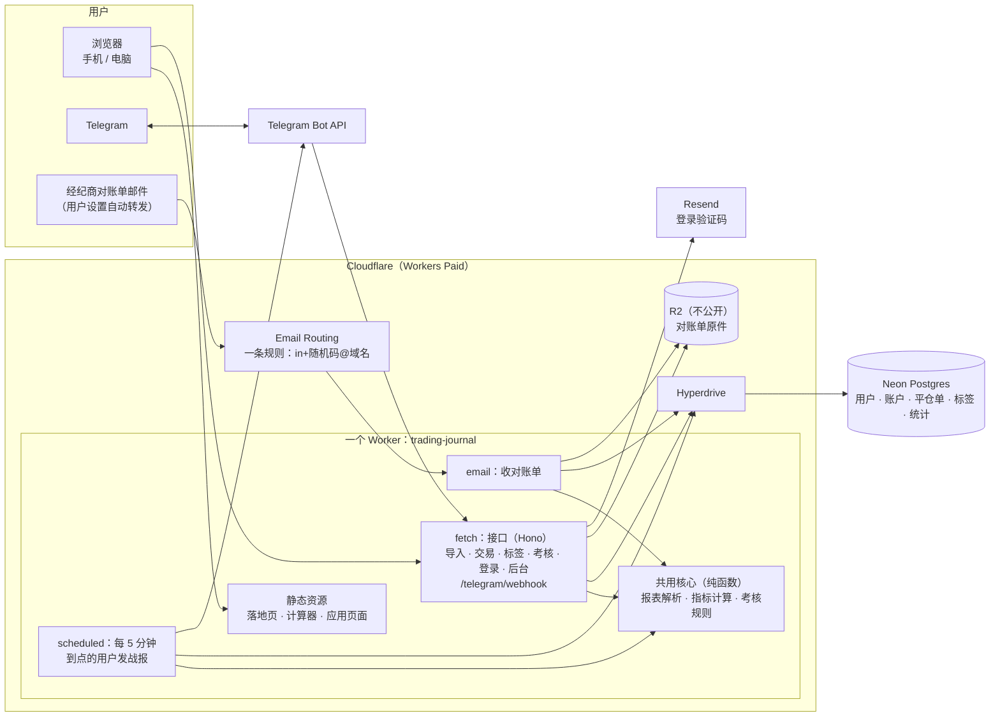

这张图想说明：
- 网页、接口、收邮件、定时战报**都在同一个 Worker 里**，共用一份解析、指标和规则代码，保证各处口径一致（需求说明书第 7 节）。
- 邮件由 Email Routing 直接交给 Worker 的 `email` 入口，不经过外部接口。
- 数据库在 Neon，Worker 通过 Hyperdrive 连接；对账单原件放在 R2。

## 1. 业务视角（PM）
| 业务 | 使用者 | 页面 | 数据 |
|---|---|---|---|
| 导入 | 交易者 | 导入页（上传、专属邮箱、导入记录） | 导入记录、对账单原件、平仓单 |
| 复盘 | 交易者 | 看板、交易列表 + 详情 | 平仓单、标签、笔记 |
| 考核红线 | 考核中的交易者 | 考核页、Telegram 战报 | 交易账户的考核设置、每次导入时的余额和净值 |
| 引流 | 访客 | 落地页、计算器（不用登录） | 内测申请、渠道统计 |
| 运营 | Amos | 后台：申请、邀请码、按渠道统计 | 邀请码、统计事件 |

核心流程是"一份对账单怎么变成战报"，分四步：
1. 用户上传对账单，或者转发到专属邮箱；
2. 解析出平仓单，按"账户 + 订单号"去重后入库；
3. 用共用的指标和规则计算看板和红线；
4. 到了用户设定的时间，定时任务按同一套规则生成战报，发到 Telegram。

## 2. 技术方案（研发）
### 2.1 技术选型
| 部分 | 选型 | 为什么 |
|---|---|---|
| 语言 | TypeScript，前后端用同一种语言 | 解析、指标、规则只写一份；计算器在浏览器里也能直接用 |
| 运行环境 | Cloudflare Workers：静态资源加一个 Worker，`fetch`、`email`、`scheduled` 三个入口 | Amos 确定用 Cloudflare。第一版没有常驻进程，适合 Workers |
| 前端 | Vite + React（单页应用）；落地页和计算器在构建时生成静态 HTML（便于被搜索引擎收录） | **不用 Next.js**。Cloudflare 官方默认推荐的 vinext 还是实验性的，OpenNext 也有限制（平台规范第二节）。我们不需要服务端渲染，用 Vite 更简单、可控 |
| 接口 | Hono（Workers 上的轻量路由） | 体积小，测试方便 |
| 数据库 | Neon Postgres，通过 Hyperdrive 连接，驱动用 Postgres.js；每个请求新建客户端；迁移脚本放 `db/migrations/` | Neon 官方推荐 Hyperdrive（平台规范 K6）。平仓单要做去重（唯一约束）和统计查询 |
| 原件存储 | R2，存储桶不公开 | 保存原件，修复解析问题后可以重新解析（澄清问题 C1） |
| HTML 解析 | 优先用轻量的流式解析器（例如 htmlparser2），不构建完整 DOM | Paid 套餐每次请求 CPU 30 秒，完全够用；轻量解析内存占用小（128 MB 上限） |
| 邮件解析 | postal-mime（Cloudflare 文档推荐） | 拆出邮件正文和附件 |
| 图表 | uPlot | 体积小 |
| 多语言 | `messages/en.json`、`messages/zh.json`；构建时检查两份的键名一致 | PM 可以直接改文案（C6） |
| 主题 | 深色、浅色两套颜色变量，默认跟随系统，用户可以手动切换；用户的选择存在浏览器本地 | 风格方向 1（C 的结构 + A 和 B 的配色） |
| 测试 | Vitest（单元测试，连真实 Postgres）、Playwright（端到端测试和页面走查）；Workers 本地运行用 wrangler 的本地模式 | C37、C42–C51 |

### 2.2 代码目录和归属角色
| 目录 | 内容 | 归属 |
|---|---|---|
| `src/core/` | 报表解析（`parsers/mt4.ts`、`parsers/mt5.ts`）、指标、考核规则模板。纯函数，不连数据库，前后端共用 | 研发 |
| `src/worker/` | Worker 的三个入口、接口、数据库访问、导入流程、登录、Telegram | 研发 |
| `src/web/` | 前端页面；手机版和电脑版的关键页面分开写组件（C64） | 研发 |
| `messages/` | 中英文文案 | PM 改文案；研发定结构 |
| `db/migrations/` | 数据库迁移脚本 | 研发 |
| `test/` | 单元测试；`test/fixtures/statements/` 放脱敏后的报表样本和标准答案 | 研发写单元测试；测试准备标准答案 |
| `e2e/` | 端到端测试和页面走查脚本 | 测试 |
| `wrangler.jsonc`、`deploy/` | Worker 配置（环境、绑定、Cron）、部署说明和脚本 | 运维（`wrangler.jsonc` 由研发和运维共同维护） |
| 文档目录 | `需求文档/`、`市场/`、`技术方案/`、`测试报告/`、`部署方案/`、`交付记录/`、`assets/` | 各角色按 agents 第三节 |

### 2.3 数据结构（要点）
| 表 | 主要字段 | 约束 |
|---|---|---|
| `users` | 邮箱、语言、注册渠道、是否管理员、**收件码**（10 位随机小写字母和数字） | 邮箱唯一；收件码唯一 |
| `invite_codes` / `applications` | 邀请码：码、渠道、上限、已用；内测申请：邮箱、来源 | |
| `trading_accounts` | 用户、平台（MT4/MT5）、账号、币种、服务器时区、考核模板及版本、参数 | |
| `imports` | 账户、来源（上传/邮件）、原件在 R2 的位置、状态、失败原因、Summary 的余额/净值/浮动、核对差额 | |
| `trades` | 账户、订单号、方向、品种、手数、开平仓时间（UTC）、价格、毛利/佣金/隔夜利息/税/净盈亏（**整数，按最小货币单位存**） | **唯一（账户, 订单号）**，用于去重（AC-I4） |
| `tags` / `trade_tags` / `notes` | 预设和自定义标签、笔记 | |
| `telegram_links` / `daily_reports` | 绑定码（10 分钟有效、只能用一次）、chat id；每天发过的战报 | **唯一（用户, 日期）**，保证同一用户同一天只发一条 |
| `events` | 渠道统计事件（访问、申请、注册、首次导入、活跃） | 只记自己的数据，不接第三方追踪（M5） |
| `rate_limits` | 验证码发送次数等计数 | 放数据库，不放内存（Workers 的实例之间不共享内存，同 C58 的道理） |

### 2.4 关键流程

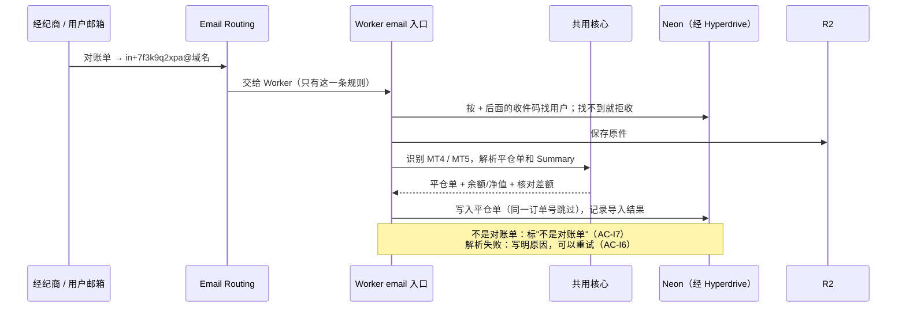

这张图想说明：邮件导入和上传走同一条解析路径，区别只在原件从哪里来。每人一个地址用子地址实现（`in+收件码@域名`），只要一条收件规则；Cloudflare 的 catch-all 只支持根域名，每个域名最多 200 条规则，没法一人一条（平台规范第二节）。

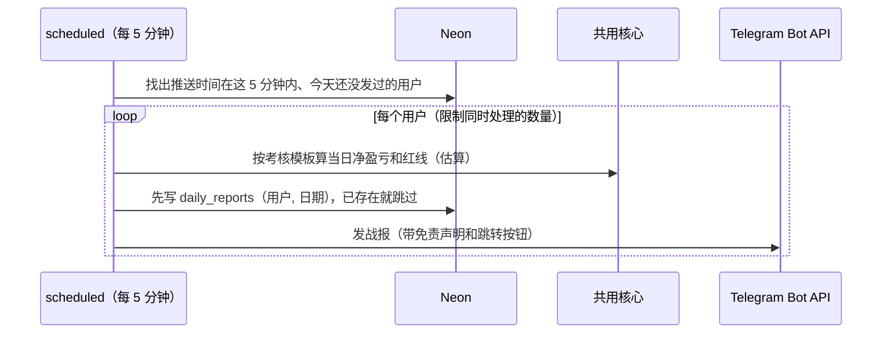

这张图想说明：先写"今天已发"的记录再发送，定时任务重跑或并发时也不会重复发。

### 2.5 计算和解析的做法
- 指标和规则的口径只在 `src/core/` 里写一份，用测试准备的标准答案数据集做单元测试（AC-D1、AC-R2）。
- 金额在解析时直接从报表文本转成整数（例如 `-1.50` → `-150`），全程不用浮点数。
- MT5 用 Positions 表合成平仓单；分几次平仓的，按持仓号合并（AC-I2）。
- 每份报表都和 Summary 自动核对，有差额就标在导入记录里（AC-I3）。
- 考核模板写成带版本号的配置，每个模板记录官网链接和核对日期（AC-R1）。规则改了就新增一个版本；旧账户继续用原来的版本，除非用户主动切换（C55 的思路）。

### 2.6 安全
- **专属邮箱**：收件码 10 位随机，不含用户信息；未知收件码直接拒收；用户可以在设置里重新生成收件码，旧地址立即失效。
- **数据隔离**：每个查询都带用户条件；端到端测试用两个账号互相改编号访问（AC-A4）。
- **原件**：R2 不公开，只能通过鉴权接口读取；删除数据时一起删除（AC-A3）。
- **登录**：邮箱验证码 10 分钟有效、只能用一次；发送次数计数放在数据库（AC-A1）。
- **Telegram**：webhook 带 secret token 校验。
- **原型**：Preview 地址用 Cloudflare Access 保护，只有 Amos 能登录访问（平台规范 K5）。
- **不保存任何账户密码**；对账单里的姓名不进数据库（需求说明书第 8 节）。

### 2.7 风险和技术债
| 编号 | 风险 | 应对 |
|---|---|---|
| R1 | 没有真实样本，解析的准确性无法确认 | Amos 提供样本（需求说明书第 13 节）；先按 MT 官方格式做，测试报告如实标注 |
| R2 | 有的经纪商报表模板被改过，或者是非英文报表 | 识别失败时给出具体原因，引导用户反馈样本 |
| R3 | 考核公司改规则 | 模板带版本号和核对日期；PM 每月核对一次官网 |
| R4 | 同一个 Worker 同时导出 `fetch`、`email`、`scheduled`，官方文档没有明说 | 测试环境第一步就实测；不行的话把 `email` 拆成第二个 Worker，通过 Service Binding 调用（工作量小） |
| R5 | Cron 的准点程度官方没有写；AC-R5 要求 5 分钟内送达 | 测试环境连续测 3 天，记录实际延迟；不满足的话，把这条验收标准的口径交 PM 和 Amos 重新确认 |
| R6 | 有的邮箱或经纪商不接受带 `+` 的转发地址（推断） | 测试环境用 Gmail、Outlook、QQ 邮箱各测一次；不行的话，改用单独的根域名做 catch-all |
| R7 | 中国大陆的访问质量没有保证（平台规范 K8） | 测试环境验收时，由 Amos 在大陆实测 |

## 3. 基础设施（运维）
### 3.1 平台
Amos 确定使用 **Cloudflare**。按 `平台规范/Cloudflare.md` 执行（草稿，[agents PR #19](https://github.com/dollar3651314/agents/pull/19) 等待确认）。商业项目用 **Workers Paid**：Free 每次请求只有 10 ms CPU，解析报表很可能超时（平台规范 K0）。

### 3.2 环境（C34、C61）
| 环境 | 分支 | 地址 | 数据 | 外部服务 |
|---|---|---|---|---|
| 原型 | 开发分支 → Worker Preview | Preview 地址，用 Cloudflare Access 保护 | 只用模拟数据，页面顶部显示 PROTOTYPE；Preview 里不跑 Cron（平台规范第二节） | 不连接 |
| 测试环境 | `staging` → `--env staging`（Worker 名为 `trading-journal-staging`） | `staging.域名`（运维建议，Amos 确认） | 单独的 Neon 数据库、单独的 R2 存储桶 | 测试机器人；收件地址 `in-staging+收件码@域名`；邮件标题带"[测试环境]" |
| 生产 | `main` → 生产 Worker | 正式域名 | 生产 Neon、R2 | 正式机器人；`in+收件码@域名` |

### 3.3 部署拓扑

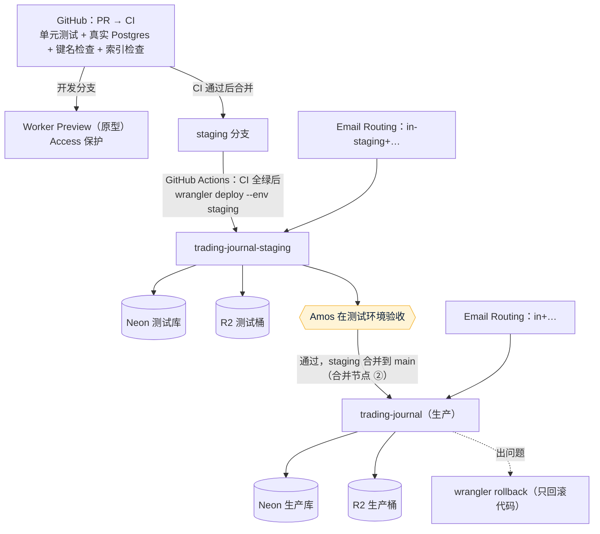

这张图想说明：测试环境和生产的数据库、存储、机器人、收件地址全部分开；只有 CI 全绿才部署；合并到 `main` 才上生产，而且必须在 Amos 于测试环境验收之后。

### 3.4 变量和密钥（只列名字，值由 Amos 填，C21）
| 放在哪里 | 名字 |
|---|---|
| Worker 密钥（Amos 在控制台填） | `APP_SECRET`、`TELEGRAM_BOT_TOKEN`、`TELEGRAM_WEBHOOK_SECRET`、`MAIL_API_KEY` |
| Worker 普通变量（写在 `wrangler.jsonc`） | `APP_ENV`、`MAIL_FROM`、`ADMIN_EMAILS`、`INBOUND_PREFIX`（`in` 或 `in-staging`） |
| 绑定（写在 `wrangler.jsonc`） | `HYPERDRIVE`（数据库连接串由 Amos 填在 Hyperdrive 的配置里）、`STATEMENTS`（R2 存储桶） |
| GitHub Secrets（Amos 填） | `CLOUDFLARE_API_TOKEN`（"Edit Cloudflare Workers" 模板，只授权到这个账户）、`CLOUDFLARE_ACCOUNT_ID` |

### 3.5 CI 和分支保护（C54）
- 每个 PR 跑这几项：单元测试（包括 CI 提供的 Postgres 容器，C37）、中英文键名检查、`scripts/check-project-index.mjs`、构建（包括 Worker 体积检查）。CI 不需要任何密钥，外部服务都用替身。
- 部署 job：推送到 `staging` 或 `main`，并且前面的检查全部通过后，才用 `wrangler deploy` 部署（平台规范 K3）。
- 分支保护：`staging`、`main` 设为"CI 必须通过"，并勾选"不允许绕过"。前提是仓库公开，或者私有仓库在付费套餐上（第 7 节 Q5）。

## 4. 估算的工作量（分步执行，C63）
原型确认后，由 PM 拆成任务清单。下面是估计，不是实测。

| 步骤 | 内容 | 工作量 |
|---|---|---|
| 1 | 项目骨架、CI、项目地图和索引、测试环境；**实测三个入口、收件、Cron**（R4–R6） | 中 |
| 2 | MT4/MT5 解析器和标准答案测试 | 大 |
| 3 | 登录、邀请码、账户、上传导入 | 中 |
| 4 | 看板、交易列表、标签笔记、深浅主题 | 大 |
| 5 | 考核模板和红线、计算器 | 中 |
| 6 | 邮件导入 | 中 |
| 7 | Telegram 绑定和每日战报 | 中 |
| 8 | 落地页、后台统计、页面走查、测试环境验收 | 中 |

## 5. 视觉效果图（研发，风格方向 1）
Amos 选定方向 1：C 的结构，配深色（A 的配色）和浅色（B 的配色，绿色加深到 #047857，满足 WCAG AA）两套主题。效果图用真实的 HTML/CSS 渲染，数字都是示例，但前后能对上。核对过的几处：
- 品种、时段、星期三种拆分的合计都等于净盈亏 $1,234.56；
- 胜率 55.0% = 33 / 60；
- 红线：当日 00:00 余额 $101,290.26 − 5% × 100,000 = $96,290.26，当前净值 $100,134.56 − $96,290.26 = 还可亏 $3,844.30。

13 张截图都检查过：没有横向溢出、没有页面报错，并逐张人工看过（C50）。

| 页面 | 电脑（1280） | 手机（390） |
|---|---|---|
| 看板 · 深色 | 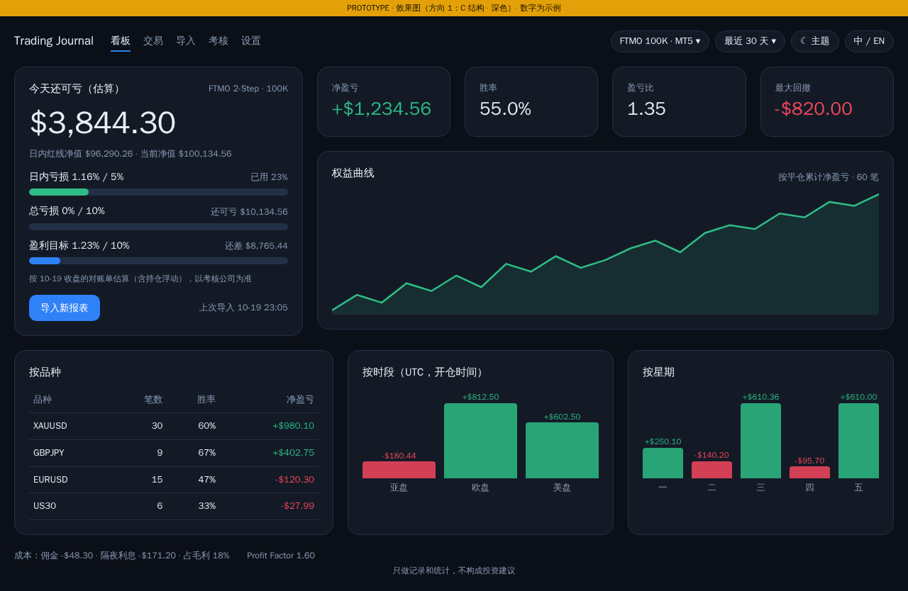 | 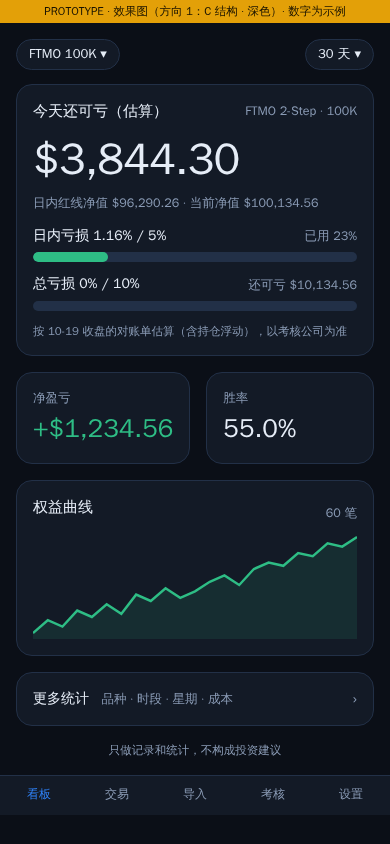 |
| 看板 · 浅色 | 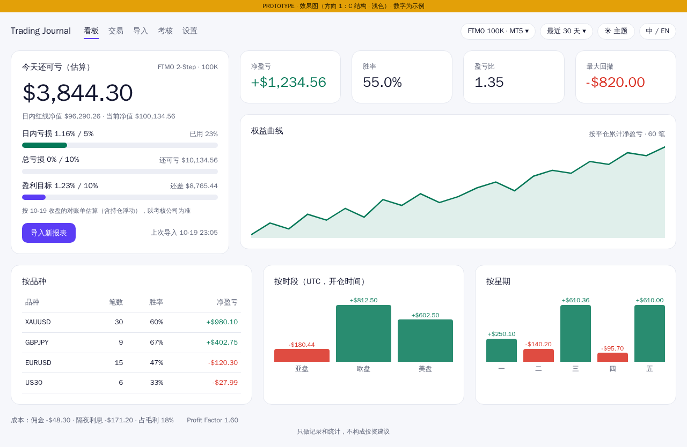 | 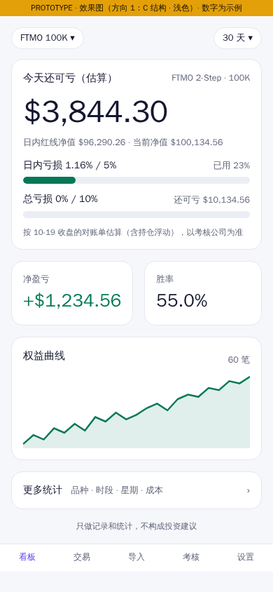 |
| 看板 · 空状态 | — | 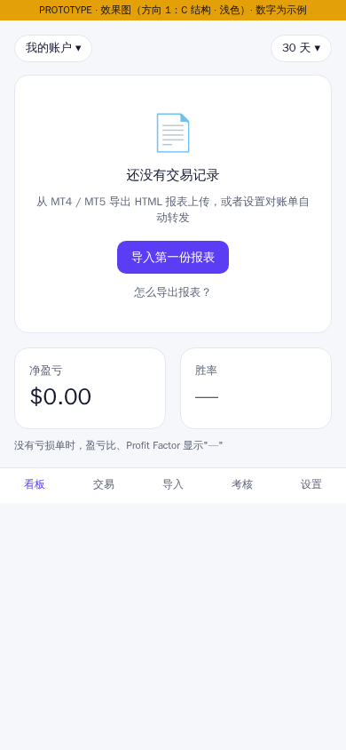 |
| 交易列表和复盘（手机是列表 + 底部弹出的详情） | 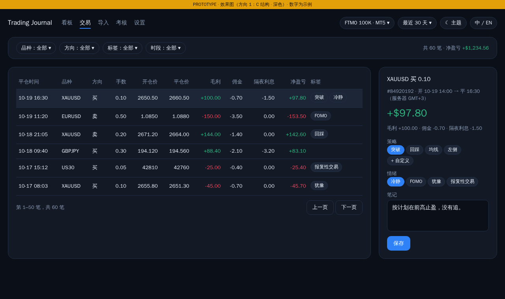 | 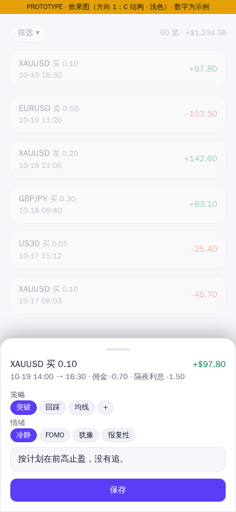 |
| 导入 | 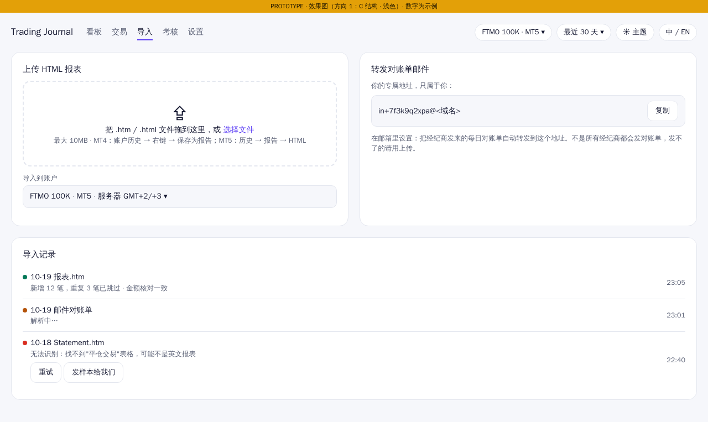 | 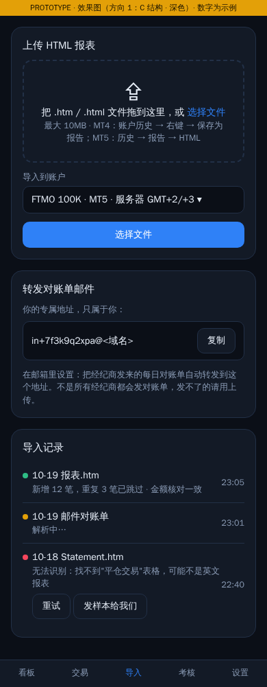 |
| 考核和 Telegram 战报 | 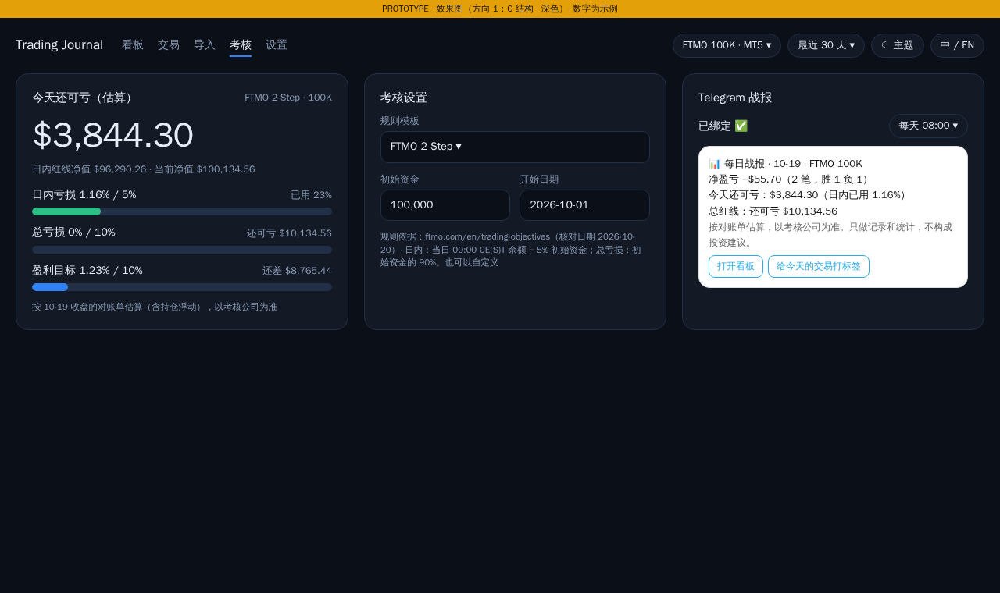 | 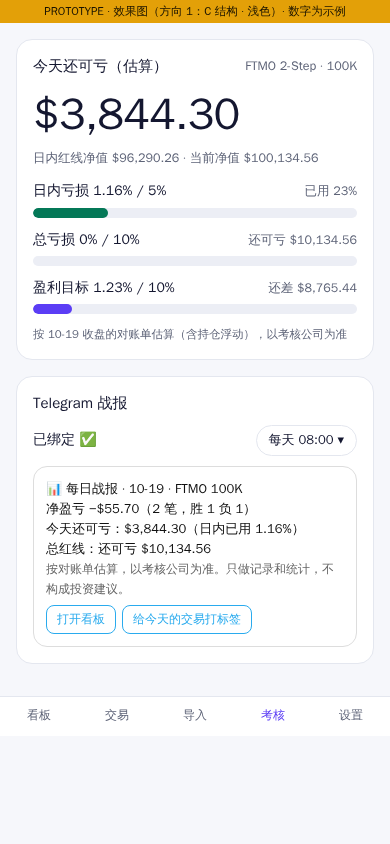 |
| 免费计算器 | 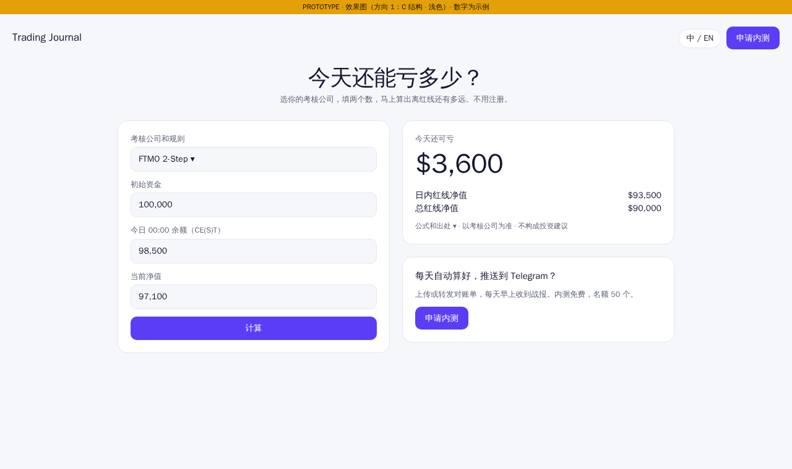 | 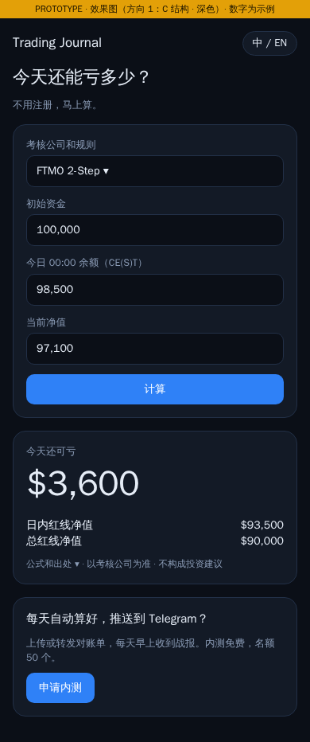 |

手机和电脑的结构差别（C64）：
- 手机首页只放"今天还可亏多少"、净盈亏、胜率和权益曲线，其他统计点进下一层；
- 交易详情在手机上是底部弹出的面板，在电脑上是右侧的详情栏。

## 6. 未验证事项
- R4、R5、R6：同一个 Worker 的三个入口、Cron 的准点程度、带 `+` 的转发地址，都要在测试环境实测。
- Worker 体积限制：两份官方文档说法不一样，以部署时实测为准（平台规范第二节）。
- Workers Paid、Neon、Resend 的实际费用：请 Amos 在后台确认（C24）。
- MT5 服务器端会不会发每日对账单（市场 §4，未查到）。

## 7. 需要 Amos 回答的问题（附默认值，C27）
| 编号 | 问题 | 默认值 |
|---|---|---|
| Q1 | 平台规范草稿 K0–K8（agents PR #19） | **按草稿确认** |
| Q2 | 用哪个 Cloudflare 账号；Workers 是 Free 还是 Paid（请截图 Workers & Pages → Plans） | **Workers Paid**；先问，不推断 |
| Q3 | 域名买了没有？是不是已经在这个 Cloudflare 账号下？ | **请 Amos 告知域名**；测试环境用 `staging.域名` |
| Q4 | Cloudflare Access 只允许哪个邮箱访问原型 | **请 Amos 告知**（不按上下文推断） |
| Q5 | `trading-journal` 仓库公开还是私有？GitHub 用什么套餐？ | **请 Amos 告知**；这决定能不能开分支保护（C54） |
| Q6 | 数据库、发信服务 | **Neon、Resend**（Amos 已按默认确认） |
| Q7 | 中文用户主要在中国大陆吗？ | **第一版不专门做大陆优化**，测试环境验收时由 Amos 实测访问速度（R7） |

## 跨角色反馈 / 分歧记录
| 编号 | 提出方 → 接收方 | 内容 | 状态 |
|---|---|---|---|
| F1 | 运维 → PM | Cloudflare 还没有平台规范，按第五节先起草，Amos 确认后才能执行 | 已采纳：agents PR #19 |
| F2 | 研发 → PM | 平台换成 Cloudflare 后不用 Next.js，改用 Vite + React + Hono | 已采纳：2.1 写明理由；技术选型的变化随本方案一起交 Amos 审核 |
| F3 | 运维 → 研发 | catch-all 只支持根域名，收件地址改为子地址 `in+收件码@域名` | 已采纳：效果图和线框图已同步修改；需求说明书 AC-I5 的含义不变 |
| F4 | 研发 → 测试 | 标准答案数据集（AC-D1、AC-R2）由测试准备，放在 `test/fixtures/` | 已采纳 |
| F5 | 研发 → PM | Cron 的准点程度没有文档保证，AC-R5 有风险 | 已采纳：R5，测试环境实测后再定 |
