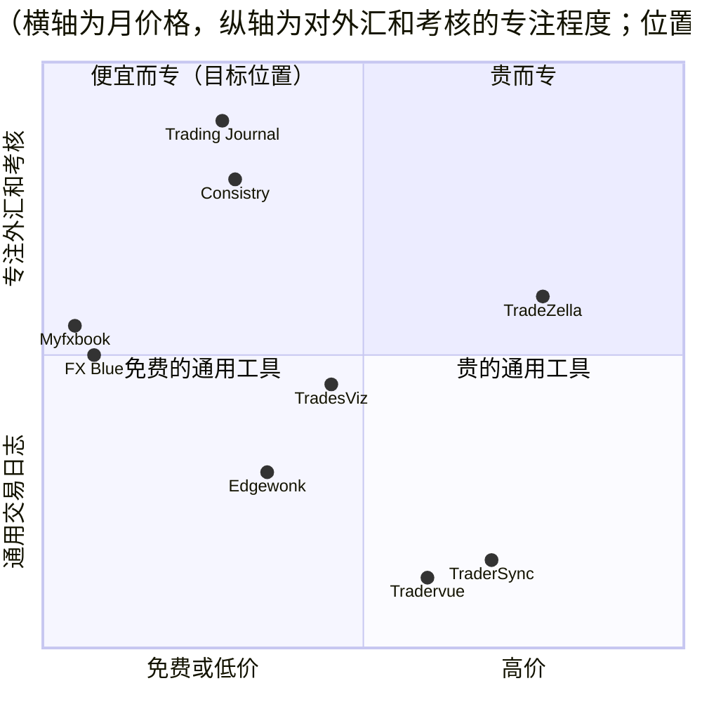
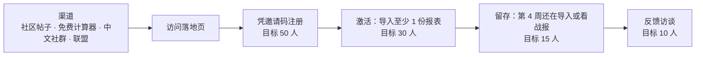

# v1 市场调研与推广策略：trading journal（CFD / 外汇）
- 版本：v1.2 草稿（2026-10-22）
- 变更历史：草稿 1（2026-10-20）首次提交；v1.1（2026-10-21）需求说明书 v1.2 加入 EA、行为习惯、邮件推送，补第 11 节（定位、竞品、信任、考核公司规则），第 1–10 节不变；v1.2 草稿（2026-10-22）Amos 要求第一版就收费、用 USDT 支付、价格在后台可改，补第 12 节（套餐、价格、渠道质量怎么看），第 5 节的定价建议由第 12 节替代
- 负责：市场经理（agents 规则 C71）。随 PM 的《[v1 需求澄清问题](../需求文档/v1-需求澄清问题.md)》一起交 Amos
- 依据：agents main `67e04ba`（v0.11）
- 调研范围：Amos 选定第一版做 CFD / 外汇（MT4/MT5）
- 出处标注（C66）：
  - **证实**：打开了页面，页面上写着这个内容。注意：这只说明页面上这么写，不代表数字本身经过独立核实。
  - **推断**：分析判断，或者只看到搜索摘要、第三方转述。
  - **未查到**：没找到资料。
- 资料线索：Amos 提供的 Gemini 对话记录只当线索用。里面的"90% 的交易者 3 天内放弃记账""Acquire.com 上有个 3 万美元年收入的期权日志项目在出售"，这次都**没有查到原始出处**，不作为依据。
- 打不开的网站：Reddit、ForexFactory、TraderSync 官网、Myfxbook 官网、Exness 帮助页拒绝抓取，相关结论只能用第三方资料，已逐条标明。

## 一图看懂：我们打在哪个位置

这张图想说明：贵的产品（TradeZella、TraderSync）功能全，但不专门做考核；免费的 Myfxbook、FX Blue 是外汇用户的老习惯。建议我们的位置是**便宜、专注外汇和自营交易考核、有中文**。

## 1. 结论摘要
1. **不缺需求，但竞争已经很充分**：
   - 全球活跃 CFD 账户约 568 万个（2025 年第二季度，不含日本）【证实】。
   - 自营交易考核行业仍在运营的公司约 192 家【证实】。
   - 交易日志已经有 8 个以上的成熟产品，价格从免费到每月 $99 不等【证实】。
2. **"上传报表"本身不是卖点**：TradeZella、TradesViz 都已经支持投资者密码自动同步和 HTML 报表上传【证实】。我们的差异化要来自另外三点：
   - **按各家考核公司的原文规则计算"今天离红线还有多远"**，每天推送到 Telegram；
   - **中文**：没找到中文的 MT 交易日志产品【未查到同类】；
   - **价格低于 TradesViz Pro（$19.99/月）**。
3. **推广不能靠付费广告**：
   - Google 只允许持牌机构投放 CFD 广告，相关联盟推广也不允许【证实】；Meta 不允许推广 CFD 交易【证实】。
   - 冷启动只能靠社区、免费工具和联盟分成（第 7 节）。
4. **最大的不确定**：各家经纪商的对账单邮件和报表格式。必须先拿到真实样本（澄清问题 C3）。

## 2. 市场规模
| 指标 | 数据 | 标注 | 出处 |
|---|---|---|---|
| 全球活跃 CFD 账户 | 568 万（2025 年第二季度，不含日本） | 证实 | [Finance Magnates（经 TradingView 转载）](https://vn.tradingview.com/news/financemagnates%3Ae2896589f094b%3A0-eleven-cfd-brokers-cross-100-000-monthly-active-accounts-milestone) |
| 英国杠杆交易者（CFD/外汇） | 2025 年 16.7 万人（2021 年高峰 27.5 万） | 证实 | [Finance Magnates（经 TradingView 转载）](https://tr.tradingview.com/news/financemagnates%3Afbacf67e7094b%3A0-uk-cfd-and-fx-traders-fall-to-167k-but-activity-hits-five-year-high) |
| MT4 和 MT5 的份额 | 2025 年底，MT 系平台的 CFD 交易量里 MT5 占 58.3%，MT4 占 41.7% | 证实 | [FM Data Lab](https://datalab.financemagnates.com/market-insights/mt5-captures-58-of-cfd-volume-as-platform-user-base-shifts-regionally/) |
| MetaTrader 用户数 | 官方只说"数百万交易者"；MQL5 社区每月独立访客超过 700 万 | 证实；准确数字未查到 | [MetaQuotes](https://www.metaquotes.net/en) |
| 自营交易考核公司 | 跟踪 253 家，仍在运营 192 家；其中 40% 用 MT4/MT5 | 证实（报告自身的数字前后有不一致） | [Prop Trading Vibes Q2 2026](https://proptradingvibes.com/state-of-prop-trading/q2-2026) |
| 考核行业规模 | 每年约 1200 万次考核购买，平均 $250 一次；通过率 5–14% | 证实为该网站的估算，不是权威数据；其他来源的估算差距很大 | [Track360](https://track360.io/blog/prop-trading-industry-statistics-2026) |
| FTMO | 2025 年收入约 $4.23 亿，净利下降 59%；注册交易者超过 450 万（公司自报） | 证实 | [Tradeinformer](https://tradeinformer.com/broker-news/ftmo-sees-59-decline-in-profit-as-co-ceo-says-oanda-performance-not-entirely-ideal)、[Finance Magnates](https://www.financemagnates.com/forex/ftmo-adds-200-million-to-lifetime-payouts-in-one-year-as-monthly-rewards-near-15-million/) |
| 散户亏损比例 | ESMA 2018 年：74–89% 的散户 CFD 账户亏损；IG 英国当前披露 70% | 证实 | [ESMA](https://www.esma.europa.eu/node/84933)、[IG](https://www.ig.com/uk) |
| 散户记交易日志的比例 | 没有可靠的调查数据 | 未查到 | — |
| 地区分布 | 前 15 家经纪商网站的流量：2024 年第四季度亚洲占 69.5%、欧洲 16.1%、北美 5.2%；2025 年第一季度亚洲占 66.6% | 证实 | [FM Data Lab](https://datalab.financemagnates.com/market-insights/evolution-of-global-cfd-interest-in-2024/)、[Finance Magnates](https://www.financemagnates.com/forex/inside-q12025-top-fxcfd-websites-and-asias-growing-influence/) |

## 3. 目标用户
| 用户画像 | 现在怎么复盘 | 最痛的点 | 付费意愿 |
|---|---|---|---|
| **P1 考核中的交易者**（FTMO、FundedNext、The5ers 等） | 考核公司自带的面板（例如 FTMO 的 Account MetriX【证实】）、Excel | 每家规则的算法不同，"今天还能亏多少"要自己算；同时考好几个账户 | **高（推断）**：一次考核平均约 $250，挂了就要重买 |
| **P2 自己用 MT4/MT5 的散户**（黄金、外汇） | Myfxbook、FX Blue（免费）、Excel | 看不清佣金和隔夜利息吃掉了多少利润；不知道自己在哪个时段亏钱 | 中（推断）：习惯了免费工具 |
| **P3 中文交易者** | 英文工具或 Excel | 现有工具都是英文 | 不确定：规模没有数据【未查到】 |

建议第一版主打 **P1**，兼顾 P2；P3 靠中文界面覆盖。

## 4. 竞品
| 产品 | 价格（USD） | MT4/MT5 数据怎么进来 | 外汇和考核相关 | 主要差评（Trustpilot） |
|---|---|---|---|---|
| TradeZella | $35 / $59 / $99 每月；年付省 25%【证实】 | 投资者密码自动同步（约 3 小时一次）、HTML 报表上传【证实】 | 抓取隔夜利息和佣金；PropFirm Sync；AI 按次计费【证实】 | 4.8 分。"同步历史时数据错乱""AI 很差"【证实】 |
| TradesViz | 免费版只支持股票；$19.99 / $29.99 每月【证实】 | 投资者密码、MT5 实时 EA、FTP、HTML 上传；自动同步每 24 小时一次【证实】 | 佣金：Pro 以上自动导入，也可以手动设置；隔夜利息：页面没提【证实】 | 3.9 分，28% 一星。"看自己的笔记也要付费""取消后照样扣款"【证实】 |
| TraderSync | $29.95 / $49.95 / $79.95 每月【推断：官网打不开，数字来自第三方】 | 未查到 | AI 每天 5 条【推断】 | 4.2 分。"币种换算错误""不退款"【证实】 |
| Edgewonk | $197/年（促销 $169）【证实】 | 官网写"自动导入"；第三方说只能导 CSV【有矛盾】 | 有佣金和费用字段、按时段分析；没有考核规则【证实/推断】 | 只能年付【证实】 |
| Tradervue | $29.95 / $49.95 每月【证实】 | 页面没提 MT【证实】 | 佣金只在 Gold 档【证实】 | 未查到 |
| Myfxbook | 基础功能免费；实时更新收费，价格未查到【推断】 | Publisher EA，或投资者密码【推断】 | 已验证的历史业绩【证实】 | 2.6 分。"实时更新时好时坏""大约一天才更新一次"【证实】 |
| FX Blue | 免费【证实】 | Publisher EA（终端要一直开着）、网页同步【证实】 | 未查到 | 未查到 |
| Consistry | $15/月，内置各家考核公司规则【推断：第三方评测】 | 投资者密码【推断】 | 考核规则 | 未查到 |

**数据进来的方式，现在是什么情况**（详见出处）：
- **投资者密码**：只能看、不能交易，EA 也不能下单【证实，[MT4 帮助](https://www.metatrader4.com/en/trading-platform/help/userguide/authorization)】。
  - 第三方接入服务 MetaApi 起步 $30/月，API 另外按用量计费【证实】。
  - 自己逆向协议直连有法律风险：MetaQuotes 2013 年封过 Myfxbook 的 IP，2024 年对 GitHub 上的 MT API 仓库发过 DMCA 删除要求【证实】。
  - FTMO 禁止"让第三方访问或使用账户"。把投资者密码交给工具算不算第三方访问，FTMO 没有明说【证实条款；"灰色"是推断】。
- **HTML 报表（Save as Report）**：
  - MT4 一行就是一笔完整的开平仓，列有订单号、时间、类型、手数、品种、价格、止损、止盈、平仓时间、平仓价、佣金、税、隔夜利息、盈亏【证实，[MT4 帮助](https://www.metatrader4.com/en/trading-platform/help/overview/terminal/terminal_account_history)】。
  - MT5 分成订单、成交、持仓三张表【证实，[MT5 帮助](https://www.metatrader5.com/en/terminal/help/trading_advanced/history_report)】。
  - 报表模板可以修改，各家经纪商的输出可能不一样【推断】。
- **每日对账单邮件**：
  - MT4 服务器可以在服务器时间 00:00 把 HTML 对账单放在邮件正文里发出；开不开由经纪商决定，没有交易的日子不发【证实，[MQL5 外包需求](https://www.mql5.com/en/job/36118)，2015 年】。
  - IG 每个工作日发日结单【证实】；Exness 可以在个人中心订阅【推断，只看到搜索摘要】。
  - MT5 服务器会不会发、IC Markets、Pepperstone、FTMO 发不发：**未查到**。
  - 结论：邮件转发**取决于经纪商**，只能作为辅助方式。HTML 上传是唯一所有人都能用的方式（推断）。
- **考核规则**：
  - FTMO：所有限额都按净值算（包括浮动盈亏、隔夜利息、手续费），每天 00:00 CE(S)T 重置。2-Step 是"当日 00:00 余额减 5% 初始资金"；1-Step 是 3%，总亏损线只升不降【证实，[FTMO](https://ftmo.com/en/trading-objectives/)】。
  - FundedNext：按服务器时间 00:00 重置（夏令时 GMT+3，其余 GMT+2），当天先赚的利润会抬高当天限额【证实，[FundedNext](https://help.fundednext.com/en/articles/8019811-how-can-i-calculate-the-daily-loss-limit)】。
  - The5ers 2-Step：每日 3%，按前一日收盘余额和净值中较高的那个算【证实，[The5ers](https://the5ers.com/faqs/2-step-plan-rules-specifications/)】。
  - 结论：**各家算法不同，所以按原文逐家建模板是有价值的**。但对账单是盘后数据，看不到盘中的净值最低点，"离红线还有多远"只能按收盘估算，必须标明"以考核公司为准"（推断）。

## 5. 定位和定价建议
- **一句话卖点**（草稿）：
  - 英文："Know how far you are from your prop firm's red line — every day, in Telegram."
  - 中文："每天告诉你，离考核红线还有多远。"
- **为什么竞品不做或做不好**（推断）：
  - 通用日志按"交易"建模，不按"考核规则"建模。
  - 现有工具是英文的。
  - 主流产品的定价在 $30 以上。
- **定价建议**（推断，第二版再收费，见澄清问题 B3）：

| 档位 | 价格 | 内容 |
|---|---|---|
| Free | $0 | 1 个账户；HTML 上传；基础统计 |
| Pro | **$15/月**，年付 $144 | 最多 5 个账户；考核规则模板和每日 Telegram 战报；邮件自动导入；时段、品种、隔夜利息分析 |

  定在 $15 的理由：低于 TradesViz Pro（$19.99）【证实】，和 Consistry 持平（$15，推断）。不设 $50 以上的档位，因为没有能支撑高价的功能（推断）。

## 6. 风险与合规
| 风险 | 内容 | 标注 | 建议 |
|---|---|---|---|
| 付费广告受限 | Google 只允许持牌的 CFD 提供商在部分地区投放广告；落地页提供"交易信号"的会被拒；联盟推广者的广告也不允许 | 证实，[Google 政策](https://support.google.com/adspolicy/answer/2464998?hl=en)、[2018 年起的规定](https://support.google.com/adspolicy/answer/7648803?hl=en) | 第一版不做付费广告；落地页不出现信号、喊单类内容 |
| Meta 广告 | 不允许推广 CFD 交易 | 证实，[Meta](https://transparency.meta.com/policies/ad-standards/restricted-goods-services/financial-services) | 同上 |
| 网红推广 | 英国 FCA：网红和联盟推广者未经授权推广受监管金融产品，可能构成刑事犯罪 | 证实，[FCA FG24/1](https://www.fca.org.uk/publications/finalised-guidance/fg24-1-finalised-guidance-financial-promotions-social-media) | 合作的 KOL 只推广"记录工具"，不推广任何经纪商或交易产品 |
| 是否构成投资建议 | FCA 定义的"投资建议"要同时满足：是建议而不只是信息，并且针对某一具体投资 | 证实，[FCA PERG 8.24](https://handbook.fca.org.uk/handbook/PERG/8/24.html) | "按你自己设定的规则，今天已接近红线"属于信息（推断）；**不提示品种和方向**，不做 AI 点评；正式结论"需法务审核" |
| 考核公司条款 | FTMO 禁止第三方访问账户；EA 每天请求超过 2000 次算违规 | 证实，[FTMO](https://ftmo.com/au/forbidden-trading-practices/) | 第一版只用用户自己导出的报表，不碰账户 |

## 7. 获客渠道、冷启动和指标

这张图想说明：内测阶段不看收入，看"导入了报表的人里，有多少第 4 周还在用"。图里的目标值都是推断，请 Amos 确认。

| 渠道 | 规模 | 标注 | 做法 |
|---|---|---|---|
| Reddit r/Forex | 55.4 万成员 | 证实，[GummySearch](https://gummysearch.com/r/Forex)（2026-10-15） | 发经验帖（例如"我按 FTMO 规则复盘了 3 个月的单子"），不直接发广告；版规未查到，发帖前先读版规 |
| Reddit r/Daytrading | 520 万成员 | 证实，[GummySearch](https://gummysearch.com/r/Daytrading/) | 同上 |
| ForexFactory | 网站流量约 340 万（Ahrefs 估算） | 证实为估算，[Ahrefs](https://ahrefstop.com/websites/forexfactory.com/competitors) | 论坛发帖 |
| 考核公司的 Discord | FundedNext 页面显示 25.5 万（同页又写 5.5 万，有矛盾）；Topstep 自称超过 17 万 | 证实 | 在交易者讨论区分享免费计算器 |
| 考核比较站 propfirmmatch | 2026 年 9 月约 168 万访问（Semrush） | 证实为估算 | 后期申请收录或合作 |
| 中文社群 | 规模未查到 | 未查到 | Amos 的人脉、微信或 Telegram 中文交易群（由 Amos 决定发不发，C73） |
| 联盟分成 | 竞品：Edgewonk 30% 终身、Tradervue 20% 终身、TradeZella 20–30% | 证实，[Edgewonk](https://edgewonk.com/affiliate)、[Tradervue](https://www.tradervue.com/site/affiliate-program)、[TradeZella](https://help.tradezella.com/en/articles/12467249-tradezella-partner-program) | 第二版收费后再开；建议 30%，持续 12 个月 |
| 免费工具 | Myfxbook 有 11 种免费计算器 | 推断（只看到搜索摘要） | 做一个**不用注册的"考核今日剩余可亏额度"计算器**，选考核公司和账户规模就能算出结果 |

**冷启动顺序**（推断）：
1. 计算器上线；
2. 用 Amos 的人脉和中文社群拉第一批 20 人；
3. Reddit 和 ForexFactory 发经验帖，再拉 30 人；
4. 第 4 周访谈 10 人。

## 8. 推广需要的产品功能（交 PM 决定是否纳入需求，C71）
| 编号 | 功能 | 为什么需要 | 建议 |
|---|---|---|---|
| M1 | 邀请码，每个码记录来源渠道 | 控制内测人数，统计哪个渠道有效 | 纳入第一版 |
| M2 | 免费计算器"考核今日剩余可亏额度"（不用注册） | 第 7 节的主要引流工具，复用规则模板 | 纳入第一版 |
| M3 | 分享卡片：每周复盘图，可以只显示百分比、隐藏金额 | 用户自发传播 | 第一版做简单版，或放 v1.1 |
| M4 | 落地页：英文和中文，有免责声明和内测申请 | 所有渠道的落点 | 纳入第一版 |
| M5 | 来源统计：注册、首次导入、每周活跃，按渠道统计 | 第 7 节的指标要有数据 | 纳入第一版（只统计自己的数据，不接第三方追踪） |

## 9. 未验证事项
- 各家经纪商的对账单邮件和 HTML 报表的实际格式，尤其是 MT5 服务器会不会发日结单（要真实样本）。
- TraderSync、Myfxbook 的官方价格（官网打不开）。
- Reddit 和 ForexFactory 的版规和自我推广规定（打不开）。
- 中文交易者的规模；FundingPips 等考核公司的官方规则原文。
- 我们的产品不推广任何交易产品，是否完全不受 Google、Meta 广告限制：**未查到**，按受限处理。

## 10. 出处（实际打开过的页面）
竞品：tradezella.com/pricing、tradezella.com/blog/connect-mt4-mt5-trading-journal、tradezella.com/partners、help.tradezella.com/en/articles/12467249、tradesviz.com/pricing、tradesviz.com/brokers/MetaTrader5、daytradingtoolkit.com/trading-tools-tutorials/tradersync-pricing-explained、edgewonk.com/pricing、edgewonk.com/affiliate、tradervue.com/site/pricing、tradervue.com/site/affiliate-program、fxblue.com/live、fxreplay.com/pricing、fortraders.com/blog/use-myfxbook-fx-blue-pro、fundedtrading.com/best-trading-journal（2026-08-20，披露收过免费账号）、ftmo.oanda.com/blog/account-metrix-…、Trustpilot 上 TradeZella、TradesViz、TraderSync、Edgewonk、Myfxbook 的评价页。

数据来源和规则：metatrader4.com（authorization、terminal_account_history）、metatrader5.com（history_report、trading/report、mail）、mql5.com/en/job/36118、mql5.com/en/forum/483624、mql5.com/en/articles/23093、docs.mql4.com/common/webrequest、metaapi.cloud（首页、docs/client、docs/metastats/faq）、financefeeds.com（2013 年 MetaQuotes 事件）、github.com/github/dmca/…/2024-09-18-metaquotes.md、ftmo.com/en/trading-objectives、ftmo.com/au/forbidden-trading-practices、help.fundednext.com/en/articles/8019811、the5ers.com/faqs/2-step-plan-rules-specifications、ig.com/uk/help-and-support/articles/687075、postmarkapp.com/pricing、mailgun.com/pricing、twilio.com（SendGrid 定价、Inbound Parse 文档）、developers.cloudflare.com（email-routing、workers pricing）。

市场和渠道：第 2 节表格中的链接，以及 gummysearch.com/r/Forex、gummysearch.com/r/Daytrading、ahrefstop.com/websites/forexfactory.com/competitors、ja.semrush.com/website/forexpeacearmy.com/competitors、discordbotlist.com/servers/fundednext-…、topstepbrokerage.com/blog/best-trading-discord-for-futures-traders、financemagnates.com 对 Myfxbook 创始人的访谈、第 6 节表格中的政策页面。

## 11. v1.1 补充：EA、行为习惯、推送（对应需求说明书 v1.2）
### 11.1 竞品里的 EA 和"实时"
| 产品 | EA / 实时 | 标注 |
|---|---|---|
| TradesViz | 有 MT5 实时同步 EA，此外支持投资者密码、FTP、HTML 上传；已建立的自动同步每 24 小时一次 | 证实（市场 §4 的出处） |
| FX Blue | Publisher EA，交易活跃时最快每 60 秒更新；终端要一直开着 | 证实（同上） |
| Myfxbook | 有 Publisher EA；付费的实时更新被用户抱怨"大约一天才更新一次" | 推断 / 证实（同上） |
| TradeZella | 投资者密码同步，约 3 小时一次 | 证实（同上） |

结论（推断）：EA 本身不新，FX Blue、Myfxbook 早就有。**我们的不同在于用 EA 的数据做什么**：按考核公司原文规则，每分钟估算离红线还有多远，接近时推送到 Telegram 或邮箱。上面几家都没有看到这样的功能（推断，没有逐个登录试用）。

### 11.2 定位更新
- 一句话卖点（草稿）："每天告诉你离考核红线还有多远，快到的时候提醒你。"
- 英文："Know how far you are from your prop firm's red line — and get a heads-up before you hit it."
- 行为习惯是第二卖点："看见自己的报复性交易和扛单"。只描述事实，不给建议（市场 §6 的合规边界不变）。

### 11.3 信任问题（新增风险）
| 风险 | 内容 | 建议 |
|---|---|---|
| 用户不敢装第三方 EA | EA 跑在交易终端里，用户会担心它下单或偷数据（推断） | 源代码公开；只读、不下单写在下载按钮旁边；EA 不需要任何账户密码 |
| 考核公司的规则 | FTMO 每天 2000 次服务器请求的限制针对开仓、修改、平仓这类交易请求【证实，[FTMO](https://ftmo.com/au/forbidden-trading-practices/)】；FTMO 允许 EA，但禁止让第三方访问或使用账户【证实，同一页面】。我们的 EA 不下单、不交出账户，推断不违反，但没有明文 | **上线前写信问 FTMO 并保存书面答复**；拿到答复之前，宣传里不说"考核公司允许" |
| 其他考核公司 | FundedNext、The5ers 对 EA 和第三方工具的规定 | 未查到，上线前逐家核对 |

### 11.4 推广功能
- 推送里的战报、行为提醒本身就是传播素材，但涉及用户的交易数据，**不做自动分享**。分享卡片仍按 M3 放到 v1.1，只显示百分比、隐藏金额。
- 每封推送邮件带退订链接；发信域名用服务商里已验证的那个（云服务器规范的坑）。

## 12. v1.2 补充：套餐、价格和渠道质量（对应需求说明书 v1.3 草稿）
### 12.1 套餐（替代第 5 节的定价建议）
| 档位 | 价格（默认，后台可改） | 内容 |
|---|---|---|
| Free | 0 | 1 个交易账户；EA 同步、上传、邮件导入；看板、复盘、行为标记；每日战报；FTMO 2-Step 红线 |
| Pro | **15 USDT/月**，**144 USDT/年**（相当于 12 USDT/月，省 20%） | 最多 5 个账户；接近红线提醒、行为提醒、EA 断开提醒；每周复盘；全部考核模板和自定义 |

为什么这样分：
- **EA 放进免费版**（推断）：
  - EA 是主要的数据来源（需求说明书 CH1），收费会让免费版几乎没法用，激活率下降，也就看不准渠道质量了；
  - FX Blue 的 EA 本来就是免费的【证实，第 4 节】，单独为 EA 收费没有说服力。
- **收费点是"快到红线时提醒你"**（推断）：这是定位的核心卖点（第 11.2 节），上面几家竞品都没有【推断，没有逐个登录试用】。考核交易者一次亏损触线就可能失去考核资格，这个提醒的价值远高于每月 15 USDT（推断）。
- **多账户放进 Pro**：同时考两个账户是常见场景（需求说明书 S2），也是付费意愿高的一群人（推断）。

### 12.2 价格的依据
| 参照 | 价格 | 标注 |
|---|---|---|
| TradesViz Pro（含 MT5 实时 EA） | $19.99/月 | 证实，第 4 节 |
| Consistry（内置考核规则） | $15/月 | 推断，第三方评测 |
| TradeZella | $35 起/月 | 证实，第 4 节 |
| Edgewonk | $197/年 | 证实，第 4 节 |

默认 15 USDT/月，低于 TradesViz、和 Consistry 持平。年付 144 USDT（省 20%），比 TradeZella 年付的折扣（省 25%）【证实】略少，因为单价已经低（推断）。内测期间 Amos 可以对不同渠道、不同客户试不同的价格（后台可以改，收费链接上的金额也可以单独改），用实际付费数据来定正式价格。

### 12.3 用 USDT 收费
- **网络**（Amos 2026-10-22）：TRC20、ERC20、BNB 链（BEP20）三条都支持，客户选自己常用的。以太坊网络的转账手续费通常比另外两条高【推断】，付费页可以提示客户优先用 TRC20 或 BNB 链（文案待 Amos 确认）。
- **退款**（Amos 2026-10-22）：客户可以申请，Amos 审批并填写退款金额。对内测用户来说，能退款会降低第一次付费的顾虑【推断】。
- **好处**（推断）：
  - 外汇、CFD 交易者里持有 USDT 的人多；
  - 不用接支付公司，第一版就能收钱；
  - 没有信用卡拒付。
- **代价**（推断）：
  - 不熟悉加密货币的客户会流失；
  - 付款要手动核对，客户等开通的时间取决于 Amos 什么时候确认；
  - 转错网络的钱找不回来，付费页要写清楚（需求说明书 AC-P4）。
- **合规**：各国对接受加密货币付款的规定不同【推断，没有逐个国家核实】，上线收费前请法务确认（需求说明书第 12 节）。宣传里不说"用 USDT 付款更划算"这类话（市场 §6 的边界）。
- 什么时候加信用卡、PayPal：Pro 付费人数稳定后再评估（推断）。

### 12.4 后台怎么用来判断渠道质量
| 看什么 | 为什么 |
|---|---|
| 第 2 周、第 4 周留存（主动活跃） | 判断渠道质量最主要的指标：只注册不用的人对收入没有意义 |
| 激活率、激活用时 | 渠道来的人是不是目标用户（真的在用 MT4/MT5） |
| 装 EA 的比例 | 愿意装 EA 的人是重度用户，也最可能付费（推断） |
| 付费人数 ÷ 激活人数 | 内测后期最终的判断依据 |

建议（推断）：每个渠道至少有 10 个激活用户以后再比较，人数太少时 1、2 个人就会让百分比大幅波动。

## 跨角色反馈 / 分歧记录
| 编号 | 提出方 → 接收方 | 内容 | 状态 |
|---|---|---|---|
| F1 | 市场 → PM | 推广需要的功能 M1–M5（第 8 节） | 已采纳：PM 写进澄清问题 B4、B7，等 Amos 回答 |
| F2 | 市场 → PM | 考核规则只能按收盘估算，看板和推送要标明"以考核公司为准" | 已采纳：澄清问题 A8 |
| F3 | 市场 → PM | EA 的信任问题：写明只读、不下单、源代码公开；考核公司是否允许要书面确认（11.3） | 已采纳：需求说明书 v1.2 第 9、12 节 |
| F4 | 市场 → PM | 套餐划分和默认价格（12.1、12.2）；USDT 收费的合规要法务确认（12.3）；渠道至少 10 个激活用户再比较（12.4） | 已写进需求说明书 v1.3 草稿第 7.6 节、第 12 节 |
