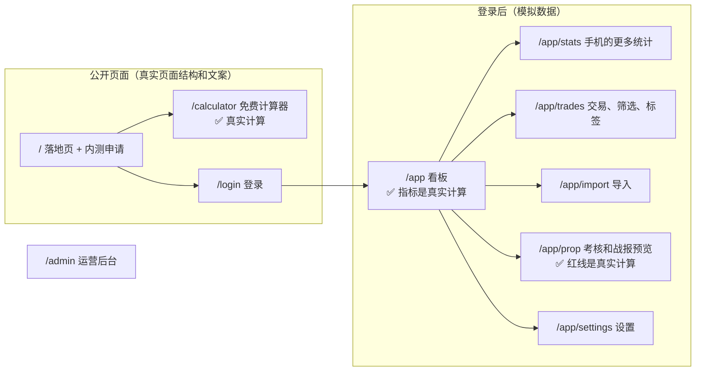

# v1 高保真原型说明：trading journal
- 版本：v1 草稿（2026-10-20）
- 变更历史：v1 草稿（2026-10-20）首次提交
- 负责：研发（原型），PM（原型走查，C40）
- 依据：agents main `e5a63bc`（v0.11.1）；《[00 架构方案](../00-架构方案.md)》v1（Amos 审核通过，合并节点 ①）；《[v1 需求说明书](../需求文档/v1-需求说明书.md)》v1.1
- 状态：**代码已完成，等待部署到原型环境**。部署需要 Amos 在 Cloudflare 和 GitHub 上操作（第 5 节），部署后在本文件补上每个页面的完整链接，再请 Amos 确认（协作总则第 4.5 步）
- 原型的代码在 Amos 确认后，作为正式开发的基础继续使用（研发 3.5）

## 一图看懂：原型里有什么

这张图想说明：一共 10 个页面。计算（指标、红线、计算器）用的是正式代码 `src/core/`，结果是真的；数据、登录、导入、Telegram、后台都是模拟的，页面顶部始终显示 PROTOTYPE。

## 1. 请 Amos 确认什么
1. **页面和流程**：10 个页面是否齐全，流程是否符合需求说明书。
2. **手机和电脑的结构**（C64）：看板、交易、导入、考核是否按效果图分别设计。
3. **文案**：中英文是否准确（右上角"中 / EN"切换）。
4. **两套主题**：深色、浅色、跟随系统（右上角切换）。
5. **决定**：确认继续 / 修改后再看 / 暂停或放弃。

另有两处需要 Amos 决定（第 6 节）：原型的部署方式和规范 K5 不完全一样；FundedNext、The5ers 的模板还没核对完。

## 2. 页面和链接
部署后，地址是 `https://trading-journal-prototype.<Amos 的 workers 子域名>.workers.dev`，只有通过 Cloudflare Access 登录后才能打开。部署完成后，下表补上完整链接。

| 页面 | 路径 | 看什么 |
|---|---|---|
| 落地页 | `/` | 卖点、怎么用、内测申请表 |
| 免费计算器 | `/calculator` | 改净值、换 1-Step，看"还可亏多少"和公式出处 |
| 登录 | `/login` | 邮箱 → 验证码（输入任意 6 位）→ 进入看板 |
| 看板 | `/app` | 手机首屏只有"今天还可亏"、净盈亏、胜率、曲线 |
| 更多统计（手机） | `/app/stats` | 品种、时段、星期、成本 |
| 交易 | `/app/trades` | 筛选、翻页（62 笔）、点一笔看详情、打标签 |
| 导入 | `/app/import` | 上传（模拟结果）、专属地址、四种导入状态 |
| 考核 | `/app/prop` | 红线、规则模板和出处、Telegram 战报预览 |
| 设置 | `/app/settings` | 账户和服务器时区、收件地址、删除数据（要输入 DELETE） |
| 运营后台 | `/admin` | 内测申请、邀请码、按渠道统计 |

**看其他状态**：在地址后面加参数。
- `?state=empty`：空状态（C32）
- `?state=loading`：加载中
- `?state=error`：出错和重试
- `?account=new-empty`：空账户
- `?account=mt4-personal`：亏损、没有考核规则的 MT4 账户
- `?lang=en`：英文
- `?theme=dark`：深色主题

## 3. 哪些是模拟的
| 部分 | 原型里 | 正式开发时 |
|---|---|---|
| 交易数据 | 3 个模拟账户：考核账户 62 笔、MT4 账户 23 笔、空账户；用固定种子生成 | 来自导入的报表 |
| 指标、红线、计算器 | **真实计算**（`src/core/`，有单元测试） | 同一份代码 |
| 登录、邀请码 | 不发邮件，任意 6 位验证码都能进 | Resend 发验证码，邀请码校验 |
| 上传报表 | 只检查扩展名和大小，显示模拟结果 | 解析 MT4/MT5 报表 |
| 专属收件地址 | 示例地址，域名用 `tradingjournal.example` 代替（域名待 Amos 提供） | `in+收件码@正式域名` |
| Telegram | 绑定状态可以切换，战报是预览 | 真实机器人 |
| 标签、笔记、设置、删除 | 只改页面上的状态，刷新后恢复 | 存数据库 |
| 后台 | 模拟数字 | 真实统计 |

## 4. 原型自检（实际执行，2026-10-20）
| 检查 | 方法 | 结果 |
|---|---|---|
| 单元测试 | `npm test`：金额、指标口径、FTMO 两个模板的红线（含效果图上的数字） | 14 个全部通过 |
| 类型、文案、构建 | `npm run typecheck`、`npm run check:messages`（236 个键，中英文一致）、`npm run build`、Worker 打包 | 全部通过 |
| 页面走查截图 | 本地 `wrangler dev` 运行原型 Worker，脚本截 80 张：10 个页面 × 手机 390 / 电脑 1280 × 浅色 / 深色 × 中文，加英文、空、加载中、出错、空账户、亏损账户，加平板 768 和 1440 | 自动检查（NaN、undefined、横向溢出、空白、未翻译的键名、控制台报错）全部通过 |
| 人工看图（C50） | 每个页面的手机版和电脑版至少各看一张；看板、交易、考核看了深浅两种主题 | 人工看了 27 张，其中 8 张是最终版本（其余在中间版本上看，之后的修改只涉及颜色、条数和模拟数据）；问题见下表。其余截图只有自动检查 |
| 交互（C40：像真实用户一样操作一遍） | 脚本实际点击：筛选和汇总、翻页、详情、标签、保存、语言切换、计算器（触线、非法金额、大金额、1-Step）、手机底部详情、删除确认、出错重试、登录、申请内测跳转 | 21 项全部通过 |

**自检中发现并修好的问题**：
| 编号 | 问题 | 怎么发现的 | 修复 |
|---|---|---|---|
| PF-01 | 平板宽度（768）下看板、交易页横向溢出 | 自动检查 | 768–1100 改为单栏或两栏 |
| PF-02 | 模拟数据最后一笔是 10-17，"今天"（10-19）没有交易，战报预览是空的 | 人工看图 | 生成器从"今天"开始生成 |
| PF-03 | 模拟数据太乐观（各品种、时段几乎全赚，胜率最高 86%），看不出亏损的样子 | 人工看图 | 调成有赚有亏：最终版本考核账户胜率 48.4%，净盈亏 +$518.19，有两个品种、两个时段是亏的；MT4 账户整体亏损 |
| PF-04 | 隔夜利息全是 $0（几乎都当天平仓），看不出 CFD 的隔夜成本 | 人工看图 | 约四分之一的单子持仓过夜 |
| PF-05 | 手机上星期柱状图的金额挤出屏幕 | 人工看图 | 超过 3 组时金额只显示到整数美元 |
| PF-06 | 深色主题的主按钮（#2F81F7 白字）对比度只有 3.75，删除按钮 3.53，低于 AA 的 4.5 | 人工看图后计算对比度 | 按钮单独用 `--accbtn`（深色 #1F6FEB，4.63）；删除按钮 #B42318（6.57） |
| PF-07 | 亏损账户的权益曲线也是绿色 | 人工看图 | 按最终盈亏着色 |
| PF-08 | 手机交易列表一页 50 条太长 | 人工看图 | 手机一页 20 条 |
| PF-09 | 柱状图下的笔数没有单位 | 人工看图 | 显示"N 笔" |

**测试方法的修正**（不是产品问题，C17、C67）：
- 截图全部空白、静态资源 404：重新构建清空了 `dist/`，本地 wrangler 还用旧的资源清单。重启后正常，记入问题索引 P-01。
- 交互脚本"出错时显示重试"第一次失败：脚本没有等模拟接口的 350 毫秒延迟。先看截图确认页面有重试按钮，再把脚本改成等按钮出现，之后通过。

## 5. 部署原型需要 Amos 操作（运维分步指导，C14）
原型部署到一个独立的 Worker `trading-journal-prototype`，只有模拟数据，不绑定任何真实资源。部署由 GitHub Actions 的 `deploy-prototype` 完成：先跑完整的 CI，全绿后才部署。一共 4 步，**在对话里一次给一步**：
1. 截图 Cloudflare 的 Workers & Pages → Plans，确认账号和套餐（K0、Q2）；
2. 创建 API Token（"Edit Cloudflare Workers" 模板，只授权到这个账户），和账户 ID 一起填进 GitHub 仓库的 Secrets（`CLOUDFLARE_API_TOKEN`、`CLOUDFLARE_ACCOUNT_ID`）。**值不发给 AI**；
3. 运行 `deploy-prototype`（Amos 点，或者 Amos 同意后由我触发）；
4. 给 `trading-journal-prototype` 的 workers.dev 地址开启 Cloudflare Access，只允许 Amos 的邮箱访问（Q4），然后从外部确认：不登录打不开，登录后能看到页面。

第 3 步和第 4 步之间，原型地址会有几分钟可以公开访问。里面只有模拟数据，没有任何密钥；但如果 Amos 希望一开始就受保护，可以先在 Cloudflare 里给 `*.workers.dev` 配好 Access，再部署（第 6 节 X1）。

## 6. 需要 Amos 决定
| 编号 | 问题 | 默认值 |
|---|---|---|
| X1 | 平台规范 K5 写的是"原型用 Worker Previews"。这里改成**部署成一个单独的 Worker**（`trading-journal-prototype`）。理由：Previews 要挂在生产 Worker 下面，现在还没有、也不应该提前部署生产 Worker；单独一个 Worker 更简单，也和生产完全隔离 | **改用单独的原型 Worker**，正式开发后的开发分支预览再按 K5 用 Previews；确认后在平台规范 v0.2 里补一句 |
| X2 | FundedNext、The5ers 的规则原文里，有几处算法没说清楚（例如"当天先赚的利润会抬高当天限额"具体怎么算）。原型里这两家显示"核对中"，不参与计算 | **正式开发前由 PM 再核对一次官网**；还说不清的，写信问考核公司，或者第一版先不上这两家 |
| X3 | 原型里"当日 00:00 余额"按 UTC 日期近似计算；正式版按考核公司的重置时区（FTMO 是 CE(S)T）计算 | 正式开发时按重置时区实现，加单元测试 |

## 跨角色反馈 / 分歧记录
| 编号 | 提出方 → 接收方 | 内容 | 状态 |
|---|---|---|---|
| F1 | 研发 → 运维 | 原型改成单独的 Worker，和 K5 不完全一样 | 转 Amos（X1） |
| F2 | 研发 → PM | FundedNext、The5ers 的模板算法需要再核对 | 转 Amos（X2） |
| F3 | PM → 研发 | 原型走查（C40）发现 PF-02、PF-03、PF-04、PF-08 | 已采纳，已修复 |
