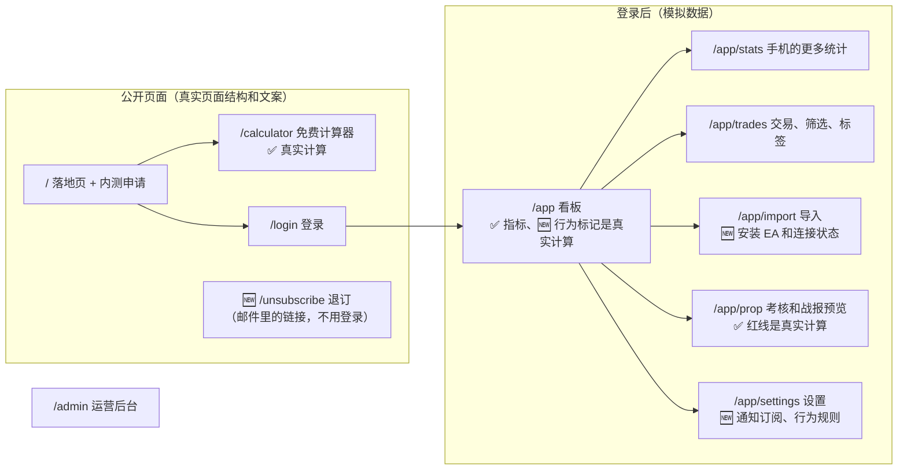

# v1 高保真原型说明：trading journal
- 版本：v1.2（2026-10-21）
- 变更历史：v1 草稿（2026-10-20）首次提交；v1.1（2026-10-20）Amos 对 X1–X3 回复"按默认"；v1.2 草稿（2026-10-21）按需求说明书 v1.2、架构方案 v1.1 补原型：EA 安装和连接状态、行为标记、通知订阅和推送预览、退订页（第 7 节）；v1.2（2026-10-21）Amos 对 Y1–Y3 回复"按默认"，情绪标签改名；部署到原型环境，补上链接和部署记录（第 5 节）
- 负责：研发（原型），PM（原型走查，C40）
- 依据：agents main `381c85f`（v0.11.1）；《[00 架构方案](../00-架构方案.md)》v1.1（Amos 审核通过，PR #3）；《[v1 需求说明书](../需求文档/v1-需求说明书.md)》v1.2（Amos 确认）
- 状态：**已部署到原型环境（2026-10-21，提交 `29ed5ff`），等待 Amos 确认原型**（协作总则第 4.5 步）。地址：https://trading-journal-prototype.jeff-zhaifei.workers.dev（要先登录 Cloudflare Access）
- 原型的代码在 Amos 确认后，作为正式开发的基础继续使用（研发 3.5）

## 一图看懂：原型里有什么

这张图想说明：一共 11 个页面（v1.2 只新增一个公开的退订页，EA 放在导入里，通知订阅放在设置里）。计算（指标、红线、计算器、行为标记）用的是正式代码 `src/core/`，结果是真的；数据、登录、导入、Telegram、后台都是模拟的，页面顶部始终显示 PROTOTYPE。

## 1. 请 Amos 确认什么
1. **页面和流程**：10 个页面是否齐全，流程是否符合需求说明书。
2. **手机和电脑的结构**（C64）：看板、交易、导入、考核是否按效果图分别设计。
3. **文案**：中英文是否准确（右上角"中 / EN"切换）。
4. **两套主题**：深色、浅色、跟随系统（右上角切换）。
5. **决定**：确认继续 / 修改后再看 / 暂停或放弃。

第 6 节的 X1–X3 Amos 已按默认确认。v1.2 新增的部分和要确认的事项见第 7 节。

## 2. 页面和链接
地址：`https://trading-journal-prototype.jeff-zhaifei.workers.dev`，只有通过 Cloudflare Access 登录后才能打开（用登录 Cloudflare 的邮箱收验证码）。下表的链接都可以直接点。

| 页面 | 路径 | 看什么 |
|---|---|---|
| 落地页 | [`/`](https://trading-journal-prototype.jeff-zhaifei.workers.dev/) | 卖点、怎么用、内测申请表 |
| 免费计算器 | [`/calculator`](https://trading-journal-prototype.jeff-zhaifei.workers.dev/calculator) | 改净值、换 1-Step，看"还可亏多少"和公式出处 |
| 登录 | [`/login`](https://trading-journal-prototype.jeff-zhaifei.workers.dev/login) | 邮箱 → 验证码（输入任意 6 位）→ 进入看板 |
| 看板 | [`/app`](https://trading-journal-prototype.jeff-zhaifei.workers.dev/app) | 手机首屏只有"今天还可亏"、净盈亏、胜率、曲线 |
| 更多统计（手机） | [`/app/stats`](https://trading-journal-prototype.jeff-zhaifei.workers.dev/app/stats) | 品种、时段、星期、成本 |
| 交易 | [`/app/trades`](https://trading-journal-prototype.jeff-zhaifei.workers.dev/app/trades) | 筛选、翻页（75 笔）、点一笔看详情、打标签；🆕 行为标记和按行为筛选 |
| 导入 | [`/app/import`](https://trading-journal-prototype.jeff-zhaifei.workers.dev/app/import) | 🆕 三个标签页：安装 EA（默认）和连接状态、上传和转发、导入记录 |
| 考核 | [`/app/prop`](https://trading-journal-prototype.jeff-zhaifei.workers.dev/app/prop) | 红线、规则模板和出处、Telegram 战报预览 |
| 设置 | [`/app/settings`](https://trading-journal-prototype.jeff-zhaifei.workers.dev/app/settings) | 账户和服务器时区、🆕 通知订阅和预览、🆕 行为规则参数、收件地址、删除数据（要输入 DELETE） |
| 退订 | [`/unsubscribe?kind=daily&account=ftmo-100k`](https://trading-journal-prototype.jeff-zhaifei.workers.dev/unsubscribe?kind=daily&account=ftmo-100k) | 🆕 邮件里的退订链接：先确认再退订，可以撤销 |
| 运营后台 | [`/admin`](https://trading-journal-prototype.jeff-zhaifei.workers.dev/admin) | 内测申请、邀请码、按渠道统计 |

**看其他状态**：在地址后面加参数。
- `?state=empty`：空状态（C32）
- `?state=loading`：加载中
- `?state=error`：出错和重试
- `?account=new-empty`：空账户
- `?account=mt4-personal`：亏损、没有考核规则的 MT4 账户
- `?lang=en`：英文
- `?theme=dark`：深色主题
- `/app/trades?flag=revenge&days=30`：近 30 天的报复性交易（`flag` 还可以是 `overtrading`、`holding`、`any`）

## 3. 哪些是模拟的
| 部分 | 原型里 | 正式开发时 |
|---|---|---|
| 交易数据 | 3 个模拟账户：考核账户 75 笔（含 v1.2 补的行为场景）、MT4 账户 23 笔、空账户；用固定种子生成 | 来自 EA 推送和导入的报表 |
| EA | 下载按钮只提示"原型"；令牌在浏览器里随机生成；三个账户分别是已连接、已断开、从未连接 | 第 5 步开发 EA；令牌只存哈希（架构方案 v1.1） |
| 行为标记 | **真实计算**（`src/core/behavior.ts`，21 个用例），用默认参数 | 同一份代码，结果存 `behavior_flags` 表 |
| 通知订阅、行为规则参数 | 只改页面上的状态；改参数不影响页面上已有的标记 | 存数据库；只影响之后的交易（AC-B5） |
| 推送预览 | 每日战报、行为习惯用模拟数据实时算；接近红线、EA 断开是示例 | Worker 按同样结构生成，经发件箱发送 |
| 退订页 | 不校验链接，确认后只显示"已退订" | 校验签名链接，改订阅 |
| 指标、红线、计算器 | **真实计算**（`src/core/`，有单元测试） | 同一份代码 |
| 登录、邀请码 | 不发邮件，任意 6 位验证码都能进 | Resend 发验证码，邀请码校验 |
| 上传报表 | 只检查扩展名和大小，显示模拟结果 | 解析 MT4/MT5 报表 |
| 专属收件地址 | 示例地址，域名用 `tradingjournal.example` 代替（域名待 Amos 提供） | `in+收件码@正式域名` |
| Telegram | 绑定状态可以切换，战报是预览 | 真实机器人 |
| 标签、笔记、设置、删除 | 只改页面上的状态，刷新后恢复 | 存数据库 |
| 后台 | 模拟数字 | 真实统计 |

## 4. 原型自检（实际执行，2026-10-20）
| 检查 | 方法 | 结果 |
|---|---|---|
| 单元测试 | `npm test`：金额、指标口径、FTMO 两个模板的红线（含效果图上的数字） | 14 个全部通过 |
| 类型、文案、构建 | `npm run typecheck`、`npm run check:messages`（236 个键，中英文一致）、`npm run build`、Worker 打包 | 全部通过 |
| 页面走查截图 | 本地 `wrangler dev` 运行原型 Worker，脚本截 80 张：10 个页面 × 手机 390 / 电脑 1280 × 浅色 / 深色 × 中文，加英文、空、加载中、出错、空账户、亏损账户，加平板 768 和 1440 | 自动检查（NaN、undefined、横向溢出、空白、未翻译的键名、控制台报错）全部通过 |
| 人工看图（C50） | 每个页面的手机版和电脑版至少各看一张；看板、交易、考核看了深浅两种主题 | 人工看了 27 张，其中 8 张是最终版本（其余在中间版本上看，之后的修改只涉及颜色、条数和模拟数据）；问题见下表。其余截图只有自动检查 |
| 交互（C40：像真实用户一样操作一遍） | 脚本实际点击：筛选和汇总、翻页、详情、标签、保存、语言切换、计算器（触线、非法金额、大金额、1-Step）、手机底部详情、删除确认、出错重试、登录、申请内测跳转 | 21 项全部通过 |

**自检中发现并修好的问题**：
| 编号 | 问题 | 怎么发现的 | 修复 |
|---|---|---|---|
| PF-01 | 平板宽度（768）下看板、交易页横向溢出 | 自动检查 | 768–1100 改为单栏或两栏 |
| PF-02 | 模拟数据最后一笔是 10-17，"今天"（10-19）没有交易，战报预览是空的 | 人工看图 | 生成器从"今天"开始生成 |
| PF-03 | 模拟数据太乐观（各品种、时段几乎全赚，胜率最高 86%），看不出亏损的样子 | 人工看图 | 调成有赚有亏：最终版本考核账户胜率 48.4%，净盈亏 +$518.19，有两个品种、两个时段是亏的；MT4 账户整体亏损 |
| PF-04 | 隔夜利息全是 $0（几乎都当天平仓），看不出 CFD 的隔夜成本 | 人工看图 | 约四分之一的单子持仓过夜 |
| PF-05 | 手机上星期柱状图的金额挤出屏幕 | 人工看图 | 超过 3 组时金额只显示到整数美元 |
| PF-06 | 深色主题的主按钮（#2F81F7 白字）对比度只有 3.75，删除按钮 3.53，低于 AA 的 4.5 | 人工看图后计算对比度 | 按钮单独用 `--accbtn`（深色 #1F6FEB，4.63）；删除按钮 #B42318（6.57） |
| PF-07 | 亏损账户的权益曲线也是绿色 | 人工看图 | 按最终盈亏着色 |
| PF-08 | 手机交易列表一页 50 条太长 | 人工看图 | 手机一页 20 条 |
| PF-09 | 柱状图下的笔数没有单位 | 人工看图 | 显示"N 笔" |

**测试方法的修正**（不是产品问题，C17、C67）：
- 截图全部空白、静态资源 404：重新构建清空了 `dist/`，本地 wrangler 还用旧的资源清单。重启后正常，记入问题索引 P-01。
- 交互脚本"出错时显示重试"第一次失败：脚本没有等模拟接口的 350 毫秒延迟。先看截图确认页面有重试按钮，再把脚本改成等按钮出现，之后通过。

## 5. 部署原型需要 Amos 操作（运维分步指导，C14）
原型部署到一个独立的 Worker `trading-journal-prototype`，只有模拟数据，不绑定任何真实资源。部署由 GitHub Actions 的 `deploy-prototype` 完成：先跑完整的 CI，全绿后才部署。一共 4 步，**在对话里一次给一步**：
1. 截图 Cloudflare 的 Workers & Pages → Plans，确认账号和套餐（K0、Q2）；
2. 创建 API Token（"Edit Cloudflare Workers" 模板，只授权到这个账户），和账户 ID 一起填进 GitHub 仓库的 Secrets（`CLOUDFLARE_API_TOKEN`、`CLOUDFLARE_ACCOUNT_ID`）。**值不发给 AI**；
3. 运行 `deploy-prototype`（Amos 点，或者 Amos 同意后由我触发）；
4. 给 `trading-journal-prototype` 的 workers.dev 地址开启 Cloudflare Access，只允许 Amos 的邮箱访问（Q4），然后从外部确认：不登录打不开，登录后能看到页面。

**部署记录（实际执行，2026-10-21）**：
| 步骤 | 谁做的 | 结果 |
|---|---|---|
| 1. 确认账号和套餐 | Amos | Workers Free（原型够用；测试环境前要升级 Paid） |
| 2. API Token 和账户 ID 填进 GitHub Secrets | Amos | 已填；值没有经过 AI |
| — 把部署工作流放到 `main` | 研发开 PR #4，Amos 合并 | GitHub 只有默认分支上的手动工作流才能运行，原计划漏了这一点 |
| 3. 运行 `deploy-prototype`（分支 `claude/v1-prototype`） | Amos 点运行 | CI 和部署都通过；从外部访问 `/api/health` 返回 `{"ok":true,"env":"prototype","version":"29ed5ff"}` |
| 4. Cloudflare Access | Amos（开通 Zero Trust Free，Worker 的 Access 标签页：范围 All traffic，策略 Cloudflare account；账户只有 Amos 一个成员） | 从外部不登录访问 `/`、`/app`、`/api/health` 都跳到 Cloudflare Access 登录页；Amos 用浏览器登录后能看到原型 |

部署后到开启 Access 之间，原型地址有十几分钟可以公开访问；里面只有模拟数据，没有密钥。Cloudflare 的界面和第 4 步原来写的不一样（Access 在 Worker 的单独标签页里），已按实际界面指导。

以后更新原型：合并到 `claude/v1-prototype` 后，在 Actions 里再运行一次 `deploy-prototype`（分支选 `claude/v1-prototype`）。

第 3 步和第 4 步之间，原型地址会有几分钟可以公开访问。里面只有模拟数据，没有任何密钥；但如果 Amos 希望一开始就受保护，可以先在 Cloudflare 里给 `*.workers.dev` 配好 Access，再部署（第 6 节 X1）。

## 6. Amos 的决定（2026-10-20，全部按默认）
| 编号 | 问题 | 结论 |
|---|---|---|
| X1 | 平台规范 K5 写的是"原型用 Worker Previews"。这里改成**部署成一个单独的 Worker**（`trading-journal-prototype`）。理由：Previews 要挂在生产 Worker 下面，现在还没有、也不应该提前部署生产 Worker；单独一个 Worker 更简单，也和生产完全隔离 | **改用单独的原型 Worker**；正式开发后的开发分支预览再用 Previews。平台规范已按此改为 v0.1.1（[agents PR #20](https://github.com/dollar3651314/agents/pull/20)） |
| X2 | FundedNext、The5ers 的规则原文里，有几处算法没说清楚（例如"当天先赚的利润会抬高当天限额"具体怎么算）。原型里这两家显示"核对中"，不参与计算 | **正式开发前由 PM 再核对一次官网**；还说不清的，写信问考核公司，或者第一版先不上这两家 |
| X3 | 原型里"当日 00:00 余额"按 UTC 日期近似计算；正式版按考核公司的重置时区（FTMO 是 CE(S)T）计算 | 正式开发时按重置时区实现，加单元测试 |

## 7. v1.2 补充（2026-10-21）
### 7.1 新增了什么
| 需求 | 在哪里 | 截图 |
|---|---|---|
| EA 安装四步、令牌只显示一次、"只读取账户数据，不会下单" | 导入 → 安装 EA | `assets/v1/proto-导入-电脑-浅色.png`、`assets/v1/proto-导入EA-手机-深色-英文.png` |
| 每个账户的 EA 连接状态（已连接、已断开、从未连接） | 导入 → 安装 EA 右侧（手机在上面） | 同上 |
| 红线按 EA 推送的净值估算，写明时间 | 看板、考核的红线卡片底部 | `assets/v1/proto-看板-电脑-深色.png` |
| 行为习惯：近 30 天每条规则的次数和净盈亏合计，点开看对应交易（AC-B3） | 看板（电脑在曲线下面，手机在"更多统计"） | `assets/v1/proto-看板-电脑-深色.png`、`assets/v1/proto-更多统计-手机-深色.png` |
| 交易列表的行为标记、按行为筛选、详情写明事实（AC-B2） | 交易 | `assets/v1/proto-交易行为标记-电脑-深色.png`、`assets/v1/proto-扛单详情-手机-浅色.png` |
| 5 种内容 × Telegram / 邮件，默认值按 AC-N1；每行可以预览 | 设置 → 通知订阅 | `assets/v1/proto-通知订阅-电脑-浅色.png`、`assets/v1/proto-邮件预览-电脑-深色.png` |
| 行为规则参数、关闭规则（AC-B5） | 设置 → 行为规则 | `assets/v1/proto-通知订阅-电脑-浅色.png` |
| 退订（不用登录，AC-N6） | `/unsubscribe` | `assets/v1/proto-退订-手机-浅色.png` |

文案按 AC-B4 的关键词清单扫了一遍中英文全部 354 个键：只有免责声明里的"不构成投资建议"和落地页风险提示里的"不推荐任何经纪商"命中（需求说明书 11.2 节列为例外的那一类）。原来英文的 EA 标签 "Recommended" 也会命中，已改成 "Preferred"。

### 7.2 自检（实际执行，2026-10-21）
| 检查 | 方法 | 结果 |
|---|---|---|
| 单元测试 | `npm test`：v1 的 14 个 + 行为规则 21 个（`test/behavior.test.ts`：每条规则 6 组以上，含刚好达到阈值、差一点、历史不足；看板汇总） | 35 个全部通过 |
| 类型、文案、构建 | `npm run typecheck`、`npm run check:messages`（354 个键）、`npm run build` | 全部通过 |
| 页面走查截图 | 同第 4 节的脚本，加上退订页和行为筛选，共 92 张 | 自动检查全部通过 |
| 人工看图（C50） | 看了 14 张：看板（电脑深色）、导入（电脑浅色、手机深色英文）、设置（电脑浅色含 Telegram 预览、电脑深色含邮件预览、手机深色）、交易（电脑深色含详情、手机浅色含底部详情）、退订、更多统计；`assets/v1/` 里的 9 张是最终版本重新截的 | 问题见下表 |
| 交互（C40） | 原来的 21 项，加 14 项：导入的三个标签页、生成令牌、看板点行为 → 交易列表筛到对应交易、详情的事实、按"有行为标记"筛选、订阅默认值、勾选、EA 断开预览、邮件预览的退订链接、关闭规则、退订先确认再退订 | 35 项全部通过 |

**自检中发现并修好的问题**：
| 编号 | 问题 | 怎么发现的 | 修复 |
|---|---|---|---|
| PF-10 | 电脑看板把行为卡片放在红线下面，右侧曲线下面空出一大块 | 人工看图 | 行为卡片移到曲线下面，三条规则横排 |
| PF-11 | 带"复制"按钮的地址框，按钮紧贴文字，没有靠右 | 人工看图 | `.field.row` 改成左右排列 |
| PF-12 | 生成的令牌末尾是一串 x | 人工看图 | 改成 32 位随机字符 |
| PF-13 | 令牌字符表有 55 个字符，代码按 56 取余，偶尔会生成带 "undefined" 的令牌 | 交互测试失败后查代码 | 按字符表的实际长度取余 |
| PF-14 | 持仓时间写成"1146 分钟"，不好读 | 人工看图 | 超过 1 小时写"19 小时 6 分钟" |
| PF-15 | 从其他菜单切到"设置"时，整个页面（包括顶部导航）变窄，Logo 和菜单往中间跳了 140 像素 | **Amos 在原型环境发现**。原因：设置页把整个页面的最大宽度改成了 1000；截图走查每次只截一个页面，看不出切换时的变化 | 顶部导航始终同一宽度，只收窄设置页的内容（和导航左对齐）；预留滚动条位置；交互测试加上"5 个页面的导航位置一致"（1280、1920 两种宽度） |

**测试方法的修正**（C67）：
- 交互脚本的"按品种筛选""翻到第 2 页"两项失败：脚本里写死了旧的总数 62 笔，v1.2 补行为场景后是 75 笔。确认页面显示的数字和模拟数据一致后，改了脚本的预期。
- 重启本地 wrangler 时，用"按命令行匹配"结束进程，匹配到了执行命令的 shell 自己，命令被中断。改成先列出进程、只结束 wrangler 的 PID（C69）。

### 7.3 Amos 的决定（2026-10-21，全部按默认）
| 编号 | 问题 | 结论 |
|---|---|---|
| Y1 | 系统的行为标记"报复性交易"和用户自己的情绪标签"报复性交易"同名。两者样式不同（标记是橙色边框，标签是灰底），但容易混 | **情绪标签改名为"想回本"（英文 "Win it back"）**，系统标记保持"报复性交易"。已改文案，键名 `tag.revenge` 不变 |
| Y2 | 退订页打开后要点一下"确认退订"才生效，不是打开链接就退订。原因：邮箱的安全扫描会预先打开邮件里的链接，直接退订会误退。同时每封邮件带 `List-Unsubscribe` 一键退订头，邮箱自带的"退订"按钮可以一步完成 | **先确认再退订**；架构方案下一版补上 `List-Unsubscribe` 和 `List-Unsubscribe-Post` 一键退订头（待办，F7） |
| Y3 | 过度交易标在"那一天"。交易列表里把那天的每一笔都显示"过度交易日"，按过度交易筛选时列出那天的全部交易 | **按这个做** |

## 跨角色反馈 / 分歧记录
| 编号 | 提出方 → 接收方 | 内容 | 状态 |
|---|---|---|---|
| F1 | 研发 → 运维 | 原型改成单独的 Worker，和 K5 不完全一样 | 转 Amos（X1）：已确认，平台规范 v0.1.1 |
| F2 | 研发 → PM | FundedNext、The5ers 的模板算法需要再核对 | 转 Amos（X2）：已确认，正式开发前 PM 核对 |
| F3 | PM → 研发 | 原型走查（C40）发现 PF-02、PF-03、PF-04、PF-08 | 已采纳，已修复 |
| F4 | 研发 → PM | 需求说明书 7.3 节的"交易日"没写清楚。代码按"周一到周五（UTC 日期），没有交易的交易日按 0 笔计入均值，历史从第一笔交易那天算起"实现（`src/core/behavior.ts`） | 待 PM 写进需求说明书 7.3 节 |
| F5 | 研发 → PM | 报复性交易的"上一笔"按"新仓开仓之前最后平仓的那一笔"实现，有单元测试 | 待 PM 写进需求说明书 7.3 节 |
| F6 | PM → 研发 | v1.2 原型走查发现 PF-10、PF-12、PF-14 | 已采纳，已修复 |
| F8 | Amos → 研发 | 原型环境里点"设置"时页面结构明显变化（PF-15） | 已修复；自检加上跨页面的导航位置检查 |
| F7 | 研发 → 研发、运维 | Y2：推送邮件要带 `List-Unsubscribe`、`List-Unsubscribe-Post` 头，退订接口用 POST | 待写进架构方案下一版 |
