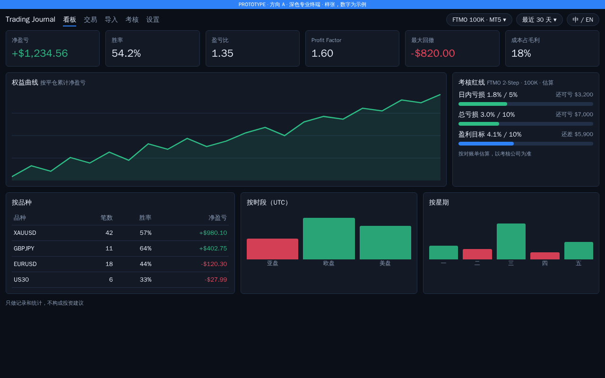
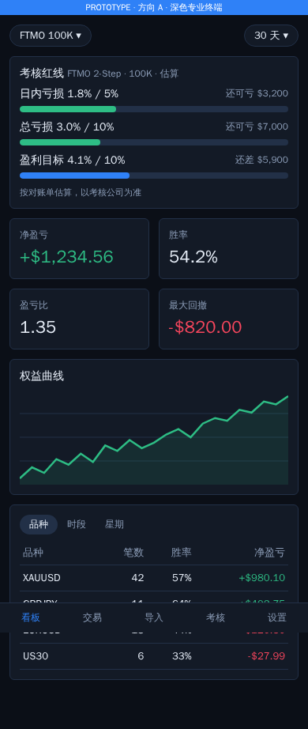
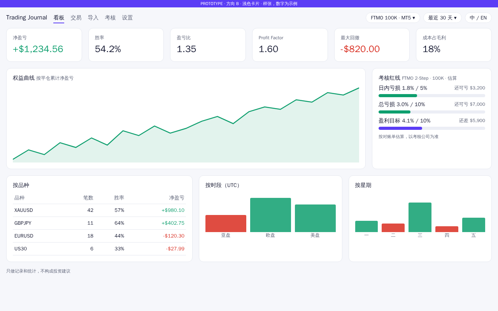
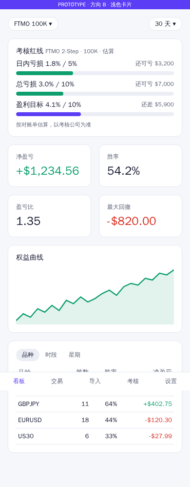
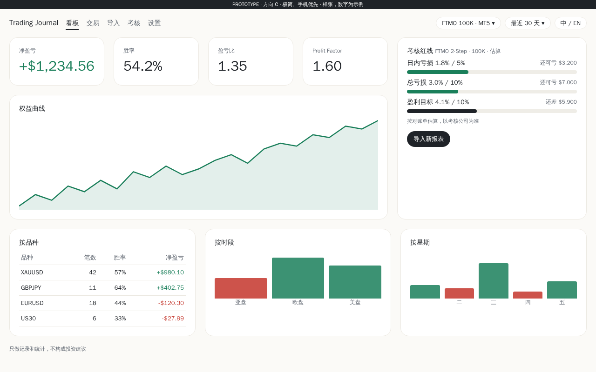
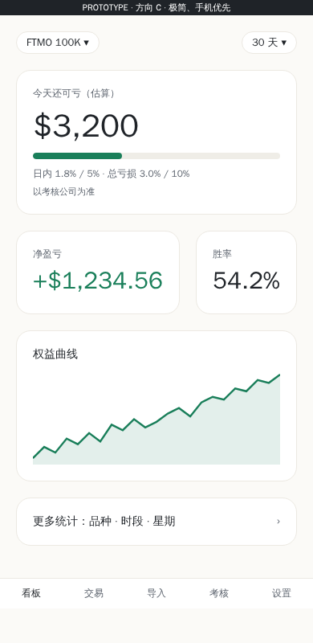

# v1 UI 风格方向：trading journal
- 版本：v1 草稿 1（2026-10-20）
- 变更历史：草稿 1（2026-10-20）首次提交
- 负责：PM（agents 规则 C65）。竞品清单来自市场（《[v1 市场调研与推广策略](../市场/v1-市场调研与推广策略.md)》第 4 节）
- 依据：agents main `f2a760c`（v0.11）
- 状态：**等待 Amos 选择一个方向**。选定后，研发按这个方向画关键页面的效果图，补进《[00 架构方案](../00-架构方案.md)》第 5 节
- 样张说明：下面 6 张图是 PM 用 HTML/CSS 渲染的**风格样张**。内容一样，只换风格；数字都是示例。不是效果图，也不是原型

## 一图看懂：三个方向放在一起

| | 电脑（1280） | 手机（390） |
|---|---|---|
| **A 深色专业终端** |  |  |
| **B 浅色卡片** |  |  |
| **C 极简、手机优先** |  |  |

这张表想说明：同样的看板内容，A 信息最密、最像交易软件；B 最像主流 SaaS；C 在手机上把"今天还可亏多少"放到最大，其他统计放到下一层。

## 1. 竞品调研（C66：逐条标出处）
看的都是未登录的公开页面。产品内部界面只能从官网的产品示意图判断。颜色值是从页面计算样式里读出来的。

| 产品 | 默认 | 主色 | 密度 | 盈亏颜色 | 手机 | 标注和出处 |
|---|---|---|---|---|---|---|
| TradeZella | 浅色 | 紫 #4C23FF，按钮用紫到粉的渐变 | 中：浅色卡片、日历热力图、灰色胶囊标签 | 绿色大数字；日历浅绿、浅红 | 响应式单栏；App 未查到 | 证实，[tradezella.com](https://www.tradezella.com/) |
| TradesViz | 浅色，有日 / 夜切换 | 蓝 #2563EB | 高：组件很多，宣传"600+ 统计" | 曲线跌到 0 以下变红；日历大面积红绿 | 有 iOS、Android App | 证实，[tradesviz.com](https://www.tradesviz.com/) |
| Edgewonk | 浅色和深色都有 | 绿 #059669 | 中：一排小 KPI 卡（迷你图、仪表、环形图） | 红绿比较克制 | 未查到 | 证实，[edgewonk.com](https://edgewonk.com/) |
| FX Blue | 深色 #062043 | 蓝色描边卡片 | 中 | 情绪条用蓝和红，不用绿 | 未查到 | 证实，[fxblue.com](https://www.fxblue.com/) |
| FTMO | 深色 #09090B | 蓝 #0781FE | Account MetriX：权益曲线（金额和百分比两种显示）、余额、净值、未实现盈亏、每日盈亏日历 | 博客配图是宣传图，不是真实界面 | — | 证实，[ftmo.com](https://ftmo.com/en/)、[Account MetriX 博客](https://ftmo.oanda.com/blog/account-metrix-a-tool-for-analyzing-and-improving-your-prop-trading/) |
| TradingView | 浅色（未登录时） | 蓝 #2962FF；涨 #089981、跌 #F23645 | 很高：工具栏、自选列表，数字右对齐 | 红绿文字 | 精简的响应式页面 | 证实，[tradingview.com](https://www.tradingview.com/)、[图表页](https://www.tradingview.com/chart/) |
| TraderSync | 深色仪表盘，可以切换浅色 | — | 20 多个组件 | — | 有 iPhone App | 推断（官网被拦截，只看到搜索摘要） |
| Myfxbook | — | — | — | — | — | 未查到（官网被拦截） |

**共性**【证实】：
- 几乎每家都有日历热力图（红绿格）。
- KPI 普遍是"小卡片 + 大数字"。
- 绿色表示盈利、红色表示亏损是行业惯例。

## 2. 三个方向
| | A 深色专业终端 | B 浅色卡片 | C 极简、手机优先 |
|---|---|---|---|
| 参考 | FTMO、FX Blue、TradingView 的密度；Edgewonk 深色版 | TradeZella、TradesViz、Edgewonk 浅色版 | Edgewonk 克制的 KPI；TradesViz 有原生 App（这一条的证据最少，主要是推断） |
| 颜色 | 近黑底 #0B0F17，蓝 #2F81F7，涨 #2EBD85、跌 #F6465D | 浅灰底 #F6F7FB，紫 #5B3DF5，涨 #0E9F6E、跌 #D92D20 | 米白底 #FBFAF7，黑色强调，涨 #1A7F5A、跌 #C4352B |
| 电脑版 | 6 个 KPI + 曲线 + 红线 + 3 组拆分，一屏看全 | 结构同 A，留白更多、圆角更大 | 只放 4 个 KPI，红线卡更突出，拆分放在下面 |
| 手机版 | 红线卡在最上，下面 4 个 KPI、曲线、品种表 | 同 A | 第一屏只有"今天还可亏多少"（大字）、净盈亏、胜率和曲线；其他统计点进下一层 |
| 文字对比度（在卡片底色上，实际计算） | 正文 14.8、次要文字 6.2、涨 7.3、跌 5.0，都达到 AA（4.5:1） | 正文 17.6、次要文字 5.9、跌 4.8；**涨 #0E9F6E 只有 3.4**，大号数字够用，小字不够。选 B 时研发要把绿色加深（例如 #047857） | 正文 15.8、次要文字 5.8、涨 5.0、跌 5.4，都达到 AA |
| 适合谁 | 考核中的交易者、重度日内交易者，长时间看盘 | 做周复盘的交易者、新手；营销截图好看 | 主要在手机上看战报和考核进度的人 |
| 优点 | 和 MT5、TradingView、FTMO 的使用习惯一致；红线进度条在深色底上很醒目 | 读起来轻松，适合放大量分组统计和标签；用户不用重新适应 | 手机体验最好；和 Telegram 战报"一句话看结论"的思路一致；和竞品长得不一样 |
| 缺点 | 手机上容易显得挤；深色底上的红绿要仔细调对比度；营销截图放在白色背景里比较突兀 | 容易和 TradeZella、TradesViz 长得一样 | 电脑版信息密度低，重度用户可能嫌"不够全"；电脑版的扩展布局要单独设计 |

## 3. PM 的推荐
**推荐 C 的结构，配 A 和 B 两套颜色（深浅主题跟随系统，用户也可以手动切换）**。理由：
1. 我们的定位是"每天告诉你，离考核红线还有多远"（市场 §5）。C 把这一个数字放在手机第一屏最大的位置，和卖点完全对应。
2. 主打的考核用户大多在手机和 Telegram 上看结论（推断），C 的手机结构最省一次点击。
3. 深浅两套颜色可以兼顾两类用户：习惯深色交易软件的人，和需要浅色营销截图的场景。代价是研发要多维护一套颜色变量（工作量小）。

如果只选一个、不要两套主题，PM 推荐 **C**。

## 4. 请 Amos 选择
| 选项 | 内容 |
|---|---|
| **1（推荐）** | C 的结构 + 深色和浅色两套主题 |
| 2 | 只用 A |
| 3 | 只用 B |
| 4 | 只用 C（只有浅色） |
| 其他 | 例如"A 的颜色 + C 的手机结构"，直接说明即可 |

## 跨角色反馈 / 分歧记录
| 编号 | 提出方 → 接收方 | 内容 | 状态 |
|---|---|---|---|
| F1 | 市场 → PM | 竞品清单（市场 §4） | 已采纳：作为第 1 节的调研对象 |
| F2 | PM → 研发 | 选定方向后，效果图要满足 WCAG AA 对比度（4.5:1），深色主题的红绿要单独检查 | 已采纳：效果图阶段执行 |
