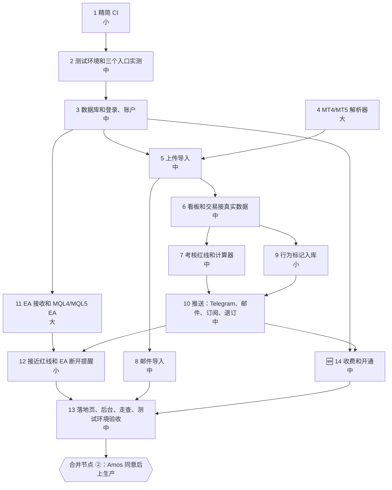

# v1 任务清单：trading journal
- 版本：v1.1 草稿（2026-10-22）
- 变更历史：v1 草稿（2026-10-21）首次提交，原型确认后由 PM 拆解（协作总则第 5 步）；v1.1 草稿（2026-10-22）按需求说明书 v1.3 草稿：新增第 14 步"收费和开通"，第 13 步加上客户活跃和渠道质量，活跃记录在第 3、5、11 步埋点；测试环境用免费版（第 2 步）。**v1.3 确认后生效**
- 负责：PM（拆解和维护），研发、测试、运维（执行）
- 依据：agents main `72ebf0f`（v0.11.2，含精简 CI C74）；《[v1 需求说明书](v1-需求说明书.md)》v1.2；《[00 架构方案](../00-架构方案.md)》v1.1 第 4 节；《[原型说明](../技术方案/v1-原型说明.md)》v1.2（2026-10-21 Amos 确认继续）
- 执行方式：**分步执行模式（C63）**。每步一个开发分支、一个 PR，合并到 `staging`；每步结束后停下，等 Amos 回复"继续"
- **进度只写在进度看板里**：[Issue #5](https://github.com/dollar3651314/trading-journal/issues/5)。本文件只写计划，不写进度

## 一图看懂：步骤和依赖

这张图想说明：
- 第 1 步不依赖任何东西，可以马上开始；
- 第 4 步（解析器）只依赖报表样本，可以和第 2、3 步并行；
- 第 11 步（EA）只依赖登录和账户，等 Amos 提供模拟账户和 VPS 后可以提前做；
- 所有步骤都在测试环境验收后，才在合并节点 ② 上生产。

## 1. 步骤
工作量是估计（小 / 中 / 大），不是实测。原型已经做好的页面和 `src/core/` 的计算会直接复用，所以第 6、9 步比架构方案估计的小。

| 步骤 | 内容 | 负责 | 依赖 | 优先级 | 工作量 | 完成标准 |
|---|---|---|---|---|---|---|
| 1 | **精简 CI（C74）**：按改动路径跳过不需要的检查、汇总 job `ci-ok`、`concurrency`、缓存、超时；分支保护的"必须通过"改成 `ci-ok`（运维分步指导 Amos） | 研发、运维 | 无 | P0 | 小 | 只改文档的 PR 只跑基本检查，其他显示"跳过"；`ci-ok` 汇总正确（故意让一项失败，`ci-ok` 也失败）；`staging`、`main` 的分支保护都要求 `ci-ok` |
| 2 | **测试环境**（🆕 v1.1：全部用免费版，Amos 2026-10-21；部署后先实测 CPU，架构风险 R12）：staging Worker、自定义域名、Neon 测试库、Hyperdrive、R2、环境标识（C34）；合并到 `staging` 后自动部署；按功能拆分的健康检查（C28）；**实测三个入口（fetch、email、scheduled）、Cron 准点程度、`in+…` 收件地址**（风险 R4–R6）；问 Amos 要不要开外部可用性探测（运维 v0.10.2） | 运维、研发 | 1 | P0 | 中 | 测试环境地址能打开，健康检查各项 ok；R4–R6 有实测记录；密钥只由 Amos 填写 |
| 3 | **数据库和登录**：建表迁移（`db/`）、邮箱验证码登录（Resend）、🆕 后台登录（只认管理员邮箱）、邀请码、交易账户的增删改、删除全部数据（AC-A1–A5）；🆕 打开页面时记活跃（`activity_daily`，AC-G11） | 研发、测试 | 2 | P0 | 中 | 在真实 Postgres 上跑测试（C37）；AC-A1–A5 通过 |
| 4 | **MT4/MT5 解析器**：解析 HTML 报表，标准答案测试（AC-I1–I3）；金额整数、MT5 分次平仓合并、去重键 | 研发、测试 | 报表样本 | P0 | 大 | 每份样本都有标准答案，解析结果和报表合计一致 |
| 5 | **上传导入**：上传、R2 存原件、导入记录、失败原因（AC-I4–I7）；🆕 导入成功记数据活跃 | 研发、测试 | 3、4 | P0 | 中 | 重复导入不重复记账；失败写明具体原因 |
| 6 | **看板和交易接真实数据**：原型页面换成真实接口，删掉对应的模拟数据；标签、笔记保存（AC-D1–D6） | 研发、测试 | 5 | P0 | 中 | 数字和 `src/core/` 单元测试一致；超过一页能看到全部（C41、C49） |
| 7 | **考核红线和计算器**：按考核公司的重置时区算（X3）；**PM 核对 FundedNext、The5ers 官网原文**（X2），核对不清的先不上（AC-R1–R4、R7，AC-G4） | PM、研发、测试 | 6 | P1 | 中 | 每个模板写明出处和核对日期；红线计算有单元测试 |
| 8 | **邮件导入**：Email Routing 收件、`in+收件码@域名`、只认已绑定的收件码、不是对账单就忽略 | 研发、运维、测试 | 5、域名 | P1 | 中 | 测试环境实际转发一封对账单邮件并入账 |
| 9 | **行为标记入库**：入账后计算、存 `behavior_flags`、设置里的参数存数据库、改参数不影响已有标记（AC-B1–B5）；PM 把"交易日""上一笔"的口径写进需求说明书 7.3 节（原型说明 F4、F5） | 研发、PM、测试 | 6 | P1 | 小 | AC-B4 关键词扫描纳入 CI；用例和原型一致 |
| 10 | **推送**：发件箱（去重、重试）、Telegram 绑定、Resend 推送邮件、通知订阅、签名退订链接和 `List-Unsubscribe` 头（原型说明 Y2、F7）、每日战报、每周复盘（AC-N1、N2、N6、N7） | 研发、测试 | 7、9 | P1 | 中 | 定时任务用固定时钟测；并发执行两次只发一条；真实发一封测试邮件并退订 |
| 11 | **EA**：`/api/ea/push` 接口、令牌（只存哈希）、连接状态；MQL4、MQL5 EA 源码、编译和发布（R8）；CI 扫描下单函数（AC-E1）；**用模拟账户实测**（AC-E1–E8）；🆕 推送记数据活跃（每人每天一行） | 研发、测试、运维 | 3、MT5 模拟账户和 VPS | P1 | 大 | 模拟账户连续推送 24 小时以上，平仓交易入账、和报表一致 |
| 12 | **提醒**：接近红线（EA 净值，70% / 90%）、行为提醒、EA 断开（AC-N3–N5） | 研发、测试 | 10、11 | P1 | 小 | 时效和去重有测试；测试环境实测一次 |
| 13 | **收尾**：落地页、🆕 后台客户列表、客户详情（含交易数据和查看记录）、渠道质量（AC-G7–G11）、全部页面走查（手机、平板、电脑，深浅主题）、**测试环境验收**（C34）、部署方案和推广方案（市场 C72） | 全部 | 8、12、14 | P0 | 大 | Amos 在测试环境验收通过；然后在合并节点 ② 请 Amos 同意上生产 |

| 🆕 14 | **收费和开通**（v1.3 草稿 CH7）：套餐权限按 `src/core/billing.ts`、价格和收款设置、收费链接（发邮件和 Telegram）、付费页、提交交易哈希、后台订单（确认到账、有问题、取消）、到期提醒和降级、试用、直接开通（AC-P1–P11）；测试环境用真实小额转账走一遍（T19） | 研发、测试、运维 | 3、10、收款地址 | P1 | 中 | 一笔真实的小额 USDT-TRC20 转账从发链接到开通走通；并发确认只开通一次 |

## 2. 每步都要做（不再逐条写进上表）
- 开始前重新拉取 agents main 和项目的 `staging`（C62、C68）。
- 同一个 PR 里更新《项目地图》《项目索引》（C53）；CI 是绿的才合并（C54）。
- 涉及界面时，按原型和效果图实现，手机和电脑分开（C64）；截图自查后人工看图（C50）。
- 每步结束在进度看板写：PR 链接、CI 链接、做了什么、"实际执行"还是"代码走查"、没做完的部分（C63）。

## 3. 需要 Amos 提供的东西，以及在哪一步之前
| 编号 | 内容 | 哪一步之前 | 状态 |
|---|---|---|---|
| N1 | 把分支保护的"必须通过"改成 `ci-ok`（运维分步指导） | 第 1 步合并时 | 待第 1 步 |
| N2 | **域名** | 第 2 步 | 待提供 |
| ~~N3~~ | ~~Cloudflare 升级到 Workers Paid~~ | — | 🆕 不需要：测试阶段用免费版（Amos 2026-10-21）；生产前按实测再定 |
| N4 | Neon 账号（Amos 注册，连接串只由 Amos 填进 Cloudflare） | 第 2 步 | 待提供 |
| N5 | Resend 账号和发信域名验证（DNS 由 Amos 在 Cloudflare 里加） | 第 3 步 | 待提供 |
| N6 | 脱敏后的 MT4、MT5 HTML 报表各至少一份；有对账单邮件的也给一封 | 第 4 步 | 待提供 |
| N7 | Telegram 机器人（Amos 在 @BotFather 创建，令牌只由 Amos 填写） | 第 10 步 | 待提供 |
| N8 | MT5 模拟账户（最好再有 MT4），以及一直开着 MT 终端的电脑或 VPS | 第 11 步 | 待提供 |
| 🆕 N9 | USDT-TRC20 收款地址（只要地址），以及测试环境真实小额转账用的钱包 | 第 14 步 | 待提供 |

## 跨角色反馈 / 分歧记录
| 编号 | 提出方 → 接收方 | 内容 | 状态 |
|---|---|---|---|
| F1 | 研发 → PM | agents 新增精简 CI（C74，所有项目适用），现在的 CI 每次都跑全部检查，需要改；放在第 1 步 | 已纳入 |
| F3 | Amos → PM | 后台客户活跃和渠道质量；收费和 USDT 开通（需求说明书 v1.3 草稿） | v1.1 草稿：第 14 步、第 13 步扩大，v1.3 确认后生效 |
| F2 | 研发 → PM | 原型已经做好的页面和 `src/core/` 的计算可以复用：看板和交易从"大"降为"中"，行为标记从"中"降为"小"；架构方案的第 1 步拆成精简 CI 和测试环境两步 | 已纳入 |
