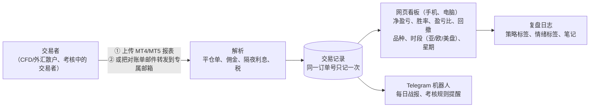

# v1 需求澄清问题：trading journal（CFD / 外汇交易日志与复盘）
- 版本：v1 草稿 1（2026-10-20）
- 变更历史：草稿 1（2026-10-20）首次提交
- 负责：PM（整合市场的《[市场调研与推广策略](../市场/v1-市场调研与推广策略.md)》）
- 依据：agents main `67e04ba`（v0.11）
- 输入：
  - Amos 2026-10-20 提供的 Gemini 对话记录《交易日志与复盘 SaaS（Trading Journal）》（PDF，第 4–22 页）
  - Amos 的决定："三个产品先做 CFD/外汇"
- 状态：**等待 Amos 回答**。每个问题都附了默认值，可以回复"全部按默认"，或者只回复要改的编号

## 一图看懂：按默认值，第一版是什么样

这张图想说明：按默认值，第一版只做**盘后复盘**，数据靠用户上传或转发对账单，不碰任何交易密码。投资者密码、实时插件（EA）、实时风控报警都放到以后的版本。

## A. 产品范围
| 编号 | 问题 | 默认值 | 说明 |
|---|---|---|---|
| A1 | 第一版的目标用户 | **CFD/外汇散户和自营交易考核中的交易者都做**；考核规则提醒作为主要卖点 | 市场调研认为考核中的交易者付费意愿最明确（见市场文档 §3） |
| A2 | 只做盘后复盘，还是也做实时风控（插件每 15 秒推送净值、回撤接近红线时报警） | **只做盘后复盘**；实时风控放 v2 | 实时风控需要用户安装 EA、常驻服务和高并发接收（PDF 第 15–20 页），工作量大好几倍 |
| A3 | 数据怎么进来 | **① 上传 MT4/MT5 导出的 HTML 报表；② 转发对账单邮件到专属邮箱**。不做投资者密码，不做 EA | 两种都不需要用户交出密码。投资者密码方案要接 MetaApi 一类服务，见市场文档 §4 |
| A4 | 支持 MT4 还是 MT5 | **两个都支持** | 两者的报表列不一样，都要用真实样本测 |
| A5 | 第一批支持哪些经纪商和考核公司的报表 | **Amos 能提供样本的那几家**，再加市场调研里用户最多的几家（见 A10） | 各家报表的格式有差异（PDF 第 15 页） |
| A6 | 产品形态 | **网页看板（手机版、电脑版分别设计，C64）+ Telegram 机器人推送** | 机器人只推送和打标签，不在机器人里做完整看板 |
| A7 | 看板指标 | **净盈亏（扣佣金、隔夜利息、税）、胜率、盈亏比、Profit Factor、最大回撤、权益曲线；按品种、交易时段（亚盘、欧盘、美盘）、星期几拆分；佣金和隔夜利息吃掉了多少利润** | 胜率按"一笔平仓单"算，不按成交记录算（PDF 第 8 页的示例代码按成交算，会算错） |
| A8 | 考核规则提醒 | **用户自己填规则数值（日内最大亏损、总最大亏损、盈利目标），提供几家考核公司的预设模板**；每天收盘后推送"今天离红线还有多少" | 各家规则的算法不同（按开盘余额还是净值、按服务器时间），模板要以官网原文为准，见市场文档 §4 |
| A9 | 复盘日志 | **策略标签、情绪标签、文字笔记**；截图和 TradingView 链接放 v2 | |
| A10 | 要不要 AI 功能（例如 AI 纪律点评） | **第一版不做** | 有被理解为投资建议的风险，见市场文档 §6 |

## B. 用户、语言、商业
| 编号 | 问题 | 默认值 | 说明 |
|---|---|---|---|
| B1 | 界面语言 | **英文和简体中文** | |
| B2 | 登录方式 | **邮箱验证码登录**；绑定 Telegram 用机器人发的一次性码 | 不做密码登录，少一类安全问题 |
| B3 | 第一版收不收费 | **第一版免费内测，不接支付**；定价按市场文档 §5 的建议，第二版再接 | 先验证有没有人持续用 |
| B4 | 内测怎么进 | **邀请码**，前 N 名（默认 50 名） | 邀请码同时用来统计用户从哪个渠道来（市场提出的推广功能 M1） |
| B5 | 产品名 | **暂用 "Trading Journal"**；正式名称和域名在架构阶段由 PM 给 2–3 个候选 | 项目名不变 |
| B6 | 目标地区 | **全球英文用户 + 中文用户**；落地页注明"不面向美国用户的 CFD 交易"这类限制，具体按市场文档 §6 | |

## C. 数据和合规
| 编号 | 问题 | 默认值 | 说明 |
|---|---|---|---|
| C1 | 对账单原件要不要保存 | **保存**（方便修复解析错误后重新解析）；用户可以一键删除自己的全部数据 | 对账单里有账号、姓名、余额，属于个人数据 |
| C2 | 免责声明 | **页面和机器人消息都写明"只做记录和统计，不构成投资建议"**，标注"需法务审核" | |
| C3 | 能否提供真实的报表样本（脱敏后） | **请 Amos 提供** MT4、MT5 各至少一份，最好包含隔夜利息、佣金、部分平仓；没有的话由研发按公开样例做，并在测试报告里标"未用真实样本验证" | 解析的准确性完全取决于样本 |

## D. 环境和资源（C27：先问，不推断）
| 编号 | 问题 | 默认值 | 说明 |
|---|---|---|---|
| D1 | 生产环境用什么平台 | **架构阶段由运维给建议，再问 Amos**；初步看，第一版没有常驻进程，Vercel 或云服务器都可以 | 第五节：先确认平台，再定方案 |
| D2 | 是否已有域名 | **请 Amos 告知**；转发对账单的专属邮箱需要一个域名 | |
| D3 | 收邮件用哪家服务 | **架构阶段由运维给 2–3 个选项**（市场文档 §4 有价格） | 密钥只由 Amos 填写（C21） |
| D4 | Telegram 机器人用谁的账号创建 | **Amos 用自己的 Telegram 通过 BotFather 创建**，令牌只由 Amos 填进平台后台 | |
| D5 | 是否用分步执行模式（C63） | **是**：拆成步骤，每步一个 PR，进度看一个 Issue | |

## 跨角色反馈 / 分歧记录
| 编号 | 提出方 → 接收方 | 内容 | 状态 |
|---|---|---|---|
| F1 | 市场 → PM | 推广需要的产品功能清单 M1–M4（市场文档 §8） | 已采纳：M1 并入 B4；M2–M4 待 Amos 回答后写进需求说明书 |
