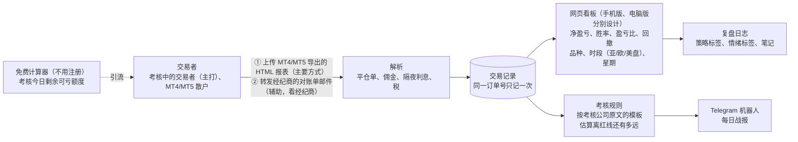

# v1 需求澄清问题：trading journal（CFD / 外汇交易日志与复盘）
- 版本：v1.1（2026-10-20，Amos 已回答）
- 变更历史：草稿 1（2026-10-20）首次提交（已按市场调研的结果修正默认值）；v1.1（2026-10-20）记录 Amos 的回答
- 负责：PM。和市场的《[v1 市场调研与推广策略](../市场/v1-市场调研与推广策略.md)》一起交 Amos（C71）；下文"市场 §n"指那份文档的第 n 节
- 依据：agents main `67e04ba`（v0.11）
- 输入：
  - Amos 2026-10-20 提供的 Gemini 对话记录《交易日志与复盘 SaaS（Trading Journal）》（PDF 第 4–22 页）
  - Amos 的决定："三个产品先做 CFD/外汇"
- 状态：**Amos 已回答（2026-10-20）："全部按默认"**。下文的默认值即为结论，写进《[v1 需求说明书](v1-需求说明书.md)》。C3 的报表样本仍待 Amos 提供

## 一图看懂：按默认值，第一版是什么样

这张图想说明：按默认值，第一版只做**盘后复盘和考核规则提醒**，数据来自用户自己导出或转发的对账单，不碰任何账户密码。投资者密码、实时插件（EA）、实时风控报警都放到以后的版本。

## A. 产品范围
| 编号 | 问题 | 默认值 | 说明 |
|---|---|---|---|
| A1 | 第一版的目标用户 | **主打考核中的交易者，兼顾 MT4/MT5 散户**；中文用户靠中文界面覆盖 | 考核失败要重新买，平均约 $250 一次，付费理由最明确（市场 §3） |
| A2 | 只做盘后复盘，还是也做实时风控（插件每 15 秒推送净值，接近红线时报警） | **只做盘后**；实时风控放 v2 | 实时风控要用户装 EA，还要常驻服务，工作量大几倍（PDF 第 15–20 页）。市场推断"准实时风控"是空档，可以作为 v2 方向 |
| A3 | 数据怎么进来 | **① HTML 报表上传（主要方式）；② 对账单邮件转发到专属邮箱（辅助方式）**。不做投资者密码，不做 EA | 只有 HTML 报表是所有用户都能导出的；对账单邮件发不发、发什么格式，由经纪商决定（市场 §4）。竞品 TradeZella、TradesViz 已经支持投资者密码同步，我们不做，是因为：第三方接入服务起步 $30/月；自己直连协议有法律风险；FTMO 禁止第三方访问账户 |
| A4 | 支持 MT4 还是 MT5 | **两个都支持** | MT4 一行就是一笔完整的开平仓；MT5 分订单、成交、持仓三张表，要把成交合成平仓单（市场 §4） |
| A5 | 第一批支持哪些经纪商和考核公司的报表 | **Amos 能提供样本的几家**，加上 FTMO 的 MT5 | 报表模板可以修改，各家输出可能不同 |
| A6 | 产品形态 | **网页看板（手机版和电脑版分别设计，C64）+ Telegram 机器人推送** | 机器人只负责推送战报和打标签 |
| A7 | 看板指标 | **净盈亏（扣佣金、隔夜利息、税）、胜率、盈亏比、Profit Factor、最大回撤、权益曲线；按品种、时段（亚盘、欧盘、美盘）、星期几拆分；佣金和隔夜利息吃掉了多少利润** | 胜率按"一笔平仓单"算。PDF 第 8 页的示例代码按成交记录算，开仓那几笔盈亏为 0 也计入总数，会把胜率拉低 |
| A8 | 考核规则 | **内置 FTMO（2-Step、1-Step）、FundedNext、The5ers 的模板**，按官网原文算法；用户也可以自己填数值。每天收盘后推送"按对账单估算，今天离日内红线和总红线各还有多远"，并标明"以考核公司为准" | 各家算法不同：按余额还是净值、几点重置、总亏损线会不会上移（市场 §4）。对账单是盘后数据，看不到盘中净值的最低点，所以只能估算 |
| A9 | 复盘日志 | **策略标签、情绪标签、文字笔记**；截图和 TradingView 链接放 v2 | |
| A10 | 要不要 AI 功能（例如 AI 纪律点评） | **第一版不做** | 可能被认为是投资建议；推送也不提示品种和方向（市场 §6） |

## B. 用户、语言、商业
| 编号 | 问题 | 默认值 | 说明 |
|---|---|---|---|
| B1 | 界面语言 | **英文和简体中文** | 没找到中文的 MT 交易日志产品（市场 §1） |
| B2 | 登录方式 | **邮箱验证码登录**；绑定 Telegram 时，用机器人发的一次性码 | 不做密码登录，少一类安全问题 |
| B3 | 第一版收不收费 | **免费内测，不接支付**；第二版按市场 §5 的定价收费（Free / Pro $15 每月） | 先看内测用户第 4 周还在不在用 |
| B4 | 内测怎么进 | **邀请码，前 50 名**；每个码记录来源渠道（市场 M1） | |
| B5 | 产品名 | **暂用 "Trading Journal"**；正式名称和域名在架构阶段由 PM 和市场给 2–3 个候选 | 项目名不变 |
| B6 | 目标地区 | **全球英文用户 + 中文用户** | 经纪商网站流量约 2/3 来自亚洲（市场 §2） |
| B7 | 市场提出的推广功能：M2 免费计算器、M3 分享卡片、M4 中英文落地页、M5 按渠道统计 | **M2、M4、M5 纳入第一版；M3 放 v1.1** | 不做付费广告，冷启动靠社区和免费工具（市场 §6、§7） |
| B8 | 内测的目标值 | **注册 50 人，激活 30 人（导入至少 1 份报表），第 4 周留存 15 人，访谈 10 人** | 目标值是推断（市场 §7） |

## C. 数据和合规
| 编号 | 问题 | 默认值 | 说明 |
|---|---|---|---|
| C1 | 对账单原件要不要保存 | **保存**，修复解析错误后可以重新解析；用户可以一键删除自己的全部数据 | 对账单里有账号、姓名、余额，属于个人数据 |
| C2 | 免责声明 | **页面和机器人消息都写明"只做记录和统计，不构成投资建议"**，标注"需法务审核" | |
| C3 | 能否提供真实的报表样本（脱敏后） | **请 Amos 提供** MT4 和 MT5 的 HTML 报表各至少一份，最好包含隔夜利息、佣金、部分平仓；如果有经纪商发的对账单邮件，也请提供一封。没有样本的话，研发按 MT 官方说明的格式做，并在测试报告里标"未用真实样本验证" | 解析准确不准确，完全取决于样本。这是第一版最大的不确定（市场 §9） |

## D. 环境和资源（C27：先问，不推断）
| 编号 | 问题 | 默认值 | 说明 |
|---|---|---|---|
| D1 | 生产环境用什么平台 | **架构阶段由运维给建议，再问 Amos**；第一版没有常驻进程，Vercel 或云服务器都可以 | 协作总则第五节：先确认平台，再定方案 |
| D2 | 是否已有域名 | **请 Amos 告知** | 专属收件邮箱和落地页都需要域名 |
| D3 | 收邮件用哪家服务 | **架构阶段由运维从 Cloudflare Email Routing、Postmark、Mailgun 里给建议** | 价格见市场 §4 的出处；密钥只由 Amos 填写（C21） |
| D4 | Telegram 机器人用谁的账号创建 | **Amos 用自己的 Telegram 账号在 BotFather 创建**，令牌只由 Amos 填进平台后台 | |
| D5 | 是否用分步执行模式（C63） | **是**：拆成步骤，每步一个 PR，进度看一个 Issue | |
| D6 | 推广由谁发 | **Amos 发**，或者 Amos 逐条同意后再发（C73）；市场只准备草稿 | |

## 跨角色反馈 / 分歧记录
| 编号 | 提出方 → 接收方 | 内容 | 状态 |
|---|---|---|---|
| F1 | 市场 → PM | 推广需要的功能 M1–M5（市场 §8） | 已采纳：M1 写进 B4，M2–M5 写进 B7，等 Amos 回答 |
| F2 | 市场 → PM | 考核规则只能按收盘估算，要标明"以考核公司为准" | 已采纳：A8 |
| F3 | PM → 研发 | PDF 示例代码的胜率按成交记录算、金额用浮点数，不能照搬；金额用整数或定点小数 | 已采纳：写进需求说明书的验收标准 |
