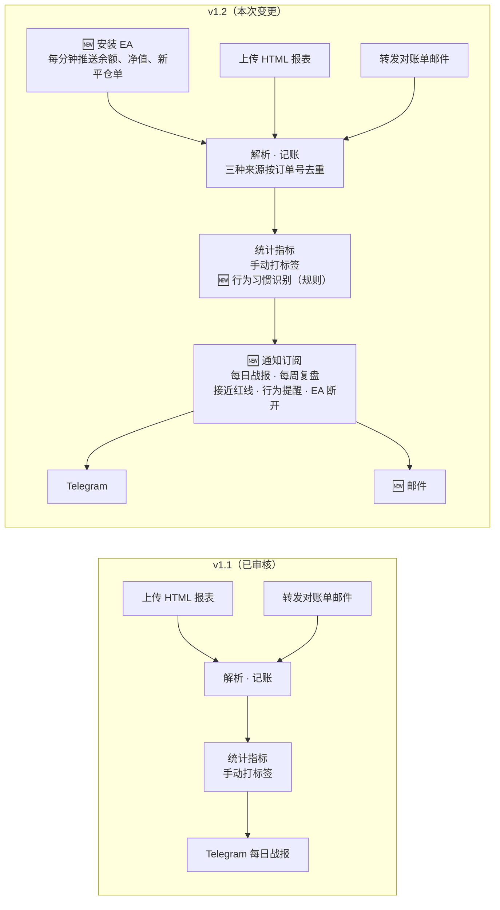
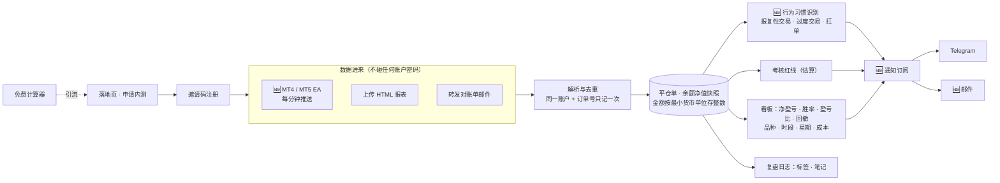
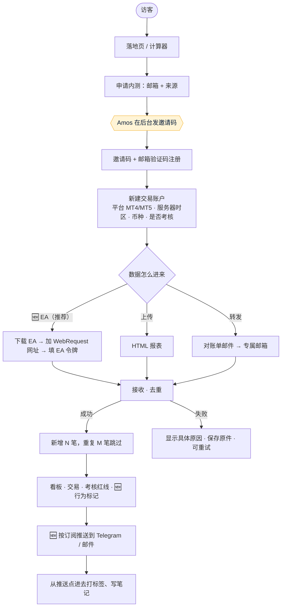
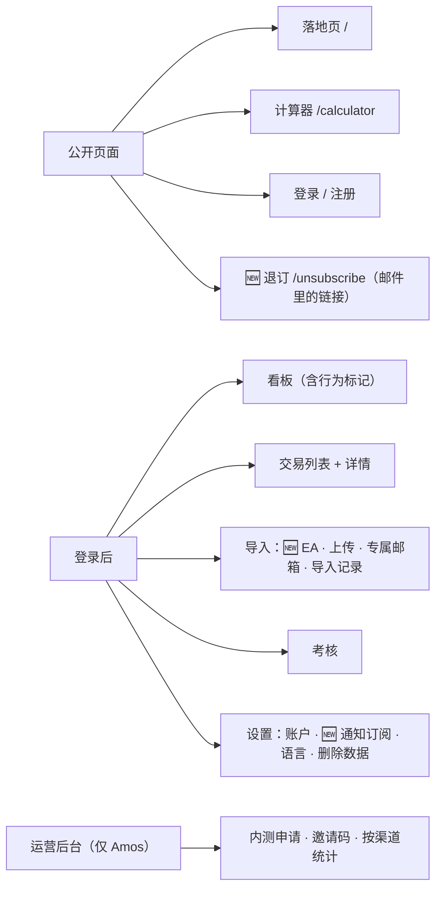
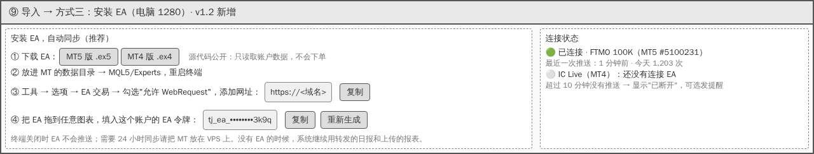
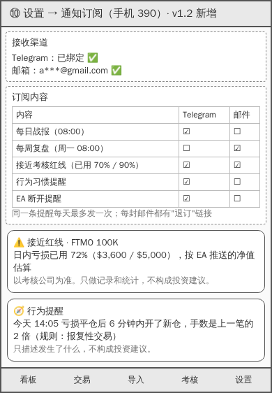

# v1 需求说明书：trading journal（CFD / 外汇交易日志与复盘）
- 版本：v1.2（2026-10-21，核心功能变更，测试预审后提交；**Amos 2026-10-21 确认**）
- 变更历史：
  - v1 初稿（2026-10-20）：PM 按 Amos 对《[v1 需求澄清问题](v1-需求澄清问题.md)》的回答（"全部按默认"）编写
  - v1.1（2026-10-20）：按测试预审意见 T1–T8 修订；Amos 2026-10-20 审阅通过
  - **v1.2（2026-10-21）**：Amos 重新明确核心功能（"CFD 客户安装 EA 或转发交易日报，系统分析交易行为和习惯并记账，必要信息或订阅信息通过邮件或 Telegram 推送"），对 V1–V4 回复"按默认"。新增 **EA 数据接入**、**行为习惯识别**、**邮件推送**、**通知订阅**；变更点见第 0 节，测试预审见第 11.2 节
- 负责：PM。市场输入见《[v1 市场调研与推广策略](../市场/v1-市场调研与推广策略.md)》（v1.1 补充了 EA 部分），下文"市场 §n"指那份文档的第 n 节
- 依据：agents main `381c85f`（v0.11.1）
- 状态：**Amos 已确认 v1.2（2026-10-21）**。接下来：架构方案升到 v1.1 交 Amos 重新审核（EA 接口、邮件推送、每周定时任务改变了已审核的架构，协作总则第二节）；原型补 EA 安装页和通知订阅页，再交 Amos 确认（第 4.5 步）

## 0. v1.2 变更点

这张图想说明：v1.2 在数据来源里加了 EA（成为主要方式），在分析里加了规则式的行为习惯识别，推送从"只有 Telegram 每日战报"变成"5 种内容 × 2 个渠道，用户自己订阅"。

| 编号 | 变更 | 类型 | Amos 的决定 | 影响 |
|---|---|---|---|---|
| CH1 | **EA 数据接入**：MT4、MT5 两个 EA，每分钟推送一次余额、净值、持仓浮动和新的平仓单；首次连接补推最近 90 天历史。数据来源改为"EA 为主，转发日报和上传为辅" | 新增（原"明确不做"里的 EA 移出） | V1 按默认 | 新增 EA 代码（MQL4/MQL5）、接收接口、EA 令牌、连接状态；红线可以按每分钟的净值估算 |
| CH2 | **行为习惯识别**：报复性交易、过度交易、扛单三条规则；只描述事实，不给交易建议，不用 AI | 新增（扩充原"统计指标"） | V2 按默认 | `src/core/` 新增规则函数；看板和交易列表显示标记 |
| CH3 | **邮件推送**：所有推送内容都可以发到邮箱 | 新增 | V3 按默认 | 发信服务从"只发验证码"扩大到推送；每封邮件带退订链接 |
| CH4 | **通知订阅**：每日战报、每周复盘、接近红线提醒、行为习惯提醒、EA 断开提醒，每项分别选渠道 | 新增（原 AC-R5 每日战报并入） | V4 按默认；"EA 断开提醒"是 PM 为 CH1 补充的 | 新增订阅设置页、每周定时任务、提醒去重 |
| CH5 | 不变的：不做投资者密码、不做 AI 点评、不做秒级实时报警、不代替用户下单、不收费 | — | — | — |

**影响范围**：
- **需求**：第 2、3、4、5、6、7、8、10、11 节都有修改，新增的验收标准用 AC-E（EA）、AC-B（行为）、AC-N（通知）编号；v1.1 的 AC-R5 改由 AC-N 系列替代。
- **市场**：卖点从"盘后估算"升级为"接近红线时提醒"（市场 v1.1 补充 §11）。
- **架构**：需要重新审核（见状态）。
- **原型**：要补两页。
- **工作量**：大约多出 3 个步骤（EA 大、行为规则中、通知和邮件中），在任务清单里拆分。

## 一图看懂：v1.2 第一版做什么

这张图想说明：数据有三种来源，都不需要账户密码；所有分析只算一次，推送按用户的订阅发到 Telegram 或邮箱。

## 1. 目标
1. 让 MT4/MT5 交易者**装一个 EA，或者转发、上传对账单**，就能看到扣掉佣金、隔夜利息、税以后的真实盈亏，以及在哪个品种、时段、星期亏钱。
2. **🆕 帮交易者看见自己的交易习惯**：报复性交易、过度交易、扛单，按事实标出来。
3. 让考核中的交易者**在接近日内红线时收到提醒**（装了 EA 时，按每分钟的净值估算），每天收到战报，渠道自选 Telegram 或邮件。
4. 用 4 周内测验证需求：注册 50 人、激活 30 人（EA 连上或导入至少 1 份报表）、第 4 周仍活跃 15 人、访谈 10 人（市场 §7，目标值属于推断）。

## 2. 范围
### 做
- **🆕 EA**：MT4（.ex4）、MT5（.ex5）各一个，只读账户数据、不下单；源代码公开在仓库里，用户可以自己检查。
- 上传 MT4、MT5 的 HTML 报表；转发对账单邮件到专属邮箱。
- 看板、交易列表、复盘日志（标签、笔记）；**🆕 行为习惯标记**。
- 考核规则模板：FTMO 2-Step、FTMO 1-Step；FundedNext、The5ers 核对通过后再加（原型说明 X2）；也可以自定义数值。
- **🆕 通知订阅**：5 种内容 × Telegram / 邮件；Telegram 绑定；邮件退订。
- 邮箱验证码登录；邀请码注册；英文和简体中文。
- 免费计算器；中英文落地页和内测申请；运营后台。
- 一键删除自己的全部数据。

### 明确不做（第一版）
- 投资者密码同步、MetaApi。
- **秒级实时报警**：EA 每分钟推送一次，提醒最快在推送后 1 分钟内发出，不承诺"实时"。
- EA 下单、改单、平仓、跟单，任何会影响交易的功能。
- AI 点评；任何提示品种或方向、或者要求用户怎么做的内容（市场 §6）。
- 收费和支付；分享卡片（M3，v1.1）；截图和 TradingView 链接（v2）。
- 加密货币、cTrader 等其他平台；不同币种之间的换算。
- 付费广告。

## 3. 使用场景
| 编号 | 用户 | 场景 |
|---|---|---|
| S1 | 考核中的交易者 | 每天收盘后，经纪商的对账单邮件自动转发进来；早上在 Telegram 看到"今天还可亏 $3,200" |
| S2 | 考核中的交易者 | 同时考 2 个账户，在看板上切换账户 |
| S3 | MT4 散户 | 每周末导出一次报表上传，看本周黄金在美盘是不是一直亏 |
| S4 | 新用户 | 在 Reddit 看到免费计算器，算完点"申请内测"，收到邀请码注册 |
| S5 | Amos | 在后台看哪个渠道来的人最多、激活最多，给申请的人发邀请码 |
| **S6 🆕** | VPS 上跑 MT5 的考核交易者 | 装上 EA。下午连亏两笔、日内亏损用到 72% 时，Telegram 收到"接近红线"提醒 |
| **S7 🆕** | 不用 Telegram 的交易者 | 只订阅邮件：每周一早上收到上周复盘，里面列出 3 次"亏损后 10 分钟内加倍开仓" |
| **S8 🆕** | 装了 EA 的交易者 | 电脑关机后 EA 停止推送；10 分钟后收到"EA 已断开"提醒，系统继续用转发的日报补数据 |

## 4. 业务流程

这张图想说明：三种数据来源走同一条"接收、去重"路径；推送按用户自己的订阅发。

## 5. 站点地图

这张图想说明：v1.2 没有加新的一级页面，EA 放在"导入"里，通知订阅放在"设置"里；只新增一个公开的退订页。

## 6. 关键页面线框图（低保真）
电脑版"一屏看全"，手机版"一屏一件事"（C64）。v1.2 新增 ⑨⑩。

| 页面 | 线框图 |
|---|---|
| ① 看板（电脑） |  |
| ② 看板（手机） |  |
| ③ 导入（手机） |  |
| ④ 交易列表与复盘（电脑） |  |
| ⑤ 考核与 Telegram 战报（手机） |  |
| ⑥ 免费计算器（手机） |  |
| ⑦ 落地页（手机） |  |
| ⑧ 运营后台（电脑） |  |
| **⑨ 🆕 导入 → 安装 EA（电脑）** |  |
| **⑩ 🆕 设置 → 通知订阅（手机）** |  |

## 7. 计算口径（所有页面、推送、计算器共用一份）
### 7.1 指标（v1.1，不变）
| 指标 | 口径 |
|---|---|
| 一笔交易 | **一笔平仓单**。MT4：Closed Transactions 表里 Type 为 buy/sell 的一行；balance、credit 等资金行不算交易，但计入余额。MT5：已平仓的一个持仓（同一持仓分几次平仓，算一笔，各次成交的盈亏相加）。EA 推送的平仓单按同样规则合并 |
| 净盈亏 | 毛利 + 佣金 + 隔夜利息 + 税（按报表原值相加） |
| 胜率 | 净盈亏 > 0 的笔数 ÷ 全部平仓笔数；持平计入分母 |
| 盈亏比 | 盈利单平均净盈亏 ÷ 亏损单平均净盈亏的绝对值；没有亏损单时显示"—" |
| Profit Factor | 盈利单净盈亏之和 ÷ 亏损单净盈亏之和的绝对值；没有亏损单时显示"—" |
| 最大回撤 | 按平仓时间排序的累计净盈亏曲线上，从最高点到之后最低点的最大跌幅 |
| 成本占毛利 | （佣金 + 税 + 为负的隔夜利息）的绝对值 ÷ 盈利单毛利之和；分母为 0 时显示"—" |
| 时段 | 按**开仓时间**换算成 UTC：亚盘 22:00–07:00、欧盘 07:00–13:00、美盘 13:00–22:00 |
| 时区 | 报表和 EA 的时间是经纪商服务器时间。每个交易账户设置服务器时区，默认"GMT+2，夏令时 GMT+3"（推断），用户可改 |
| 金额 | 按账户币种的最小单位存整数；不在不同币种之间换算 |

### 7.2 考核红线（v1.2 修订）
- 按所选模板的官网原文计算，每个模板注明出处链接和核对日期；"当日 00:00"按考核公司的重置时区（FTMO 是 CE(S)T，原型说明 X3）。
- **净值从哪里来（🆕）**：有 EA 时，用 EA 最近一次推送的净值；没有 EA 时，用报表时刻的净值（报表不含持仓时用余额，并注明"未含持仓"）。页面上写明用的是哪一种和它的时间。
- 所有地方都写"按 X 估算，以考核公司为准"，X 为"EA 推送的净值"或"对账单"。

### 7.3 🆕 行为习惯规则（CH2）
每条规则只看已入账的平仓单，参数是默认值，用户可以在设置里调整或关闭。

| 规则 | 什么时候标记 | 标在哪里 | 默认参数 |
|---|---|---|---|
| **报复性交易** | 一笔亏损单平仓后 **15 分钟内**开了新仓，并且新仓手数 ≥ 上一笔的 **1.5 倍** | 标在那笔新仓上 | 15 分钟、1.5 倍 |
| **过度交易** | 某个交易日的平仓笔数 ≥ 过去 **20 个交易日**日均笔数的 **2 倍**，并且当天 ≥ **10 笔**；历史不足 5 个交易日时不判断 | 标在那一天 | 20 日、2 倍、10 笔、5 日 |
| **扛单** | 单笔：亏损单的持仓时间 > 过去 30 天盈利单平均持仓时间的 **3 倍**（盈利单不足 5 笔时不判断）。汇总：过去 30 天亏损单平均持仓时间 ≥ 盈利单的 **2 倍**（两类各至少 5 笔） | 单笔标在交易上；汇总显示在看板 | 3 倍、2 倍、30 天、5 笔 |

- 文案只描述发生了什么，例如"亏损平仓后 6 分钟内开新仓，手数是上一笔的 2 倍"；**不写"应该""建议""停止"**（AC-B4）。
- 看板显示近 30 天每条规则被触发的次数，以及触发时那些交易的净盈亏合计（例如"报复性交易 4 次，合计 -$612.40"）。

### 7.4 🆕 提醒的口径（CH4）
| 提醒 | 触发 | 去重 |
|---|---|---|
| 每日战报 | 用户设定的时间（误差不超过 5 分钟） | 每人每账户每天一条 |
| 每周复盘 | 每周一用户设定的时间；内容是上周一到周日的指标和行为标记 | 每人每账户每周一条 |
| 接近红线 | 日内亏损已用 ≥ **70%**、≥ **90%**（两个档位，可调）；总亏损同样两档 | 每个档位每天最多一次 |
| 行为习惯 | 有新的行为标记时 | 每条规则每天最多一次（当天再触发只累加次数，在战报里汇总） |
| EA 断开 | 已连接的 EA **超过 10 分钟**没有推送 | 断开一次提醒一次，恢复连接后重新计算 |

## 8. 字段对照表（C35）
### 8.1 MT4 / MT5 报表 → 系统字段（v1.1，不变）
来源：MT4 帮助《Account History》、MT5 帮助《History Report》（市场 §4）。实际列名、列顺序以 Amos 提供的样本为准。

| 原文（MT4 Closed Transactions） | 原文（MT5） | 系统字段 | 说明 |
|---|---|---|---|
| Order / Ticket | Positions 表 Position | `ticket` | 和账户一起组成去重键 |
| Time（第一个） | Positions 表开仓 Time | `open_time` | 服务器时间，按账户时区换成 UTC 存 |
| Type | Type | `side` | buy / sell；其他类型存为资金记录 |
| Size | Volume | `lots` | |
| Symbol | Symbol | `symbol` | 原样保存；另存去掉后缀的 `symbol_base` |
| Price（第一个） | 开仓 Price | `open_price` | |
| S/L | S / L | `sl` | 可为空 |
| T/P | T / P | `tp` | 可为空 |
| Time（第二个） | 平仓 Time | `close_time` | 同 `open_time` |
| Price（第二个） | 平仓 Price | `close_price` | |
| Commission | Commission | `commission` | 最小单位整数 |
| Taxes | （MT5 Deals 表中如有） | `taxes` | 没有的记 0 |
| Swap | Swap | `swap` | 最小单位整数 |
| Profit | Profit | `gross_profit` | 不含佣金、隔夜利息、税 |
| Comment | Comment | `comment` | |
| —（计算） | —（计算） | `net_pnl` | 第 7.1 节 |
| 报表头的 Account、Name、Currency | 同左 | `account_no`、`currency` | 姓名不保存 |
| Summary 区（Balance、Equity、Floating P/L） | Summary 区 | 导入记录的 `balance`、`equity`、`floating` | 用于红线估算和自动核对 |
| Open Trades、Working Orders | Orders、Working Orders | 不做 | |

### 8.2 🆕 EA 推送 → 系统字段
EA 用 MT 自带的账户和历史函数读取数据（MQL4：`AccountInfo*`、`OrdersHistoryTotal` 等；MQL5：`AccountInfo*`、`HistorySelect` 等；推断，研发在技术方案里逐个确认）。

| EA 推送的内容 | 系统字段 | 说明 |
|---|---|---|
| 账号、服务器名、币种 | 和交易账户的 `account_no` 核对 | 和 EA 令牌绑定的账户不一致时拒收（AC-E3） |
| 余额、净值、持仓浮动盈亏、推送时间 | 新表"余额净值快照"：`balance`、`equity`、`floating`、`at` | 每分钟一条；用于红线（7.2）和"接近红线"提醒 |
| 上次推送之后新的平仓单 | 同 8.1 的 `trades` 字段 | MT5 按持仓合并；去重键同 8.1 |
| EA 版本号、平台（MT4/MT5） | 连接记录 | 用于连接状态和排查 |
| 不推送 | — | 账户密码、持仓明细之外的任何个人信息 |

## 9. 市场与推广输入（C71）
- 目标用户：主打考核中的交易者（市场 §3 P1），兼顾 MT4/MT5 散户（P2），中文界面覆盖 P3。
- 定位（v1.2 更新）："**每天告诉你离考核红线还有多远，快到的时候提醒你**"（市场 §11）。第一版免费内测，第二版定价 Free / Pro $15 每月。
- 推广功能的结论（v1.1，不变）：M1 邀请码、M2 计算器、M4 落地页、M5 按渠道统计纳入；M3 分享卡片放 v1.1。
- 🆕 落地页和推广物料要写明"EA 只读取数据、不会下单，源代码公开"（市场 §11 的信任问题）。

## 10. 验收标准
### 导入（v1.1，不变）
| 编号 | 验收标准 |
|---|---|
| AC-I1 | 上传 MT4 HTML 报表后，系统记录的平仓笔数等于报表 Closed Transactions 中 buy/sell 的行数；每笔的 9 个字段（订单号、品种、方向、手数、开平仓时间、开平仓价、净盈亏）和报表一致 |
| AC-I2 | 上传 MT5 HTML 报表后，系统记录的平仓笔数等于报表中已平仓的持仓数；分几次平仓的持仓算一笔，净盈亏等于各次成交之和 |
| AC-I3 | 一份报表导入后，系统算出的净盈亏合计和报表 Summary 的对应合计**相差 0.00**；对不上时，导入记录标"金额核对不一致"，并列出差额 |
| AC-I4 | 同一份报表上传两次，或两份报表时间重叠，交易不重复；导入结果显示"新增 N 笔，重复 M 笔已跳过"。**🆕 EA 推送、上传、邮件三种来源之间同样不重复** |
| AC-I5 | 每个用户有一个只属于自己、不可猜测的专属邮箱地址（随机部分至少 8 位字母数字）；转发到该地址的对账单 5 分钟内出现在导入记录里 |
| AC-I6 | 无法解析的文件或邮件，导入记录显示具体原因，原件保存，可以"重试"；不显示错误代码 |
| AC-I7 | 发到专属邮箱、但不是对账单的邮件，不产生交易，导入记录标"不是对账单" |

### 🆕 EA（CH1）
| 编号 | 验收标准 |
|---|---|
| AC-E1 | 提供 MT4（.ex4）和 MT5（.ex5）两个 EA，源代码在仓库里公开；EA 代码里**没有任何下单、改单、平仓、撤单的调用**（测试用代码扫描确认） |
| AC-E2 | 每个交易账户有自己的 EA 令牌（至少 24 位随机字符），可以重新生成；重新生成后旧令牌立即失效 |
| AC-E3 | 令牌错误、令牌已失效、推送的账号和令牌绑定的账号不一致时，服务器拒收，EA 在 MT 的"专家"日志里显示原因；同一个令牌 30 秒内只接受一次推送 |
| AC-E4 | EA 每 60 秒推送一次余额、净值、持仓浮动和新的平仓单；在测试环境用 MT5 模拟账户连续运行 1 小时，服务器收到的推送次数 ≥ 55 次，平仓单和 MT 里的账户历史一致 |
| AC-E5 | 首次连接时补推最近 90 天的平仓单，和同一时间段的 HTML 报表导入结果一致（笔数、净盈亏合计相差 0.00） |
| AC-E6 | 导入页显示每个账户的 EA 连接状态：已连接（最近一次推送的时间）、已断开（超过 10 分钟没有推送）、从未连接 |
| AC-E7 | 服务器没有响应时，EA 每次等待不超过 5 秒，不让 MT 终端卡住；网络恢复后补推断开期间的平仓单 |
| AC-E8 | 导入页写明安装步骤（下载、放进目录、添加 WebRequest 网址、填令牌），每一步有截图；"只读取数据、不会下单、源代码公开"写在下载按钮旁边 |

### 看板和复盘（v1.1，不变）
| 编号 | 验收标准 |
|---|---|
| AC-D1 | 看板上的净盈亏、胜率、盈亏比、Profit Factor、最大回撤、成本占毛利，按第 7.1 节口径计算，和测试准备的标准答案数据集**完全一致** |
| AC-D2 | 按品种、时段、星期拆分，各部分的笔数和净盈亏相加等于总数 |
| AC-D3 | 可以按账户、时间范围筛选；交易列表可以按品种、方向、标签、时段筛选，显示"筛选后 X / 共 Y 笔"和筛选后的净盈亏；可以翻页看到全部 |
| AC-D4 | 每笔交易可以加策略标签和情绪标签（预设 + 自定义）、写笔记；看板可以按标签筛选 |
| AC-D5 | 没有任何交易时，各页面显示明确的空状态和导入入口；加载中、加载失败分别有提示，失败时有"重试"（C52） |
| AC-D6 | 手机（390）和电脑（1280）的关键页面按线框图分别设计结构（C64）；1280 宽时交易列表不用横向滚动 |

### 🆕 行为习惯（CH2）
| 编号 | 验收标准 |
|---|---|
| AC-B1 | 三条规则按第 7.3 节口径计算，对测试准备的用例（每条规则至少 6 组，包括刚好达到阈值、差一点没达到、历史不足不判断）结果全部一致 |
| AC-B2 | 被标记的交易在交易列表里显示规则名称，详情里写明触发的事实（时间、手数倍数、持仓时间倍数）；交易列表可以按"有行为标记"筛选 |
| AC-B3 | 看板显示近 30 天每条规则的触发次数和对应交易的净盈亏合计，点开能看到对应的交易 |
| AC-B4 | 行为标记、行为提醒的所有文案只描述事实，不出现"应该、建议、停止、不要、必须"及对应英文（should、recommend、stop、don't、must）；用关键词扫描确认 |
| AC-B5 | 用户可以在设置里调整每条规则的参数或关闭某条规则；关闭后不再标记、不再提醒，已有的标记保留 |

### 考核（v1.2 修订）
| 编号 | 验收标准 |
|---|---|
| AC-R1 | 提供 FTMO 2-Step、FTMO 1-Step 两个模板，每个模板注明官网出处和核对日期；FundedNext、The5ers 在 PM 核对通过后再上（原型说明 X2）；也可以自定义"日内亏损 %、总亏损 %、盈利目标 %、重置时刻和时区、按余额还是净值" |
| AC-R2 | 对测试准备的每组规则用例（每个模板至少 5 组，包括边界值），算出的红线和"还可亏多少"和按官网原文手算的结果一致到 0.01；"当日 00:00"按模板的重置时区 |
| AC-R3 | 考核相关的每个页面、推送、计算器，都写明"按 EA 推送的净值估算"或"按对账单估算"，以及数据时间，并写"以考核公司为准" |
| AC-R4 | 用户在设置里拿到一次性码，发给 Telegram 机器人后完成绑定；一次性码 10 分钟内有效，只能用一次 |
| ~~AC-R5~~ | v1.2 由 AC-N1、AC-N2 替代 |
| AC-R6 | 推送和页面上不出现任何品种、方向的建议，也不出现指令性的话；每条推送末尾有免责声明（与 AC-B4 用同一份关键词清单） |
| AC-R7 | 推送里的按钮或链接能打开对应的页面，并直接给交易打标签 |

### 🆕 通知订阅和推送（CH3、CH4）
| 编号 | 验收标准 |
|---|---|
| AC-N1 | 设置页可以分别为 5 种内容（每日战报、每周复盘、接近红线、行为习惯、EA 断开）勾选 Telegram、邮件或都不选；默认：每日战报和接近红线发 Telegram（已绑定时），其余关闭 |
| AC-N2 | 每日战报、每周复盘在用户设定的时间发出，误差不超过 5 分钟；当天或当周没有新数据时，发"还没有收到数据" |
| AC-N3 | 装了 EA 时，日内亏损或总亏损用到 70%、90% 时，在**收到那次推送后 2 分钟内**发出提醒；每个档位每天最多一次（第 7.4 节） |
| AC-N4 | 行为提醒在新标记产生后 5 分钟内发出；每条规则每天最多一次 |
| AC-N5 | EA 超过 10 分钟没有推送时发"EA 已断开"提醒（已订阅时）；恢复后不发重复提醒 |
| AC-N6 | 每封推送邮件都有退订链接，点开后不用登录就能退订这一类内容；邮件标题注明内容类型和账户名；测试环境的邮件标题带"[测试环境]" |
| AC-N7 | 同一条推送不会重复发送：定时任务重跑、同时运行时，同一用户、同一账户、同一内容、同一时段只发一条 |

### 账号、语言、数据（v1.2 修订 AC-A3）
| 编号 | 验收标准 |
|---|---|
| AC-A1 | 用邮箱验证码登录；验证码 10 分钟有效、只能用一次；同一邮箱 1 小时内最多发 5 次 |
| AC-A2 | 所有页面、错误提示、推送、邮件都有英文和简体中文两种；切换语言后立即生效，推送按用户选择的语言 |
| AC-A3 | "删除我的全部数据"二次确认后，交易记录、原件、标签、笔记、Telegram 绑定、**🆕 EA 令牌、余额净值快照、通知订阅**全部删除，账号退出；之后该 EA 令牌的推送一律拒收 |
| AC-A4 | 一个用户看不到另一个用户的任何数据，包括直接改链接里的编号 |
| AC-A5 | 页面页脚、落地页、计算器、推送都有"只做记录和统计，不构成投资建议"（需法务审核） |

### 推广功能（v1.1，不变）
| 编号 | 验收标准 |
|---|---|
| AC-G1 | 落地页访问、内测申请、注册、首次导入成功（**🆕 或 EA 首次连接**）、每周活跃，都按来源渠道记录 |
| AC-G2 | 没有有效邀请码不能注册；Amos 可以在后台新建邀请码（渠道、使用上限）；使用次数不超过上限 |
| AC-G3 | 落地页有中英文两版和内测申请表，提交后在后台出现 |
| AC-G4 | 计算器不用登录；结果和 AC-R2 的用例一致；可以展开公式和出处 |
| AC-G5 | 后台"按渠道统计"的数字和数据库一致 |
| AC-G6 | 运营后台只有 Amos 的账号能进 |

### 已有的数据怎么办（C55）
还没有上线，没有已保存的数据，本节不涉及。原型阶段浏览器里只存了语言和主题偏好（`tj.prefs.v1`），v1.2 不改它的格式。

## 11. 测试预审（测试工程师）
### 11.1 v1.1 的预审（2026-10-20，不变）
测试逐条检查了第 10 节验收标准能不能测，下面是判定口径和测试方式。预审中提出的 T1–T8 已由 PM 在 v1.1 修订。

| 验收标准 | 判定口径 | 测试方式 |
|---|---|---|
| AC-I1、I2 | 逐字段对比，全部一致才算通过 | 单元测试：用样本报表和手工整理的标准答案（每份样本一个 JSON）；**样本来自 Amos（C3）**，没有真实样本时用 MT 官方格式手工构造，报告里标"未用真实样本验证" |
| AC-I3 | 差额 = 0.00 | 同上，每份样本都核对 Summary |
| AC-I4 | 重复导入后笔数不变 | 单元测试 + 真实数据库测试（C37） |
| AC-I5 | 专属地址格式；5 分钟内出现 | 端到端：测试环境真实发一封邮件到专属地址，计时；地址随机性用单元测试检查 |
| AC-I6、I7 | 每类失败都有对应的中文和英文提示 | 准备 6 类坏文件（空文件、非 HTML、非英文、截断、超大、广告邮件）逐个测 |
| AC-D1、D2 | 和标准答案完全一致 | 测试准备一份包含盈利、亏损、持平、部分平仓、负隔夜利息、资金行的数据集，手算标准答案 |
| AC-D3–D6 | 页面走查（C42–C45、C50） | 5 种状态 × 390 / 1280 截图，自动检查后人工看 |
| AC-R1、R2 | 和手算一致到 0.01 | 每个模板至少 5 组用例：正常、刚好触线、当天先赚后亏（FundedNext 抬高限额）、1-Step 总线上移、余额和净值取高者（The5ers） |
| AC-R3、R6、A5 | 文案存在；不出现建议性词语 | 自动扫描所有页面和战报模板里的关键词（买入、卖出、做多、做空、建议、停止交易、buy、sell、stop trading） |
| AC-R4、R5、R7 | 绑定、定时、按钮跳转 | 测试环境用真实的 Telegram 测试机器人；定时用固定时钟的单元测试 + 测试环境实测一次 |
| AC-A1–A4 | 有效期、次数、隔离 | 单元测试 + 端到端；A4 用两个账号互相改编号访问 |
| AC-G1–G6 | 统计数字和数据库一致 | 端到端造 3 个渠道的数据，核对后台数字 |

**预审意见（已由 PM 修订）**：
| 编号 | 意见 | PM 修订 |
|---|---|---|
| T1 | 初稿写"胜率按交易算"，没说持平单怎么算 | 第 7 节：持平计入分母 |
| T2 | 初稿没写时段按开仓还是平仓、按什么时区 | 第 7 节：按开仓时间、换成 UTC，账户设服务器时区 |
| T3 | AC-I3 初稿写"金额一致"，没说允许多大误差 | 改为"相差 0.00"；金额按最小单位存整数 |
| T4 | 考核红线没有可以对照的标准答案 | AC-R2：每个模板至少 5 组用例，按官网原文手算 |
| T5 | "5 分钟内出现"在本地测不了 | AC-I5 在测试环境实测，本地只测解析 |
| T6 | 盈亏比、Profit Factor 没有亏损单时会除以 0 | 第 7 节：显示"—" |
| T7 | AC-R6"不出现建议"不好判定 | 测试用关键词清单自动扫描，清单写进测试报告 |
| T8 | 没有真实样本时，AC-I1–I3 的结论不可靠 | 保留默认：Amos 提供样本；没有样本时报告如实标注 |

### 11.2 🆕 v1.2 新增验收标准的预审（2026-10-21）
| 验收标准 | 判定口径 | 测试方式 |
|---|---|---|
| AC-E1 | EA 源代码里不出现下单类函数 | 代码扫描：MQL4 的 `OrderSend`、`OrderModify`、`OrderClose`、`OrderDelete`；MQL5 的 `OrderSend`、`OrderSendAsync`、`CTrade` 类、`PositionClose` 等，出现即失败（清单写进测试报告） |
| AC-E2、E3 | 令牌长度、失效、拒收原因、30 秒限流 | 单元测试 + 测试环境用 curl 模拟推送 |
| AC-E4 | 1 小时 ≥ 55 次；平仓单和 MT 账户历史一致 | **需要一个 MT5 模拟账户**和一台能一直开着 MT5 的机器（Amos 提供，或者用 VPS）；没有条件时在报告里标"未实际执行" |
| AC-E5 | 和同时间段报表导入结果一致 | 同一个模拟账户：先装 EA 补推，再导出 HTML 报表上传，比较 |
| AC-E6、E7 | 状态变化；5 秒超时；补推 | 测试环境人为停掉接口 2 分钟，看 MT 终端是否卡住、恢复后是否补推 |
| AC-B1 | 和手算一致 | 测试准备每条规则 6 组以上用例（放 `test/fixtures/`） |
| AC-B4、R6 | 关键词清单扫描 | 扫描所有文案文件和推送模板；免责声明里的"建议"一词列为例外（"不构成投资建议"） |
| AC-N2–N5 | 时效和去重 | 定时任务用固定时钟做单元测试；测试环境实测一次；用 Cron 的实际执行时间判断（架构风险 R5） |
| AC-N6 | 退订链接不用登录也能用 | 端到端测试：真实发一封测试邮件，点退订，确认该类内容不再发送 |
| AC-N7 | 不重复 | 单元测试：同一时段并发执行两次 |

**预审意见（PM 已修订进 v1.2）**：
| 编号 | 意见 | PM 修订 |
|---|---|---|
| T9 | 初稿写"EA 实时推送"，没法判定 | 改为"每 60 秒一次"，并且"1 小时 ≥ 55 次"（AC-E4） |
| T10 | 初稿写"接近红线时提醒"，没写阈值和时效 | 7.4 节：70%、90% 两档；AC-N3：收到推送后 2 分钟内 |
| T11 | 行为规则初稿写"短时间内加仓"，没有数字 | 7.3 节：15 分钟、1.5 倍等全部写成参数 |
| T12 | 过度交易在新用户历史很少时会误报 | 7.3 节：历史不足 5 个交易日不判断 |
| T13 | AC-B4 的关键词扫描会被免责声明里的"建议"误报 | 11.2 节：列为例外 |
| T14 | EA 实测需要模拟账户和一直开着的 MT5，测试自己没有 | 写进第 13 节"待 Amos 提供"；没有条件时如实标注 |

## 12. 需要 Amos 确认的事实性内容（C12、C73）
1. 落地页卖点"按考核公司原文规则估算红线"：模板上线前，PM 逐个核对官网原文并写明核对日期。
2. 免责声明"只做记录和统计，不构成投资建议"：**需法务审核**。
3. "不推荐任何经纪商或交易产品"：落地页和推广物料都遵守。
4. 🆕 "EA 只读取数据、不会下单、源代码公开"：EA 代码通过 AC-E1 扫描后才能这样写。
5. 🆕 "FTMO 等考核公司允许使用这个 EA"：**目前不能这样写**。FTMO 每天 2000 次服务器请求的限制针对的是开仓、修改、平仓这类交易请求【证实，[FTMO](https://ftmo.com/au/forbidden-trading-practices/)】，我们的 EA 不下单，推断不受这条限制；但"是否允许第三方工具读取账户"FTMO 没有明说。上线前由市场写信向 FTMO 确认，拿到书面答复之前，宣传里不提考核公司是否允许。

## 13. 待 Amos 提供
- 脱敏后的 MT4、MT5 HTML 报表各至少一份，有经纪商对账单邮件的也提供一封（澄清问题 C3）。
- 🆕 一个 **MT5 模拟账户**（最好再有一个 MT4 模拟账户），以及一台能一直开着 MT 终端的机器或 VPS，用来实测 EA（AC-E4、E5、E7）。可以在开发到 EA 那一步之前提供。

## 跨角色反馈 / 分歧记录
| 编号 | 提出方 → 接收方 | 内容 | 状态 |
|---|---|---|---|
| F1 | 测试 → PM | v1.1 预审意见 T1–T8 | 已采纳（v1.1） |
| F2 | 市场 → PM | 推广功能 M1–M5 | 已采纳：M1、M2、M4、M5 纳入，M3 放 v1.1 |
| F3 | PM → 研发 | PDF 示例代码不能照搬：胜率按成交算、金额用浮点数 | 已采纳：第 7.1 节、AC-D1 |
| F4 | PM → 运维 | 专属邮箱需要域名和收件服务 | 转 Amos：域名待提供 |
| F5 | 测试 → PM | v1.2 预审意见 T9–T14 | 已采纳（v1.2） |
| F6 | 市场 → PM | EA 的信任问题：要写明只读、不下单、源代码公开；考核公司是否允许要书面确认 | 已采纳：第 9、12 节 |
| F7 | PM → 研发、运维 | CH1、CH3、CH4 改变了已审核的架构（新增 EA 接收接口、余额净值快照表、推送邮件、每周定时任务、提醒去重） | 转 Amos：v1.2 确认后，架构方案升到 v1.1 重新审核 |
