# v1 需求说明书：trading journal（CFD / 外汇交易日志与复盘）
- 版本：v1.1（2026-10-20，测试预审后修订；**Amos 2026-10-20 审阅通过**）
- 变更历史：
  - v1 初稿（2026-10-20）：PM 按 Amos 对《[v1 需求澄清问题](v1-需求澄清问题.md)》的回答（"全部按默认"）编写
  - v1.1（2026-10-20）：按测试预审意见 T1–T8 修订（见第 11 节），本版定稿后交 Amos
- 负责：PM。市场输入见《[v1 市场调研与推广策略](../市场/v1-市场调研与推广策略.md)》，下文"市场 §n"指那份文档的第 n 节
- 依据：agents main `67e04ba`（v0.11）

## 一图看懂：第一版做什么

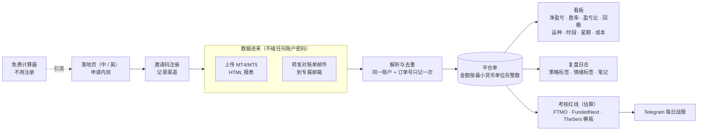

这张图想说明：第一版只做**盘后复盘和考核红线估算**，数据只来自用户自己导出或转发的对账单；推广靠免费计算器和落地页，用邀请码控制内测人数并统计渠道。

## 1. 目标
1. 让 MT4/MT5 交易者**上传一份报表**，就能看到扣掉佣金、隔夜利息、税以后的真实盈亏，以及在哪个品种、时段、星期亏钱。
2. 让考核中的交易者**每天在 Telegram 收到一条战报**，知道按对账单估算，离日内红线和总红线还有多远。
3. 用 4 周内测验证需求：注册 50 人、激活 30 人（导入至少 1 份报表）、第 4 周仍活跃 15 人、访谈 10 人（市场 §7，目标值属于推断，Amos 已按默认确认）。

## 2. 范围
### 做
- 上传 MT4、MT5 的 HTML 报表；转发对账单邮件到专属邮箱。
- 看板、交易列表、复盘日志（标签、笔记）。
- 考核规则模板：FTMO 2-Step、FTMO 1-Step、FundedNext（CFD）、The5ers 2-Step；也可以自己填数值。
- Telegram 机器人：绑定、每日战报、从战报跳到打标签。
- 邮箱验证码登录；邀请码注册；英文和简体中文。
- 免费计算器（不用注册）；中英文落地页和内测申请；Amos 用的运营后台（申请、邀请码、按渠道统计）。
- 一键删除自己的全部数据。

### 明确不做（第一版）
- 投资者密码同步、MetaApi、EA 插件、实时风控报警（v2 方向，市场 §4）。
- AI 点评；任何提示品种或方向的内容（市场 §6）。
- 收费和支付（第二版按市场 §5 定价）。
- 分享卡片（M3，v1.1）；截图和 TradingView 链接（v2）。
- 加密货币、cTrader 等其他平台；不同币种之间的换算（不同币种的账户分开显示）。
- 付费广告（市场 §6）。

## 3. 使用场景
| 编号 | 用户 | 场景 |
|---|---|---|
| S1 | 考核中的交易者 | 每天收盘后，经纪商的对账单邮件自动转发进来；早上在 Telegram 看到"今天还可亏 $3,200" |
| S2 | 考核中的交易者 | 同时考 2 个账户，在看板上切换账户 |
| S3 | MT4 散户 | 每周末导出一次报表上传，看本周黄金在美盘是不是一直亏 |
| S4 | 新用户 | 在 Reddit 看到免费计算器，算完点"申请内测"，收到邀请码注册 |
| S5 | Amos | 在后台看哪个渠道来的人最多、激活最多，给申请的人发邀请码 |

## 4. 业务流程

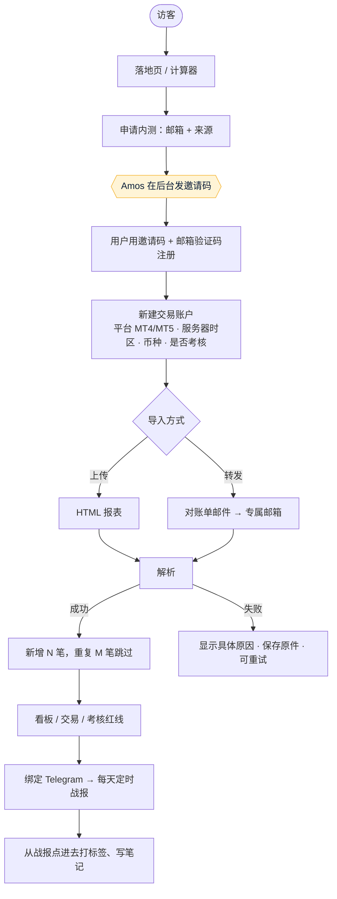

这张图想说明：用户从计算器或落地页进来，经 Amos 发码才能注册；每份导入都会明确告诉用户"新增几笔、跳过几笔、失败原因"。

## 5. 站点地图

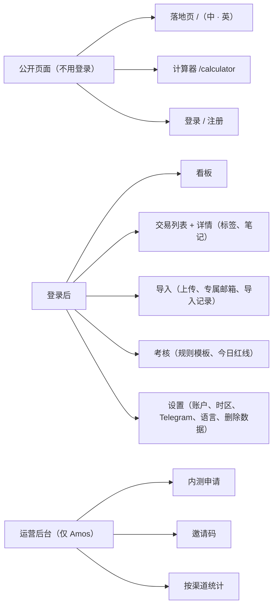

这张图想说明：一共 3 个公开页面、5 个用户页面、3 个后台页面。

## 6. 关键页面线框图（低保真）
电脑版"一屏看全"，手机版"一屏一件事"（C64）。正式的视觉效果图在架构方案阶段由研发按 Amos 选定的风格方向（C65）给出。

| 页面 | 线框图 |
|---|---|
| ① 看板（电脑） | 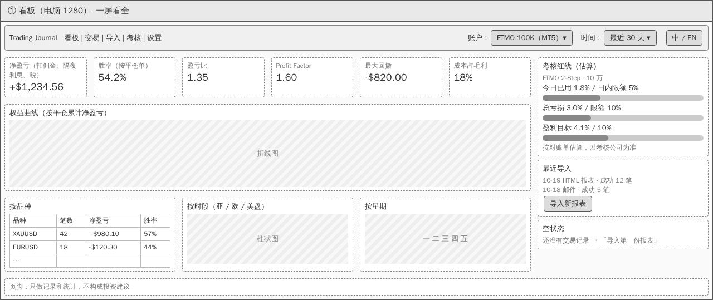 |
| ② 看板（手机） | 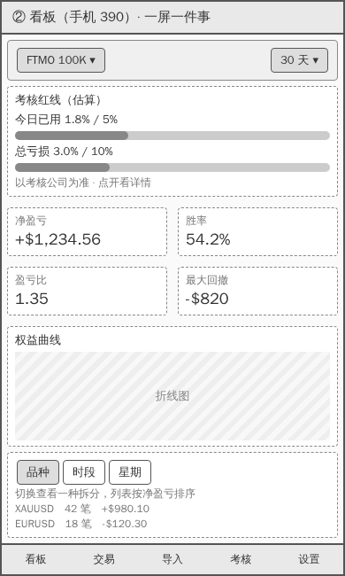 |
| ③ 导入（手机） | 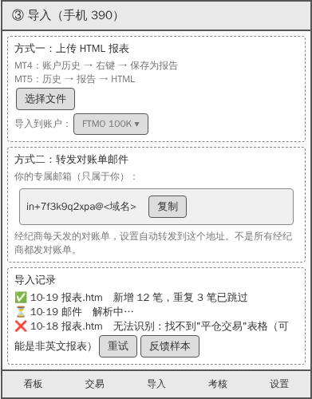 |
| ④ 交易列表与复盘（电脑） | 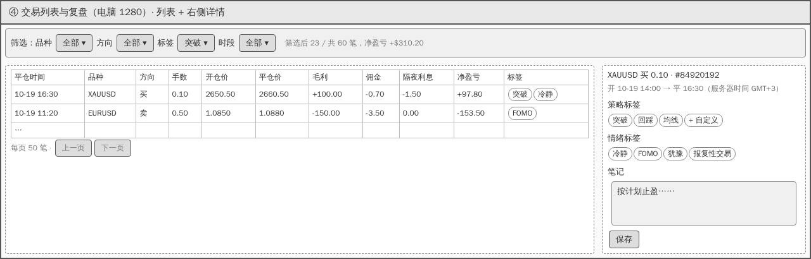 |
| ⑤ 考核与 Telegram 战报（手机） | 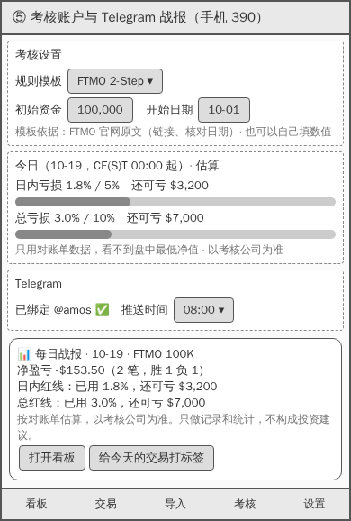 |
| ⑥ 免费计算器（手机） | 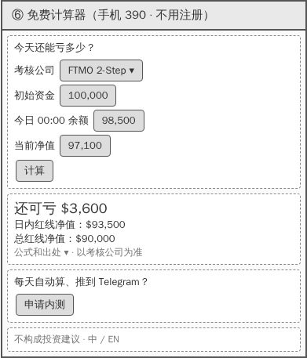 |
| ⑦ 落地页（手机） | 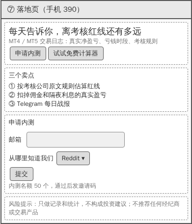 |
| ⑧ 运营后台（电脑） | 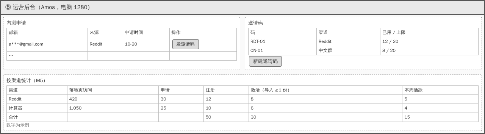 |

## 7. 计算口径（所有页面、战报、计算器共用一份）
| 指标 | 口径 |
|---|---|
| 一笔交易 | **一笔平仓单**。MT4：Closed Transactions 表里 Type 为 buy/sell 的一行；balance、credit 等资金行不算交易，但计入余额。MT5：Positions 表里已平仓的一个持仓（同一持仓分几次平仓，算一笔，各次成交的盈亏相加） |
| 净盈亏 | 毛利 + 佣金 + 隔夜利息 + 税（佣金和税在报表里通常为负数，按报表原值相加，不取绝对值） |
| 胜率 | 净盈亏 > 0 的笔数 ÷ 全部平仓笔数。净盈亏 = 0 的算"持平"，计入分母 |
| 盈亏比 | 盈利单的平均净盈亏 ÷ 亏损单平均净盈亏的绝对值；没有亏损单时显示"—" |
| Profit Factor | 盈利单净盈亏之和 ÷ 亏损单净盈亏之和的绝对值；没有亏损单时显示"—" |
| 最大回撤 | 按平仓时间排序的累计净盈亏曲线上，从最高点到之后最低点的最大跌幅（金额）。只用平仓数据，不含盘中浮动 |
| 成本占毛利 | （佣金 + 税 + 为负的隔夜利息）的绝对值 ÷ 盈利单毛利之和；分母为 0 时显示"—" |
| 时段 | 按**开仓时间**换算成 UTC：亚盘 22:00–07:00、欧盘 07:00–13:00、美盘 13:00–22:00 |
| 星期 | 按开仓时间换算成 UTC 后的星期 |
| 时区 | 报表里的时间是经纪商服务器时间。每个交易账户设置服务器时区，默认"GMT+2，夏令时 GMT+3"（常见设置，推断），用户可改 |
| 金额 | 按账户币种的最小单位存整数（例如美分），显示保留 2 位小数；不在不同币种之间换算 |
| 考核红线（估算） | 按所选模板的官网原文计算（市场 §4），每个模板注明出处链接和核对日期。"今日已用" = 当日重置时刻的余额 − 报表时刻的净值（报表含持仓浮动盈亏时计入；不含时用余额，并注明"未含持仓"）。所有地方都写"按对账单估算，以考核公司为准" |

## 8. 字段对照表（C35：MT4 / MT5 报表 → 系统字段）
来源：MT4 帮助《Account History》、MT5 帮助《History Report》（市场 §4 的出处）。实际列名、列顺序以 Amos 提供的样本为准（澄清问题 C3）。

| 原文（MT4 Closed Transactions） | 原文（MT5） | 系统字段 | 说明 |
|---|---|---|---|
| Order / Ticket | Positions 表 Position | `ticket` | 和账户一起组成去重键 |
| Time（第一个） | Positions 表开仓 Time | `open_time` | 服务器时间，按账户时区换成 UTC 存 |
| Type | Type | `side` | buy / sell；其他类型（balance、credit 等）存为资金记录 |
| Size | Volume | `lots` | |
| Symbol | Symbol | `symbol` | 原样保存；带后缀的（例如 `XAUUSD.m`）另存一个去掉后缀的 `symbol_base`，用于按品种统计 |
| Price（第一个） | 开仓 Price | `open_price` | |
| S/L | S / L | `sl` | 可为空 |
| T/P | T / P | `tp` | 可为空 |
| Time（第二个） | 平仓 Time | `close_time` | 同 `open_time` |
| Price（第二个） | 平仓 Price | `close_price` | |
| Commission | Commission | `commission` | 最小单位整数 |
| Taxes | （MT5 Deals 表中如有） | `taxes` | 没有的记 0 |
| Swap | Swap | `swap` | 最小单位整数 |
| Profit | Profit | `gross_profit` | 不含佣金、隔夜利息、税 |
| Comment | Comment | `comment` | |
| —（计算） | —（计算） | `net_pnl` | 第 7 节口径 |
| 报表头的 Account、Name、Currency | 同左 | 交易账户的 `account_no`、`currency` | 姓名不保存（只在原件里） |
| Summary 区（Balance、Equity、Floating P/L） | Summary 区 | 导入记录的 `balance`、`equity`、`floating` | 用于考核红线估算，和自动核对（AC-I3） |
| Open Trades、Working Orders | Orders、Working Orders | 不做 | 第一版只统计平仓单；未平仓只用 Summary 的浮动盈亏 |

## 9. 市场与推广输入（C71）
- 目标用户：主打考核中的交易者（市场 §3 P1），兼顾 MT4/MT5 散户（P2），中文界面覆盖 P3。
- 定位："每天告诉你，离考核红线还有多远"（市场 §5）。第一版免费内测，第二版定价 Free / Pro $15 每月。
- 推广功能的结论：

| 编号 | 功能 | 结论 |
|---|---|---|
| M1 | 邀请码，记录来源渠道 | 纳入（AC-G2） |
| M2 | 免费计算器 | 纳入（AC-G4） |
| M3 | 分享卡片 | 不做，放 v1.1（Amos 按默认确认） |
| M4 | 中英文落地页 | 纳入（AC-G3） |
| M5 | 按渠道统计 | 纳入（AC-G5），只统计自己的数据，不接第三方追踪 |

## 10. 验收标准
### 导入
| 编号 | 验收标准 |
|---|---|
| AC-I1 | 上传 MT4 HTML 报表后，系统记录的平仓笔数等于报表 Closed Transactions 中 buy/sell 的行数；每笔的 9 个字段（订单号、品种、方向、手数、开平仓时间、开平仓价、净盈亏）和报表一致 |
| AC-I2 | 上传 MT5 HTML 报表后，系统记录的平仓笔数等于报表 Positions 表中已平仓的持仓数；分几次平仓的持仓算一笔，净盈亏等于各次成交之和 |
| AC-I3 | 一份报表导入后，系统算出的净盈亏合计和报表 Summary 的对应合计**相差 0.00**；对不上时，导入记录标"金额核对不一致"，并列出差额 |
| AC-I4 | 同一份报表上传两次，或两份报表时间重叠，交易不重复；导入结果显示"新增 N 笔，重复 M 笔已跳过" |
| AC-I5 | 每个用户有一个只属于自己、不可猜测的专属邮箱地址（随机部分至少 8 位字母数字）；转发到该地址的对账单（HTML 在正文或附件里），5 分钟内出现在导入记录里，处理结果同上传 |
| AC-I6 | 无法解析的文件或邮件，导入记录显示具体原因（例如"找不到平仓交易表格""不是英文报表""文件超过 10MB"），原件保存，可以"重试"；不显示错误代码 |
| AC-I7 | 发到专属邮箱、但不是对账单的邮件（广告、空邮件），不产生交易，导入记录标"不是对账单" |

### 看板和复盘
| 编号 | 验收标准 |
|---|---|
| AC-D1 | 看板上的净盈亏、胜率、盈亏比、Profit Factor、最大回撤、成本占毛利，按第 7 节口径计算，和测试准备的标准答案数据集**完全一致** |
| AC-D2 | 按品种、时段、星期拆分，各部分的笔数和净盈亏相加等于总数 |
| AC-D3 | 可以按账户、时间范围筛选；交易列表可以按品种、方向、标签、时段筛选，筛选旁显示"筛选后 X / 共 Y 笔"和筛选后的净盈亏；超过 50 笔时可以翻页看到全部 |
| AC-D4 | 每笔交易可以加策略标签和情绪标签（预设 + 自定义）、写笔记；看板可以按标签筛选 |
| AC-D5 | 没有任何交易时，看板、交易列表、考核页都显示明确的空状态和"导入第一份报表"入口，不显示空白或 NaN；数据加载中、加载失败分别有提示，失败时有"重试"（C52） |
| AC-D6 | 手机（390）和电脑（1280）的看板、交易列表、导入、考核页，按线框图分别设计结构（C64）；1280 宽时交易列表不用横向滚动就能看到全部列 |

### 考核和 Telegram
| 编号 | 验收标准 |
|---|---|
| AC-R1 | 提供 FTMO 2-Step、FTMO 1-Step、FundedNext（CFD）、The5ers 2-Step 四个模板，每个模板注明官网出处链接和核对日期；也可以自定义"日内亏损 %、总亏损 %、盈利目标 %、重置时刻和时区、按余额还是净值" |
| AC-R2 | 对测试准备的每组规则用例（每个模板至少 5 组，包括边界值），系统算出的"日内红线净值、总红线净值、还可亏多少"和按官网原文手算的结果一致到 0.01 |
| AC-R3 | 考核相关的每个页面、战报、计算器，都显示"按对账单估算，以考核公司为准"；报表不含持仓浮动盈亏时，加注"未含持仓" |
| AC-R4 | 用户在设置里拿到一次性码，发给机器人后完成绑定；一次性码 10 分钟内有效，只能用一次 |
| AC-R5 | 绑定后，每天在用户设定的时间推送战报（误差不超过 5 分钟）：当天净盈亏、笔数、胜负，有考核规则时加红线估算；当天没有新数据时推送"今天还没有收到对账单" |
| AC-R6 | 战报和页面上不出现任何品种、方向的建议，也不出现"建议停止交易"这类指令；每条战报末尾有免责声明 |
| AC-R7 | 战报的按钮能打开当天的交易列表，并直接给交易打标签 |

### 账号、语言、数据
| 编号 | 验收标准 |
|---|---|
| AC-A1 | 用邮箱验证码登录；验证码 10 分钟有效、只能用一次；同一邮箱 1 小时内最多发 5 次 |
| AC-A2 | 所有页面、错误提示、战报、邮件都有英文和简体中文两种；切换语言后立即生效，并记住选择 |
| AC-A3 | "删除我的全部数据"二次确认后，交易记录、原件、标签、笔记、Telegram 绑定全部删除，账号退出；删除后用同一邮箱登录看不到任何旧数据 |
| AC-A4 | 一个用户看不到另一个用户的任何数据（交易、原件、专属邮箱、战报），包括直接改链接里的编号 |
| AC-A5 | 页面页脚、落地页、计算器、战报都有"只做记录和统计，不构成投资建议"（需法务审核） |

### 推广功能
| 编号 | 验收标准 |
|---|---|
| AC-G1 | 落地页访问、内测申请、注册、首次导入成功、每周活跃，都按来源渠道记录 |
| AC-G2 | 没有有效邀请码不能注册；Amos 可以在后台新建邀请码（渠道、使用上限）；每个码的使用次数不超过上限 |
| AC-G3 | 落地页有中英文两版，有内测申请表（邮箱、从哪里知道我们），提交后在后台"内测申请"里出现 |
| AC-G4 | 计算器不用登录；选模板、填初始资金、今日 00:00 余额、当前净值，算出"还可亏多少"和两条红线净值，结果和 AC-R2 的用例一致；页面上可以展开公式和出处 |
| AC-G5 | 后台"按渠道统计"显示每个渠道的落地页访问、申请、注册、激活、本周活跃，数字和数据库一致 |
| AC-G6 | 运营后台只有 Amos 的账号能进，其他账号访问返回"无权限" |

### 已有的数据怎么办（C55）
新项目，没有已保存的数据，本节不涉及。

## 11. 测试预审（测试工程师，2026-10-20）
测试逐条检查了第 10 节验收标准能不能测，下面是判定口径和测试方式。预审中提出的 T1–T8 已由 PM 在 v1.1 修订。

| 验收标准 | 判定口径 | 测试方式 |
|---|---|---|
| AC-I1、I2 | 逐字段对比，全部一致才算通过 | 单元测试：用样本报表和手工整理的标准答案（每份样本一个 JSON）；**样本来自 Amos（C3）**，没有真实样本时用 MT 官方格式手工构造，报告里标"未用真实样本验证" |
| AC-I3 | 差额 = 0.00 | 同上，每份样本都核对 Summary |
| AC-I4 | 重复导入后笔数不变 | 单元测试 + 真实数据库测试（C37） |
| AC-I5 | 专属地址格式；5 分钟内出现 | 端到端：测试环境真实发一封邮件到专属地址，计时；地址随机性用单元测试检查 |
| AC-I6、I7 | 每类失败都有对应的中文和英文提示 | 准备 6 类坏文件（空文件、非 HTML、非英文、截断、超大、广告邮件）逐个测 |
| AC-D1、D2 | 和标准答案完全一致 | 测试准备一份包含盈利、亏损、持平、部分平仓、负隔夜利息、资金行的数据集，手算标准答案 |
| AC-D3–D6 | 页面走查（C42–C45、C50） | 5 种状态 × 390 / 1280 截图，自动检查后人工看 |
| AC-R1、R2 | 和手算一致到 0.01 | 每个模板至少 5 组用例：正常、刚好触线、当天先赚后亏（FundedNext 抬高限额）、1-Step 总线上移、余额和净值取高者（The5ers） |
| AC-R3、R6、A5 | 文案存在；不出现建议性词语 | 自动扫描所有页面和战报模板里的关键词（买入、卖出、做多、做空、建议、停止交易、buy、sell、stop trading） |
| AC-R4、R5、R7 | 绑定、定时、按钮跳转 | 测试环境用真实的 Telegram 测试机器人；定时用固定时钟的单元测试 + 测试环境实测一次 |
| AC-A1–A4 | 有效期、次数、隔离 | 单元测试 + 端到端；A4 用两个账号互相改编号访问 |
| AC-G1–G6 | 统计数字和数据库一致 | 端到端造 3 个渠道的数据，核对后台数字 |

**预审意见（已由 PM 修订）**：
| 编号 | 意见 | PM 修订 |
|---|---|---|
| T1 | 初稿写"胜率按交易算"，没说持平单怎么算 | 第 7 节：持平计入分母 |
| T2 | 初稿没写时段按开仓还是平仓、按什么时区 | 第 7 节：按开仓时间、换成 UTC，账户设服务器时区 |
| T3 | AC-I3 初稿写"金额一致"，没说允许多大误差 | 改为"相差 0.00"；金额按最小单位存整数 |
| T4 | 考核红线没有可以对照的标准答案 | AC-R2：每个模板至少 5 组用例，按官网原文手算 |
| T5 | "5 分钟内出现"在本地测不了 | AC-I5 在测试环境实测，本地只测解析 |
| T6 | 盈亏比、Profit Factor 没有亏损单时会除以 0 | 第 7 节：显示"—" |
| T7 | AC-R6"不出现建议"不好判定 | 测试用关键词清单自动扫描，清单写进测试报告 |
| T8 | 没有真实样本时，AC-I1–I3 的结论不可靠 | 保留默认：Amos 提供样本；没有样本时报告如实标注 |

## 12. 需要 Amos 确认的事实性内容（C12、C73）
1. 落地页卖点"按考核公司原文规则估算红线"：模板上线前，由 PM 逐个核对官网原文并写明核对日期。
2. 免责声明"只做记录和统计，不构成投资建议"：**需法务审核**。
3. "不推荐任何经纪商或交易产品"：落地页和推广物料都遵守。

## 13. 待 Amos 提供
- 脱敏后的 MT4、MT5 HTML 报表各至少一份，有经纪商对账单邮件的也提供一封（澄清问题 C3）。可以在开发开始前提供，不影响架构方案。

## 跨角色反馈 / 分歧记录
| 编号 | 提出方 → 接收方 | 内容 | 状态 |
|---|---|---|---|
| F1 | 测试 → PM | 预审意见 T1–T8 | 已采纳（v1.1） |
| F2 | 市场 → PM | 推广功能 M1–M5 | 已采纳：M1、M2、M4、M5 纳入，M3 放 v1.1 |
| F3 | PM → 研发 | PDF 示例代码不能照搬：胜率按成交算、金额用浮点数 | 已采纳：第 7 节口径、AC-D1 |
| F4 | PM → 运维 | 专属邮箱需要域名和收件服务（澄清问题 D2、D3） | 转 Amos：架构阶段由运维给建议 |
