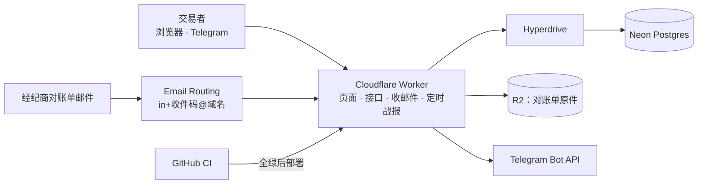

# 项目地图：trading journal
- 用途：**新加入的人或大模型先读这一份**，10 分钟了解项目现在是什么样、代码在哪里、有哪些不能破坏的约定。要查具体的文件、接口、表、变量、历史问题，看《[项目索引](项目索引.md)》。
- 只写**当前状态**。按版本追加的文档（`00-架构方案.md`、需求文档）是当时的记录；和本文件不一致时，以本文件和代码为准。
- 版本：v0.1（2026-10-20，对应：需求说明书已通过、架构方案 v1 审核中，**还没有代码**）
- 维护：研发整合，各角色写自己的部分（C53）。**每次功能迭代，在同一个 PR 里更新本文件和《项目索引》**；`scripts/check-project-index.mjs` 在 CI 里检查索引（C54）。
- 变更历史：v0.1（2026-10-20）首次创建（架构方案审核时建框架，agents 协作总则第一节第 4 步）；v0.1.1（2026-10-21）原型环境改为单独的 Worker，加上原型部署工作流

## 一图看懂

这张图想说明：所有功能都在一个 Worker 里（计划，代码还没有建）；数据在 Neon，原件在 R2；只有 CI 全绿才部署。

## 1. 这个项目做什么
<!-- PM 写 -->
MT4/MT5 交易者上传或转发对账单，看到扣掉佣金、隔夜利息、税以后的真实盈亏，以及按品种、时段、星期的拆分；参加自营交易考核的交易者每天在 Telegram 收到"按对账单估算，离红线还有多远"的战报。

| 业务 | 版本 | 使用者 | 页面 | 接口 | 数据 |
|---|---|---|---|---|---|
| 导入、复盘、考核红线、Telegram 战报 | v1（开发前） | 交易者 | 看板、交易、导入、考核、设置 | 尚未实现 | 尚未建表 |
| 引流和运营 | v1（开发前） | 访客、Amos | 落地页、计算器、后台 | 尚未实现 | 尚未建表 |

需求的权威来源是 `需求文档/v1-需求说明书.md`，计算口径见那份文档的第 7 节。

## 2. 代码怎么分层
<!-- 研发写 -->
还没有代码。计划的目录和归属见 `00-架构方案.md` 第 2.2 节：`src/core/`（解析、指标、规则，纯函数）、`src/worker/`、`src/web/`、`messages/`、`db/migrations/`、`test/`、`e2e/`、`wrangler.jsonc`、`deploy/`。第 1 步建立代码时改写本节。

## 3. 环境
<!-- 运维写 -->
| 环境 | 分支 | 地址 | 数据 | 外部服务 |
|---|---|---|---|---|
| 原型 | 开发分支 → 单独的 Worker `trading-journal-prototype`（Cloudflare Access 保护，原型说明 X1） | 尚未部署 | 模拟数据 | 不连接 |
| 测试环境 | `staging`（尚未建立） | 尚未建立，计划 `staging.域名` | 独立的 Neon、R2 | 测试机器人、`in-staging+…` 收件 |
| 生产 | `main` | 尚未建立 | 生产 Neon、R2 | 正式机器人、`in+…` 收件 |

- 平台：Cloudflare Workers Paid，按 agents 的 `平台规范/Cloudflare.md`。
- 原型部署：Actions 里手动运行 `deploy-prototype`，分支选 `claude/v1-prototype`（工作流放在 `main` 上，按钮才会出现）。
- 发布：PR 的 CI 全绿 → 合并到 `staging` 自动部署测试环境 → Amos 在测试环境验收 → 合并到 `main` 部署生产（C34、C54）。
- 密钥：只由 Amos 填在 Cloudflare 控制台和 GitHub Secrets，变量名见《项目索引》第 5 节。

## 4. 关键流程在哪里
<!-- 研发写 -->
还没有代码。设计见 `00-架构方案.md` 第 2.4 节（邮件导入、每日战报）。

## 5. 不能破坏的约定
<!-- 研发写；代码建立后补上代码位置 -->
1. **一笔交易 = 一笔平仓单**：MT5 按持仓合并分次平仓；胜率、盈亏比都按平仓单算（需求说明书第 7 节；PDF 示例代码按成交记录算，会算错）。
2. **金额用整数存**（账户币种的最小单位），全程不用浮点数；不同币种之间不换算（AC-I3、AC-D1）。
3. **去重键是（账户, 订单号）**，重复导入不会重复记账（AC-I4）。
4. **口径只写一份**：解析、指标、考核规则在 `src/core/`，页面、接口、定时任务、计算器共用。
5. **考核红线是估算**：每个显示的地方都写"按对账单估算，以考核公司为准"；模板带版本号和官网出处（AC-R1、AC-R3）。
6. **不给任何交易建议**：页面和战报不出现品种、方向的建议，也不出现"停止交易"这类指令（AC-R6，市场 §6）。
7. **同一用户同一天只发一条战报**：先写 `daily_reports`，再发送。
8. **不保存任何账户密码**；对账单里的姓名不进数据库；原件放不公开的 R2。
9. **计数和限流放数据库**，不放 Worker 内存（实例之间不共享内存）。

## 6. 常用命令
| 做什么 | 命令 |
|---|---|
| 项目地图和索引检查 | `node scripts/check-project-index.mjs` |
| 安装、单元测试、端到端测试、本地运行 | 第 1 步建立代码后补充 |

## 7. 排查从哪里开始
还没有代码。上线后补：导入失败看导入记录的失败原因和 R2 原件；战报没发看 `daily_reports` 和 Workers Logs。
