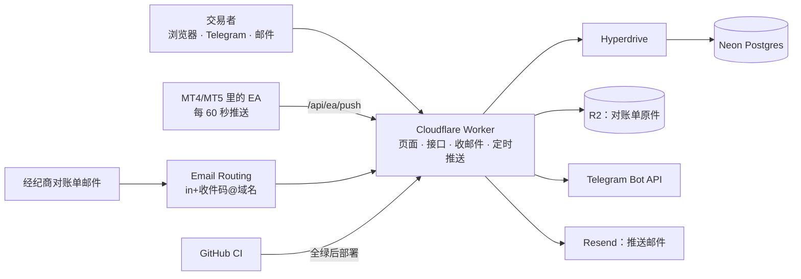

# 项目地图：trading journal
- 用途：**新加入的人或大模型先读这一份**，10 分钟了解项目现在是什么样、代码在哪里、有哪些不能破坏的约定。要查具体的文件、接口、表、变量、历史问题，看《[项目索引](项目索引.md)》。
- 只写**当前状态**。按版本追加的文档（`00-架构方案.md`、需求文档）是当时的记录；和本文件不一致时，以本文件和代码为准。
- 版本：v0.3.2（2026-10-21，对应：需求说明书 v1.2、架构方案 v1.1 已通过；**原型已确认，正式开发按任务清单分步进行**，后端还是模拟的）
- 维护：研发整合，各角色写自己的部分（C53）。**每次功能迭代，在同一个 PR 里更新本文件和《项目索引》**；`scripts/check-project-index.mjs` 在 CI 里检查索引（C54）。
- 变更历史：v0.1（2026-10-20）首次创建（架构方案审核时建框架，agents 协作总则第一节第 4 步）；v0.1.1（2026-10-21，main）原型环境改为单独的 Worker，加上原型部署工作流；v0.2（2026-10-20）高保真原型；v0.3（2026-10-21）原型补 v1.2：EA 安装、行为标记、通知订阅、退订；v0.3.1（2026-10-21）原型确认，加任务清单和进度看板；v0.3.2（2026-10-21）精简 CI

## 一图看懂



这张图想说明：所有功能都在一个 Worker 里（目前只有原型：页面 + 健康检查，数据是模拟的）；以后数据在 Neon，原件在 R2；只有 CI 全绿才部署。

## 1. 这个项目做什么
<!-- PM 写 -->
CFD/外汇（MT4/MT5）交易者安装 EA，或者上传、转发对账单，系统帮他记账：扣掉佣金、隔夜利息、税以后的真实盈亏，按品种、时段、星期的拆分；按规则标出报复性交易、过度交易、扛单；考核红线、战报、行为提醒、EA 断开按用户的订阅发到 Telegram 或邮箱。

| 业务 | 版本 | 使用者 | 页面 | 接口 | 数据 |
|---|---|---|---|---|---|
| EA 推送、导入、复盘、考核红线 | v1 原型 | 交易者 | 看板、交易、导入、考核 | 只有 `/api/health`；其他是模拟 | 尚未建表 |
| 行为标记 | v1 原型 | 交易者 | 看板、交易、设置 | 模拟（计算是真实的） | 尚未建表 |
| 通知订阅和推送（Telegram、邮件） | v1 原型 | 交易者 | 设置、考核、退订 | 模拟 | 尚未建表 |
| 引流和运营 | v1 原型 | 访客、Amos | 落地页、计算器、后台 | 模拟 | 尚未建表 |

需求的权威来源是 `需求文档/v1-需求说明书.md`，计算口径见那份文档的第 7 节。开发计划见 `需求文档/v1-任务清单.md`，进度只看 [Issue #5](https://github.com/dollar3651314/trading-journal/issues/5)（C63）。

## 2. 代码怎么分层
<!-- 研发写 -->
```
src/core/     纯函数，前端和 Worker 共用：money（金额整数）、metrics（看板口径）、rules（考核模板和红线）、behavior（行为规则）
src/worker/   Worker 入口（Hono）：目前只有 /api/health；以后加接口、email、scheduled 入口
src/web/      前端（Vite + React）：lib（多语言、主题、路由）、components（共用组件、页面框架、行为标记、推送预览）、pages（各页面）
src/web/mock/ 原型专用的模拟数据和模拟接口（正式开发时换成真实接口后删除）
messages/     中英文文案（PM 改值）
test/         单元测试（Vitest）
```
- 静态资源由 Worker 的 assets 直接返回，单页应用的地址都回退到 `index.html`；只有 `/api/*` 交给 Worker 代码（`wrangler.jsonc`）。
- 手机和电脑分开写页面结构：`useIsMobile()`（768 以下算手机），同一份数据和计算，两套布局（C64）。768–1100 之间电脑布局改成单栏或两栏。
- 计算只写在 `src/core/`：看板、考核页、计算器、战报和推送预览、行为标记都调用同一套函数。

## 3. 环境
<!-- 运维写 -->
| 环境 | 分支 | 地址 | 数据 | 外部服务 |
|---|---|---|---|---|
| 原型 | `claude/v1-prototype` → 单独的 Worker `trading-journal-prototype`（Cloudflare Access 保护，只有这个 Cloudflare 账户的成员能登录，原型说明 X1） | `https://trading-journal-prototype.jeff-zhaifei.workers.dev`（2026-10-21 部署 `29ed5ff`） | 模拟数据 | 不连接 |
| 测试环境 | `staging`（尚未建立） | 尚未建立，计划 `staging.域名` | 独立的 Neon、R2 | 测试机器人、`in-staging+…` 收件 |
| 生产 | `main` | 尚未建立 | 生产 Neon、R2 | 正式机器人、`in+…` 收件 |

- 平台：Cloudflare Workers Paid，按 agents 的 `平台规范/Cloudflare.md`。
- 原型部署：Actions 里手动运行 `deploy-prototype`，分支选 `claude/v1-prototype`（工作流放在 `main` 上，按钮才会出现）。
- CI 按精简 CI（C74）：只改文档时只跑基本检查（索引、密钥扫描），改了代码才跑测试和构建；分支保护只要求汇总 job `ci-ok`：`staging`、`main` 都要求通过 PR 合并、`ci-ok` 必须通过、不允许绕过（2026-10-21 Amos 设置）。
- 发布：PR 的 CI 全绿 → 合并到 `staging` 自动部署测试环境 → Amos 在测试环境验收 → 合并到 `main` 部署生产（C34、C54）。
- 密钥：只由 Amos 填在 Cloudflare 控制台和 GitHub Secrets，变量名见《项目索引》第 5 节。

## 4. 关键流程在哪里
<!-- 研发写 -->
| 流程 | 入口 | 核心代码 |
|---|---|---|
| 看板指标 | `src/web/pages/Dashboard.tsx` | `src/core/metrics.ts` 的 `computeMetrics` |
| 考核红线（看板、考核页、战报预览） | `src/web/components/ui.tsx` 的 `RedLineCard`、`accountRuleState` | `src/core/rules.ts` 的 `computeRedLines` |
| 免费计算器 | `src/web/pages/Public.tsx` 的 `Calculator` | `src/core/rules.ts`、`src/core/money.ts` 的 `parseMoney` |
| 行为标记（看板卡片、交易列表、详情） | `src/web/components/Behavior.tsx` | `src/core/behavior.ts` 的 `detectBehavior`、`summarize`、`holdingSummary` |
| 推送预览（5 种内容 × Telegram / 邮件） | `src/web/components/Alerts.tsx` | `src/core/metrics.ts`、`src/core/rules.ts`、`src/core/behavior.ts` |
| EA 接收、导入、邮件、推送发件箱 | 尚未实现（原型里是模拟） | 设计见 `00-架构方案.md`（v1.1 第 2.6 节起） |

## 5. 不能破坏的约定
<!-- 研发写；代码建立后补上代码位置 -->
1. **一笔交易 = 一笔平仓单**：MT5 按持仓合并分次平仓；胜率、盈亏比都按平仓单算（需求说明书第 7 节；PDF 示例代码按成交记录算，会算错）。
2. **金额用整数存**（账户币种的最小单位），全程不用浮点数；不同币种之间不换算（AC-I3、AC-D1）。
3. **去重键是（账户, 订单号）**，重复导入不会重复记账（AC-I4）。
4. **口径只写一份**：解析、指标、考核规则在 `src/core/`，页面、接口、定时任务、计算器共用。不要在页面里另算。
5. **考核红线是估算**：每个显示的地方都写"按对账单估算，以考核公司为准"；模板带版本号和官网出处（AC-R1、AC-R3）。**没有按官网原文核对过的模板不进 `TEMPLATES`**（FundedNext、The5ers 目前在 `PENDING_TEMPLATES`，页面上显示"核对中"）。
6. **不给任何交易建议**：页面、战报、行为标记、提醒不出现品种、方向的建议，也不出现指令性的话（AC-R6、AC-B4，市场 §6）；关键词清单见需求说明书 AC-B4，免责声明里的"不构成投资建议"是例外。
12. **行为规则的口径只在 `src/core/behavior.ts`**："上一笔"是新仓开仓前最后平仓的那笔；交易日是周一到周五（UTC 日期），没有交易的交易日按 0 笔计入。改参数只影响之后的交易，已有标记保留（AC-B5）。
13. **EA 只读**：EA 代码里不出现任何下单、改单、平仓函数（架构方案 v1.1，CI 扫描）；令牌只在生成时显示一次，数据库只存哈希。
14. **退订链接不用登录**，但要点一下确认才生效（原型说明 Y2）。
7. **同一用户同一天只发一条战报**：先写 `daily_reports`，再发送。
8. **不保存任何账户密码**；对账单里的姓名不进数据库；原件放不公开的 R2。
9. **计数和限流放数据库**，不放 Worker 内存（实例之间不共享内存）。
10. **按钮上的白字要满足 4.5:1**：按钮用 `--accbtn`，不用 `--acc`（深色主题的 `--acc` 配白字只有 3.75）；删除按钮用 `#B42318`。
11. **浏览器本地存储的键带版本号**（`tj.prefs.v1`），改格式时换键名（C55）。

## 6. 常用命令
| 做什么 | 命令 |
|---|---|
| 安装 | `npm ci` |
| 全部检查（和 CI 一样） | `npm run check` |
| 单元测试 | `npm test` |
| 项目地图和索引检查 | `node scripts/check-project-index.mjs` |
| 文案检查 | `npm run check:messages` |
| 本地开发（只有前端） | `npm run dev` |
| 本地运行 Worker + 页面 | `npm run build` 后 `npx wrangler dev --env prototype`（重新构建后要重启，见问题索引 P-01） |
| 部署原型 | GitHub Actions 里手动运行 `deploy-prototype`（需要 Amos 填的 Cloudflare 密钥） |

## 7. 排查从哪里开始
还没有代码。上线后补：导入失败看导入记录的失败原因和 R2 原件；战报没发看 `daily_reports` 和 Workers Logs。
